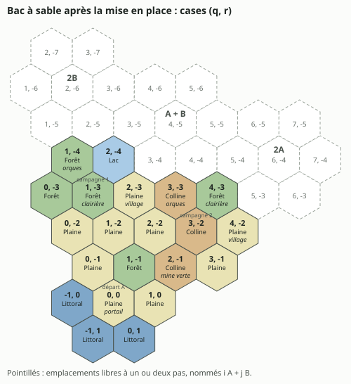

# Coordonnées du bac à sable

Page de référence pour les specs et les tests qui ont besoin de cases précises du plateau de jeu du bac à sable (portail, village,
Lac, mine, forteresse…) : **lire ici au lieu de recalculer** depuis `content/tiles.ron` et la géométrie des emplacements.

- Cases en coordonnées axiales `(q, r)` : `q` croît vers l'est, `r` vers le sud-est ; cases à pointe en haut (spec 010).
- Emplacements en coordonnées `(i, j)` = `i A + j B`, avec `A = (1, 0)` de centre `(3, -2)` et `B = (0, 1)` de centre `(1, -3)`
  (specs 012 et 015, schéma `specs/images/emplacements-en-coin.svg`).
- Côtés d'une tuile dans l'ordre de `Direction::ALL` : E, N-E, N-O, O, S-O, S-E (voir `tuiles.md`, « Lecture »).
- Mise en place du bac à sable (« Première reconnaissance » en solo, MKUE p. 18) : tuile de départ A, campagne 1 en `B`,
  campagne 2 en `A`, puis pioche des campagnes 3 à 8 dans l'ordre, et trois tuiles royaumes mélangées dessous (non décrites ici :
  elles dépendent de la graine). Le plateau ci-dessous ne dépend pas de la graine.
- Une tuile de campagne explorée se pose où le joueur l'explore : ses cases se lisent en croisant le tableau des emplacements
  et celui de la pioche, côté par côté.

Cette page et son schéma sont **générés et vérifiés** par `crates/arcanum-core/tests/reference_bac_a_sable.rs`, depuis la mise en place
réelle : ils ne peuvent pas dériver du contenu. Après un changement voulu des tuiles ou du scénario, régénérer avec
`ARCANUM_REGENERER_DOCS=1 cargo test -p arcanum-core --test reference_bac_a_sable` et relire le diff. Ne rien modifier à la main entre
les marqueurs.

<!-- Généré par crates/arcanum-core/tests/reference_bac_a_sable.rs : début -->

### Emplacements de la forme en coin

Cases de chaque emplacement `(i, j)` = `i A + j B`, jusqu'à trois pas de la tuile de départ.

| Emplacement | `(i, j)` | Centre | E | N-E | N-O | O | S-O | S-E |
|---|---|---|---|---|---|---|---|---|
| départ | `(0, 0)` | `(0, 0)` | `(1, 0)` | `(1, -1)` | `(0, -1)` | `(-1, 0)` | `(-1, 1)` | `(0, 1)` |
| A | `(1, 0)` | `(3, -2)` | `(4, -2)` | `(4, -3)` | `(3, -3)` | `(2, -2)` | `(2, -1)` | `(3, -1)` |
| B | `(0, 1)` | `(1, -3)` | `(2, -3)` | `(2, -4)` | `(1, -4)` | `(0, -3)` | `(0, -2)` | `(1, -2)` |
| 2A | `(2, 0)` | `(6, -4)` | `(7, -4)` | `(7, -5)` | `(6, -5)` | `(5, -4)` | `(5, -3)` | `(6, -3)` |
| A + B | `(1, 1)` | `(4, -5)` | `(5, -5)` | `(5, -6)` | `(4, -6)` | `(3, -5)` | `(3, -4)` | `(4, -4)` |
| 2B | `(0, 2)` | `(2, -6)` | `(3, -6)` | `(3, -7)` | `(2, -7)` | `(1, -6)` | `(1, -5)` | `(2, -5)` |
| 3A | `(3, 0)` | `(9, -6)` | `(10, -6)` | `(10, -7)` | `(9, -7)` | `(8, -6)` | `(8, -5)` | `(9, -5)` |
| 2A + B | `(2, 1)` | `(7, -7)` | `(8, -7)` | `(8, -8)` | `(7, -8)` | `(6, -7)` | `(6, -6)` | `(7, -6)` |
| A + 2B | `(1, 2)` | `(5, -8)` | `(6, -8)` | `(6, -9)` | `(5, -9)` | `(4, -8)` | `(4, -7)` | `(5, -7)` |
| 3B | `(0, 3)` | `(3, -9)` | `(4, -9)` | `(4, -10)` | `(3, -10)` | `(2, -9)` | `(2, -8)` | `(3, -8)` |

### Cases posées à la mise en place

| Case | Tuile | Emplacement | Côté | Terrain, élément |
|---|---|---|---|---|
| `(0, 0)` | départ A | départ | centre | Plaine, portail |
| `(1, 0)` | départ A | départ | E | Plaine |
| `(1, -1)` | départ A | départ | N-E | Forêt |
| `(0, -1)` | départ A | départ | N-O | Plaine |
| `(-1, 0)` | départ A | départ | O | Littoral |
| `(-1, 1)` | départ A | départ | S-O | Littoral |
| `(0, 1)` | départ A | départ | S-E | Littoral |
| `(1, -3)` | campagne 1 | B | centre | Forêt, clairière magique |
| `(2, -3)` | campagne 1 | B | E | Plaine, village |
| `(2, -4)` | campagne 1 | B | N-E | Lac |
| `(1, -4)` | campagne 1 | B | N-O | Forêt, orques maraudeurs (errants) |
| `(0, -3)` | campagne 1 | B | O | Forêt |
| `(0, -2)` | campagne 1 | B | S-O | Plaine |
| `(1, -2)` | campagne 1 | B | S-E | Plaine |
| `(3, -2)` | campagne 2 | A | centre | Colline |
| `(4, -2)` | campagne 2 | A | E | Plaine, village |
| `(4, -3)` | campagne 2 | A | N-E | Forêt, clairière magique |
| `(3, -3)` | campagne 2 | A | N-O | Colline, orques maraudeurs (errants) |
| `(2, -2)` | campagne 2 | A | O | Plaine |
| `(2, -1)` | campagne 2 | A | S-O | Colline, mine verte |
| `(3, -1)` | campagne 2 | A | S-E | Plaine |

### Tuiles de campagne de la pioche, dans l'ordre

La première est le dessus de la pioche. Les cases d'une tuile posée à l'emplacement `(i, j)` sont celles de la ligne de cet emplacement, côté par côté.

| Tuile | Centre | E | N-E | N-O | O | S-O | S-E |
|---|---|---|---|---|---|---|---|
| campagne 3 | Forêt | Colline | Colline, forteresse | Plaine | Plaine | Plaine, village | Colline, mine blanche |
| campagne 4 | Désert, tour de mage | Montagne | Désert | Désert | Colline, orques maraudeurs (errants) | Plaine | Plaine, village |
| campagne 5 | Lac | Plaine, orques maraudeurs (errants) | Plaine, monastère | Forêt | Forêt, clairière magique | Forêt | Colline, mine bleue |
| campagne 6 | Colline, mine rouge | Plaine | Forêt | Montagne | Colline, antre | Colline | Forêt, orques maraudeurs (errants) |
| campagne 7 | Marais | Forêt, clairière magique | Forêt, orques maraudeurs (errants) | Lac | Plaine, monastère | Plaine | Plaine, donjon |
| campagne 8 | Marais, orques maraudeurs (errants) | Plaine | Forêt, ruines | Forêt, clairière magique | Forêt | Marais | Marais, village |

<!-- Généré : fin -->
