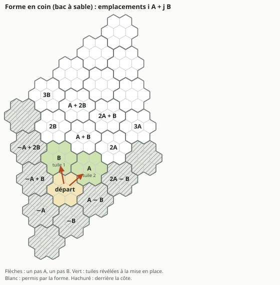
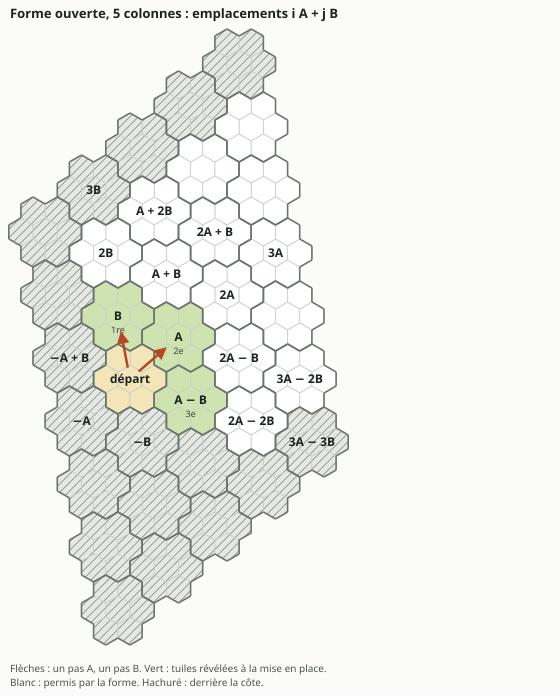

# 012 — Scénario et mise en place

- Statut : implémentée (2026-10-24)
- Jalon : J1
- Dépend de : 000 (noyau du moteur), 010 (plateau de jeu hexagonal), 011 (affichage du plateau de jeu)
- Livret : MKUE p. 1 (déroulé d'une partie), p. 3 (mise en place : pioche de tuiles, plateau de jeu, figurine), p. 7 (5.a, 5.d :
  côte et orientation), p. 14 (formes du plateau de jeu), p. 18-19 (paramètres des scénarios, pour exemple)
- Crates touchées : arcanum-core, arcanum-ui, `assets/i18n/` (fr.json et en.json), `assets/images/`

## Objectif

Une partie ne démarre plus d'un simple deck : elle démarre d'une **configuration de départ** = un scénario, un héros et une graine.
Le **scénario** est une valeur (pas du code de mise en place) qui dit quelle forme a le plateau de jeu et de quelles tuiles est faite
la pioche de tuiles. La mise en place lit ce scénario : elle pose la tuile de départ, forme la pioche de tuiles, révèle les premières
tuiles et place la figurine du héros. Lancer `cargo run -p arcanum-ui` montre alors le plateau de jeu **de la partie** (et non plus le
plateau de démonstration), avec la zone interdite par la forme du plateau de jeu hachurée.

## Règles

- **Le scénario décide** (MKUE p. 1, étapes 1 à 3) : scénario, puis héros, puis mise en place modifiée par le scénario.
- **Pioche de tuiles** (MKUE p. 3) : tuiles de campagne au hasard ; tuiles royaume tirées séparément parmi celles de cité et sans cité,
  mélangées ensemble et posées **sous** les tuiles de campagne. « Première reconnaissance » trie ses tuiles de campagne par numéro
  (p. 18) : l'ordre des tuiles de campagne est donc un paramètre du scénario, *au hasard* ou *par numéro* (la tuile 1 sur le dessus, et
  seulement les tuiles 1 à n).
- **Tuile de départ et premières tuiles** (MKUE p. 3 ; p. 14) : face A, deux tuiles révélées ; face B, trois. Elles viennent de la pioche
  et gardent l'orientation de la tuile de départ (p. 7, 5.d, comme à la spec 010).
- **Forme du plateau de jeu** (MKUE p. 14 ; côte : p. 7, 5.a) : en coin (face A), ouverte à 5 colonnes (face B), ouverte limitée à 4 ou
  3 colonnes ; traduites en emplacements ci-dessous. La face de la tuile de départ découle de la forme : elle n'est pas un paramètre
  séparé, pour qu'un scénario ne puisse pas combiner une forme ouverte avec la face A. La limitation « pas de tuile royaume sur la
  côte » de la forme en coin standard : voir Hors périmètre.
- **Figurine** (MKUE p. 3 ; p. 7, 8.d) : elle entre sur le plateau de jeu par le portail. Il n'y a pas encore de tours (spec 016) : la
  mise en place pose donc la figurine **sur le portail** (voir Q3).

### Géométrie des formes

Les emplacements de tuile (spec 010) forment un réseau triangulaire. On repère un emplacement par deux entiers `(i, j)`, ses
**coordonnées d'emplacement** : sa case centrale vaut `i × A + j × B`, avec `A = (3, −2)` et `B = (1, −3)` (deux des six emplacements
voisins de l'origine, spec 010). Inversement, pour la case centrale `(q, r)` : `i = (3q + r) / 7` et `j = q − 3i`.

**Comment lire A et B.** A et B sont deux *pas* d'une tuile à sa voisine, en partant de la tuile de départ, figurine au portail et
littoral en bas : **B** est un pas vers le **haut**, **A** un pas vers le **haut à droite**. Le nom d'un emplacement dit combien de pas
faire dans chaque direction, et l'ordre des pas ne compte pas :

- `2A` (coordonnées `(2, 0)`) : deux pas en haut à droite, dans le prolongement de la tuile posée en `A` ;
- `2B` (`(0, 2)`) : deux pas vers le haut, juste au-dessus de la tuile posée en `B` ;
- `A + B` (`(1, 1)`) : un pas de chaque, l'emplacement qui touche à la fois la tuile en `A` et celle en `B` ;
- `A − B` (`(1, −1)`) : un pas en haut à droite puis un pas vers le bas, donc à droite de la tuile de départ, côté littoral ;
- `−A` (`(−1, 0)`) : un pas en bas à gauche, en pleine mer.

La forme en coin ne garde que les emplacements sans pas négatif (`i ≥ 0` et `j ≥ 0`) : elle s'ouvre entre « haut » et « haut à droite ».
La forme ouverte accepte aussi des pas `−B` (vers le bas, donc vers la droite une fois combinés avec des pas `A`), dans la limite des
colonnes.

Repères utiles, avec la tuile de départ en `(0, 0)` :

| Emplacement | Case centrale | `(i, j)` | Côtés de la tuile de départ qu'il borde |
|---|---|---|---|
| `B` | `(1, −3)` | `(0, 1)` | N-O et N-E |
| `A` | `(3, −2)` | `(1, 0)` | N-E et E |
| `A − B` | `(2, 1)` | `(1, −1)` | E et S-E |
| `B − A` | `(−2, −1)` | `(−1, 1)` | O et N-O |

La face A n'a des terres que vers N-O, N-E et E (littoral sur S-E, S-O, O) : seuls `B` et `A` la bordent entièrement par la terre.
La face B a aussi la terre vers S-E : `B`, `A` et `A − B`. Les formes en découlent :

| Forme | Emplacements permis (`(i, j)`) | Premières tuiles, dans l'ordre de révélation |
|---|---|---|
| En coin | `i ≥ 0` et `j ≥ 0` | `B`, puis `A` |
| Ouverte, 5 colonnes | `i ≥ 0`, `i + j ≥ 0` et `−2 ≤ j ≤ 2` | `B`, puis `A`, puis `A − B` |
| Ouverte, 4 colonnes | `i ≥ 0`, `i + j ≥ 0` et `−2 ≤ j ≤ 1` | idem |
| Ouverte, 3 colonnes | `i ≥ 0`, `i + j ≥ 0` et `−1 ≤ j ≤ 1` | idem |

Une **colonne** est une file d'emplacements de même `j` ; elles avancent dans la direction de `A`. Pour la forme ouverte, la côte
part dans les directions `B` et `A − B` et se brise après deux tuiles (`2B` et `2A − 2B`), puis longe les colonnes extrêmes.
Avec 4 colonnes, la colonne en plus est `j = −2`, du côté de `A − B` : c'est la droite quand on regarde vers où le plateau de jeu
s'ouvre, comme sur l'illustration de la p. 14.

L'ordre de révélation vient de l'illustration de la p. 14 : la tuile de campagne 1 (clairière, lac au N-E), première de la pioche
de « Première reconnaissance », y est posée du côté N-O/N-E de la tuile de départ, donc en `B`. À vérifier sur la Prise en main ou
sur le jeu (Q5).

## Modèle

### Termes

Termes du glossaire déjà présents : Scénario (`Scenario`), Joueur fantôme, Tuile, Tuile de départ, Tuile de campagne, Tuile royaume,
Emplacement de tuile, Plateau de jeu, Héros (`Hero`), Figurine (`HeroFigure`), Configuration de départ (`GameConfig`).

Nouveaux termes, ajoutés au glossaire dans la même PR (à valider) :

| Livret (EN) | Français | Code |
|---|---|---|
| Setup | Mise en place | `setup` |
| Map shape | Forme du plateau de jeu | `MapShape` |
| Wedge (map) | En coin | `MapShape::Wedge` |
| (Fully) Open map, limited to n columns | Ouverte (n colonnes) | `MapShape::Open(Columns)` |
| Column (of tiles) | Colonne | `Columns::Three` / `Four` / `Five` |
| Coastline | Côte | — (la limite définie par la forme ; ne pas confondre avec le Littoral, `Terrain::Sea`) |
| Tile deck | Pioche de tuiles | `TileDeck` |
| City tile / non-city tile (core) | Tuile royaume de cité / sans cité | `TileId::is_city()` |
| Arythea, Goldyx, Norowas, Tovak | (noms propres, inchangés) | `Hero::Arythea` / `Goldyx` / `Norowas` / `Tovak` |

Termes techniques :

| Français | Code | Sens |
|---|---|---|
| Bac à sable | `ScenarioId::Sandbox` | Notre scénario d'entraînement, absent du livret : on explore sans ennemis ni fin de partie. |
| Composition de la pioche de tuiles | `TileDeckRecipe` | Nombre de tuiles de campagne et leur ordre (au hasard, par numéro), nombre de tuiles royaume de cité et sans cité. |
| Coordonnées d'emplacement | `TilePosition::lattice()` | Le couple `(i, j)` ci-dessus. |
| Zone interdite | — (UI) | Les emplacements sans tuile que la forme du plateau de jeu ne permet pas, hachurés à l'écran. |

### Le scénario, une valeur

Un scénario est une valeur de `arcanum-core` (contenu écrit en Rust, comme les tuiles) dont les champs sont privés et qui n'est créée que
par un constructeur qui la valide (voir L1) : un scénario incohérent ne peut pas exister. Ce que la spec 012 y met, parce que la mise
en place s'en sert :

- son identifiant (`ScenarioId`), qui donne aussi sa clé de libellé ;
- la forme du plateau de jeu (dont découle la face de la tuile de départ et le nombre de tuiles révélées) ;
- la composition de la pioche de tuiles.

Les autres paramètres et les règles spéciales arrivent **avec la spec qui s'en sert** (Q7), chacun comme un champ typé ; une règle
spéciale est un **point d'extension** : un type énuméré dont chaque scénario choisit une variante, jamais du code libre. Prévisions :

| Paramètre ou point d'extension | Exemple (livret) | Spec qui l'introduit |
|---|---|---|
| Nombre de manches | 3 pour Première reconnaissance, 6 pour Conquête en solitaire (p. 18-19) | 023 Fin de manche |
| Pas de tuile royaume sur la côte (forme en coin standard) | p. 14 | 064 Conquête en solitaire (reporté par la spec 015, Q3) |
| Unités d'élite oui / non | p. 18 | 042 Unités |
| Niveaux des cités | « 5 puis 8 » (p. 19) | 062 Cités |
| Joueur fantôme, et sa façon de choisir sa tactique (point d'extension) | p. 15, p. 19 | 060 Tactiques, 061 Joueur fantôme |
| Fin de partie (point d'extension) | « cité révélée », « toutes les cités conquises » (p. 18-19) | 063 |
| Calcul du score (point d'extension) | succès standard, score solo (p. 15, 19) | 063 |
| Règles spéciales et restrictions (points d'extension) | « 1 gloire par tuile révélée », pas de combat entre joueurs (p. 18) | 063, ou la spec qui en a besoin |
| Nombre de joueurs permis | « 2 à 4 (plus une variante solo) » | 065, ou le multijoueur |
| Variantes cumulables (rotation aléatoire des tuiles, cités aléatoires…) | p. 16-17 | hors périmètre (place réservée dans la configuration) |

### Les scénarios de cette spec

- **Bac à sable** (`ScenarioId::Sandbox`), le seul proposé par le jeu pour l'instant (Q6). Son plateau de jeu est celui de
  « Première reconnaissance » en solo (MKUE p. 18) : forme en coin, 8 tuiles de campagne **par numéro** (1 à 8), 1 tuile royaume de
  cité, 2 tuiles royaume sans cité. Pas d'ennemis (il n'y a pas encore de jetons d'ennemis, spec 030), pas de fin de partie.
- **Un scénario de test**, construit **dans les tests** avec le même constructeur, et qui diffère du bac à sable sur tout ce que la
  mise en place lit : forme ouverte à 4 colonnes, 7 tuiles de campagne **au hasard**, 2 tuiles royaume de cité, 2 sans cité. Qu'un
  test puisse fabriquer son propre scénario prouve qu'aucun n'est câblé dans la mise en place.

### Configuration de départ

`GameConfig` devient : la graine, le **scénario** (la valeur entière, pas seulement son identifiant, voir Q1), le **héros**, et, jusqu'à
la spec 013, la liste de cartes du jeu jouet (Q2). Une place est réservée aux variantes, sans champ tant qu'aucune n'existe.
L'événement `GameStarted` porte cette configuration : une sauvegarde (spec 024) qui la contient suffit à rejouer la mise en place.

### Nouvelles données dans l'état

- le scénario et le héros (copiés de la configuration) ;
- le **plateau de jeu** (`Map`, spec 010) ;
- la **pioche de tuiles** : suite ordonnée de tuiles, cachée ;
- la position de la **figurine** du héros (une case).

Les tuiles écartées à la mise en place (dont l'exploration a besoin quand la pioche est vide, MKUE p. 7, 5.e) ne sont pas stockées :
ce sont les tuiles du jeu de base qui ne sont ni sur le plateau de jeu ni dans la pioche. La spec 015 s'en servira.

## Actions et événements

Aucune action nouvelle. `new_game` produit, dans cet ordre, les événements de démarrage :

| Événement | Effet de `apply` | Révèle une information ? |
|---|---|---|
| `GameStarted { config }` | initialise l'état : scénario, héros, plateau de jeu vide, pioche vide, joueur sans deck ni main | non (la configuration est publique) |
| `TilePlaced { tile, position }` | pose la tuile de départ (face de la forme) en `(0, 0)` | oui, publique |
| `TileDeckFormed { order }` | la pioche de tuiles devient `order` (premier = dessus) ; le hasard est résolu ici | non : la vue n'en voit que le nombre de tuiles de chaque dos |
| `TileRevealed { tile, position }` (×2 ou ×3) | retire `tile` de la pioche et la pose à `position` | oui, publique |
| `HeroFigurePlaced { player, hex }` | la figurine du joueur va sur `hex` (le portail, `(0, 0)`) | oui, publique |
| `DeckShuffled { player, order }` | inchangé (spec 000) | inchangé |

Ordre d'usage du générateur : la pioche de tuiles d'abord (tirage des tuiles de campagne si « au hasard », tirage des tuiles royaume
de cité puis sans cité, mélange des tuiles royaume, mélange des tuiles de campagne), puis le deck. Cet ordre fait partie du contrat :
le changer change les parties d'une graine donnée.

`apply` reste pure et infaillible : un `TilePlaced` ou `TileRevealed` qui viserait un emplacement occupé ou une tuile déjà posée ne
change rien (L3).

## Comportements attendus

Chaque cas devient au moins un test (nom indicatif entre parenthèses).

Formes du plateau de jeu (arcanum-core) :

- **C1** — Les coordonnées d'emplacement de `(0, 0)`, `A`, `B` et `A − B` sont `(0, 0)`, `(1, 0)`, `(0, 1)` et `(1, −1)`, et pour tout
  emplacement à moins de 10 emplacements de l'origine, repasser par la case centrale redonne l'emplacement
  (`lattice_coordinates_round_trip`) — MKUE p. 7, 5.a.
- **C2** — La forme en coin permet `(0, 0)`, `B`, `A`, `2A`, `A + B`, `2B`, `5A + 3B` ; elle refuse `A − B`, `B − A`, `−A`, `−B`
  (`wedge_shape_opens_between_a_and_b`) — MKUE p. 14.
- **C3** — La forme ouverte à 5 colonnes permet `(0, 0)`, `B`, `A`, `A − B`, `2B`, `2A − 2B`, `10A + 2B`, `10A − 2B` ; elle refuse
  `B − A`, `−A`, `3B`, `3A − 3B`, `10A + 3B` (`open_shape_has_five_columns`) — MKUE p. 14.
- **C4** — La forme ouverte à 4 colonnes permet `2A − 2B` et refuse `2B` ; celle à 3 colonnes refuse les deux et permet `10A + B` et
  `10A − B` (`limited_open_shapes_drop_outer_columns`) — MKUE p. 14.
- **C5** — La forme en coin donne la tuile de départ A et deux premières tuiles en `B` puis `A` ; chaque forme ouverte donne la tuile
  de départ B et trois premières tuiles en `B`, `A`, `A − B` ; ces emplacements sont tous permis par leur forme
  (`shape_gives_starting_side_and_first_positions`) — MKUE p. 3, p. 14.

Mise en place (arcanum-core) :

- **C6** — Bac à sable : la tuile de départ A est en `(0, 0)`, la tuile de campagne 1 en `B` et la 2 en `A` ; la pioche contient
  9 tuiles : les tuiles de campagne 3 à 8 dans cet ordre, puis 3 tuiles royaume dont exactement une de cité (`sandbox_setup_follows_first_reconnaissance_map`) — MKUE p. 3, p. 18.
- **C7** — Bac à sable, sur 20 graines : les tuiles royaume de la pioche sont toujours une de cité et deux sans cité, et au moins deux
  graines donnent des tuiles royaume différentes ou dans un ordre différent (`core_tiles_are_drawn_at_random`) — MKUE p. 3.
- **C8** — Scénario de test : la tuile de départ B est en `(0, 0)` ; les trois premières tuiles de `TileDeckFormed` sont posées en `B`,
  `A` et `A − B` ; la pioche restante a 8 tuiles ; les 7 tuiles de campagne tirées sont distinctes, prises parmi les 11, et toutes
  au-dessus des 4 tuiles royaume (2 de cité, 2 sans cité) (`test_scenario_uses_its_own_shape_and_tile_deck`) — MKUE p. 3, p. 14.
- **C9** — Scénario de test : deux graines différentes donnent (pour au moins une paire de graines parmi 20) des tuiles de campagne
  différentes ; la même graine donne exactement les mêmes événements (`tile_deck_depends_only_on_seed`).
- **C10** — Après la mise en place, la figurine du héros est sur le portail `(0, 0)`, dans les deux scénarios
  (`hero_figure_starts_on_the_portal`) — MKUE p. 3, p. 7 (8.d).
- **C11** — Les événements de démarrage sont, dans l'ordre : `GameStarted`, `TilePlaced`, `TileDeckFormed`, `TileRevealed` (2 ou 3),
  `HeroFigurePlaced`, `DeckShuffled` (`setup_events_come_in_order`).
- **C12** — Rejouer le journal d'une partie mise en place redonne le même état : même plateau de jeu, même pioche, même figurine
  (`replaying_setup_rebuilds_the_map`).
- **C13** — La configuration et `GameStarted` portent le scénario et le héros choisis ; l'état les rend tels quels
  (`config_carries_scenario_and_hero`) — MKUE p. 1.

Information cachée (arcanum-core) :

- **C14** — La vue joueur après la mise en place du bac à sable contient le plateau de jeu (3 tuiles), la forme du plateau de jeu, la
  position de la figurine, le scénario, le héros, et le nombre de tuiles de la pioche par dos : 6 de campagne, 3 royaume ; elle ne
  contient pas l'ordre ni l'identité des tuiles de la pioche (`view_shows_tile_deck_backs_only`) — MKUE p. 3.
- **C15** — Dans le journal filtré, `TileDeckFormed` ne montre que ces deux nombres ; `TilePlaced`, `TileRevealed` et
  `HeroFigurePlaced` sont montrés en entier (`filtered_log_hides_tile_deck_order`).

Affichage (arcanum-ui) :

- **C16** — L'application affiche le plateau de jeu de la vue joueur : au lancement avec la configuration par défaut, l'écran du plateau
  a 21 cases (3 tuiles), la figurine en `(0, 0)` (`board_shows_the_game_map`).
- **C17** — Zone interdite : avec le plateau de jeu du bac à sable et un cadrage qui le montre, l'écran du plateau contient les sept cases
  hachurées de l'emplacement `A − B`, celles de `B − A`, aucune case d'un emplacement permis (`(0, 0)`, `B`, `A`, `2A`…) ni d'un
  emplacement où une tuile est posée (`forbidden_zone_covers_empty_positions_outside_the_shape`).
- **C18** — Seules les cases hachurées dont le polygone touche la zone sont dans l'écran (`forbidden_zone_is_culled`).
- **C19** — Une case hachurée utilise l'image `board/forbidden.svg`, ou, si elle manque, la couleur de repli `#3A3A3F` ; le fichier
  existe et commence par `<svg` (`forbidden_zone_has_an_image_and_a_fallback`).
- **C20** — Survol d'une case de la zone interdite : le panneau de survol affiche `board.hover.forbidden` ; survol d'une case vide
  permise : `board.hover.none`, comme à la spec 011 (`hovering_the_forbidden_zone_says_so`).
- **C21** — Le panneau latéral affiche le nom du scénario (« Bac à sable ») et la pioche de tuiles (« Pioche de tuiles : 6 campagne,
  3 royaume ») (`side_panel_shows_scenario_and_tile_deck`).
- **C22** — Avec le vrai `fr.json`, calculer l'écran du plateau, le survol de chaque case visible (posée, permise ou interdite) et le
  panneau latéral ne relève aucun manque (`every_setup_key_exists_in_french`).

Vérification manuelle : `cargo run -p arcanum-ui` sous Linux (et Windows quand c'est possible) montre la tuile de départ A et les tuiles de
campagne 1 et 2, la figurine sur le portail, et des hachures au-delà de la côte (à gauche et à droite du coin) ; dézoomer montre le coin
s'ouvrir à 60° ; le survol de la zone hachurée l'annonce ; le jeu jouet marche toujours.

## Cas limites et refus

- **L1** — Le constructeur refuse (erreur typée `ScenarioError`) une composition impossible : plus de 11 tuiles de campagne, plus de 4
  tuiles royaume de cité ou de 4 sans cité, ou une pioche qui a moins de tuiles de campagne que la forme n'en révèle à la mise en
  place (les premières tuiles révélées sont des tuiles de campagne, MKUE p. 3) (`impossible_tile_deck_is_refused`).
- **L2** — « Par numéro » avec 5 tuiles de campagne : la pioche commence par 1, 2, 3, 4, 5 (dont 1 et 2 révélées), sans tuile 6 à 11
  (`by_number_uses_the_lowest_numbers`) — MKUE p. 18.
- **L3** — `apply` d'un `TileRevealed` vers un emplacement occupé, ou d'une tuile déjà posée : l'état est inchangé (`apply` reste
  infaillible) (`invalid_tile_event_changes_nothing`).
- **L4** — Zéro tuile royaume : permis ; la pioche n'a que des tuiles de campagne (`tile_deck_without_core_tiles`).
- **L5** — Un emplacement voisin de la tuile de départ mais hors forme (`A − B` en coin) est refusé par la forme même s'il touche une case
  de terre (E) : c'est la forme qui décide, pas le terrain (couvert par C2).

## Information cachée

- Publics : le scénario et toute sa valeur, le héros, la forme, les tuiles posées, la figurine.
- Cachés : l'ordre et l'identité des tuiles de la pioche. Leur dos est visible : la vue donne le nombre de tuiles de campagne et de tuiles
  royaume restantes, pas la distinction cité / sans cité (même dos brun, MKUE p. 3).
- Les tuiles écartées ne sont pas dans la vue (elles sont dans la boîte).

## Libellés (i18n)

Ajoutés dans `fr.json` et `en.json`.

| Clé | Paramètres | Français | English |
|---|---|---|---|
| `scenario.sandbox.name` | — | Bac à sable | Sandbox |
| `board.tile_deck` | `countryside`, `core` | Pioche de tuiles : {countryside} campagne, {core} royaume | Tile deck: {countryside} countryside, {core} core |
| `board.hover.forbidden` | — | Au-delà de la côte : aucune tuile ne peut être posée ici | Beyond the coastline: no tile can be placed here |

`ScenarioId` donne sa clé (`scenario.<id>.name`), sans texte dans arcanum-core (ADR 0003). Les noms des héros ne sont pas affichés avant la
spec 065 (choix du héros) : pas de clé ici.

## Interface

- **Plateau de jeu affiché** : celui de la vue joueur (plateau, figurine, forme), à la place du plateau de démonstration de la spec 011.
  Le cadrage initial et toutes les commandes de la spec 011 sont inchangés.
- **Zone interdite** : pour chaque emplacement **sans tuile** que la forme ne permet pas et dont une case touche la zone, ses sept cases
  sont dessinées avec l'image `assets/images/board/forbidden.svg` (nouvelle) : une case à pointe en haut, gris sombre avec des hachures
  diagonales, aux mêmes dimensions que les images de terrain. Couleur de repli `#3A3A3F`, différente du fond `#202124` et des neuf
  couleurs de terrain. Elle est dessinée sous les contours de tuile et ne cache jamais une tuile posée. Pas de surimpression ni de
  contour de tuile pour ces emplacements.
- **Panneau latéral** : en haut, le nom du scénario, puis la ligne de la pioche de tuiles ; le reste (bouton « Recentrer », survol, jeu
  jouet) est inchangé.
- **Configuration par défaut** : tant que l'écran de nouvelle partie n'existe pas (spec 065), l'application lance le bac à sable, avec
  le héros par défaut (Q2) et une graine tirée de l'horloge comme aujourd'hui.

### Raccourcis clavier

Aucun : la spec n'ajoute aucune action à la souris. `docs/raccourcis.md` est inchangé.

## Effets sur les specs déjà implémentées

Signalés ici parce que des tests existants changent (règle « jamais modifier un test sans le signaler ») :

- **000** : `GameConfig` gagne le scénario et le héros, et les événements de démarrage s'allongent. Les tests qui fabriquent une
  configuration passent par une fonction d'aide qui prend le bac à sable ; ceux qui lisent `events[1]` comme `DeckShuffled` le cherchent
  par sa sorte. Leur sens ne change pas.
- **002** : `toy_config(seed)` devient la configuration par défaut (bac à sable, héros par défaut, cartes du jeu jouet).
- **011** : le **plateau de démonstration** quitte l'application. Il reste dans les tests d'arcanum-ui (support de test), qui gardent leur
  sens (C10, C12, C13, C15, C16, C23-C27) ; l'écran du plateau reçoit en plus la forme du plateau de jeu, pour laquelle ces tests passent
  la forme ouverte à 5 colonnes (la zone interdite n'y change aucun décompte, elle est une couche à part).

## Hors périmètre

- Choix du scénario et du héros à l'écran : spec 065. Ici, configuration par défaut.
- Deck du héros (ses 16 cartes, `docs/reference/decks-de-depart.md`) à la place des cartes du jeu jouet : spec 013 (Q2).
- Le reste de la mise en place de la p. 3 (gloire, réputation, offres, source, tactiques, jetons d'ennemis, joueur fantôme…) : chaque
  élément avec sa spec (J2 à J6).
- Règles d'exploration (adjacence à 2 tuiles, tuiles royaume interdites sur la côte de la forme en coin, tuiles écartées quand la pioche
  est vide) : spec 015, qui s'appuie sur `MapShape` pour refuser un emplacement derrière la côte.
- « When revealed » des sites des tuiles révélées (monastère, cité…) : J4 et spec 062.
- Points d'extension (fin de partie, score, tactique du fantôme, restrictions) : introduits par leurs specs, voir le tableau du modèle.
- Variantes (p. 16-17), dont la rotation aléatoire des tuiles et les cités aléatoires : hors périmètre ; la configuration de départ leur
  réserve une place.
- Tuiles et héros des extensions.
- Les scénarios du livret eux-mêmes (« Première reconnaissance », « Conquête en solitaire ») : specs 063 et 064.

## Corrections pendant l'implémentation

Signalées à Mathieu (2026-10-24) :

- **Test C26 de la spec 011** (`hovering_nothing_shows_placeholder`) : il survolait le premier emplacement libre du plateau de
  démonstration, hors de la forme ouverte à 5 colonnes, qui annonce donc la zone interdite. Il survole maintenant le premier
  emplacement libre **permis** par la forme ; son sens (une case vide permise n'affiche que le message d'attente) est inchangé.
- **Test des logs de la boucle (spec 003)** : il attendait le premier événement d'action au numéro 2 (après deux événements de
  démarrage) ; ce numéro est maintenant calculé à partir du nombre d'événements de démarrage.
- **Scénario de test** : il reprend l'identifiant `ScenarioId::Sandbox`, qui ne sert qu'au nom ; un identifiant réservé aux tests
  aurait mis du code de test dans arcanum-core.
- **Version du format des événements** : laissée à 1. Aucune sauvegarde n'existe encore ; la spec 024 fixera la version quand le
  format sera écrit sur disque.

## Décisions prises à la relecture

Réponses de Mathieu (2026-10-24) :

1. **Q1** — La configuration de départ contient la valeur entière du scénario : accepté.
2. **Q2** — `Hero` (Arythea, Goldyx, Norowas, Tovak) dans la configuration, deck du jeu jouet jusqu'à la spec 013, héros par défaut
   Arythea jusqu'à la spec 065 : accepté.
3. **Q3** — Figurine posée sur le portail dès la mise en place (`HeroFigurePlaced`) : accepté.
4. **Q4** — Zone interdite hachurée (image `board/forbidden.svg`, repli gris uni) : accepté.
5. **Q6** — Bac à sable = plateau de jeu de « Première reconnaissance » en solo, tuiles de campagne par numéro ; nom « Bac à sable » /
   `Sandbox` : accepté.
6. **Q7** — Paramètres et points d'extension ajoutés au scénario par la spec qui s'en sert : accepté.

7. **Q5** — Ordre des premières tuiles (`B`, puis `A`, puis `A − B`) et colonne en plus du côté de `A − B` pour la forme ouverte à
   4 colonnes : retenus tels que déduits de l'illustration p. 14. Confirmé par Mathieu sur le jeu le 2026-10-25 : les tuiles de
   campagne 1 et 2 sont posées comme dans la mise en place de « Première reconnaissance ».

## Questions ouvertes

Aucune.
