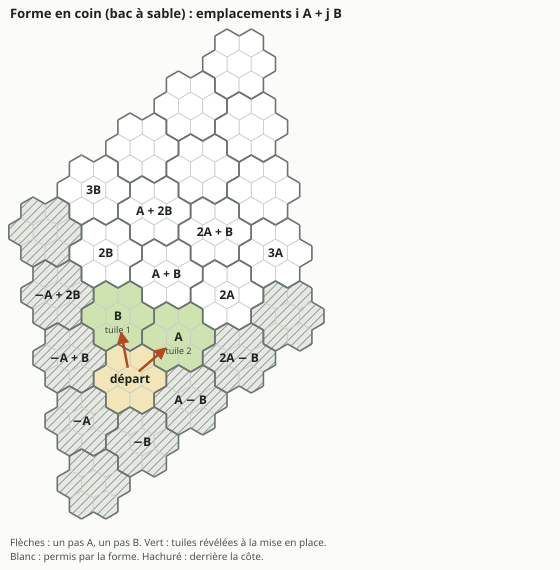

# 015 — Exploration

- Statut : implémentée (2026-10-25)
- Jalon : J1
- Dépend de : 010 (plateau de jeu hexagonal), 011 (affichage du plateau de jeu), 012 (scénario et mise en place), 014 (déplacement)
- Livret : MKUE p. 6 (6.d : explorer avant l'action), p. 7 (« Movement » 5.a à 5.g et 6.a : révéler une tuile), p. 14 (formes du
  plateau de jeu, côte), p. 18 (forme « en coin sans limitation » de Première reconnaissance)
- Crates touchées : arcanum-core, arcanum-ui, `assets/i18n/` (fr.json et en.json)

## Objectif

Le héros ne tourne plus en rond sur trois tuiles : quand sa figurine est au bord du plateau de jeu, le joueur peut **explorer** un
emplacement de tuile libre voisin en dépensant **2 points de mouvement**. La tuile du dessus de la pioche de tuiles est alors révélée
et posée à cet emplacement, et le héros peut y entrer. À l'écran, les emplacements que le héros peut explorer sont dessinés en
fantôme à côté de lui, et un clic sur l'un d'eux révèle la tuile.

## Règles

- **Où** (MKUE p. 7, 5.a ; p. 14) : depuis une case **adjacente à un emplacement** libre du pavage (spec 010), permis par la forme du
  plateau de jeu du scénario (spec 012). Les emplacements hachurés ne s'explorent jamais.
- **Coût** (MKUE p. 7, 5.b) : **2 points de mouvement**, de jour comme de nuit, quel que soit le terrain. La figurine ne bouge pas.
- **Quelle tuile** (MKUE p. 7, 5.c) : celle du **dessus de la pioche de tuiles** ; son dos se voit (campagne ou royaume), pas son recto.
- **Annoncer l'emplacement** (MKUE p. 7, 5.c) : l'action porte l'emplacement exploré.
- **Orientation** (MKUE p. 7, 5.d) : imposée, comme pour toute tuile posée (spec 010).
- **Contraintes selon le dos** (MKUE p. 7, 5.e) :
  - **tuile de campagne** : adjacente à **au moins deux** tuiles posées, **ou** à une tuile posée qui borde elle-même au moins deux
    autres tuiles posées (lecture de cette phrase : Q1) ;
  - **tuile royaume** : adjacente à **au moins deux** tuiles posées ;
  - « adjacente » se dit d'emplacements qui se touchent par un bord (les six voisins de la spec 010) ; la tuile de départ compte.
- **Pioche vide** (MKUE p. 7, 5.e, dernier point) : une tuile de campagne **écartée** au hasard, puis une tuile royaume **sans cité**
  écartée, adjacente à **au moins trois** tuiles posées ; sans tuile écartée, plus d'exploration. Les tuiles écartées sont celles du jeu
  de base ni posées ni dans la pioche (spec 012) ; les tuiles royaume de cité écartées ne reviennent jamais.
- **Quand** (MKUE p. 7, 6, 6.a et 6.b ; p. 6, 6.d) : en alternance avec le déplacement. Il n'y a pas encore d'action (specs 031 et 040) :
  on peut donc explorer à tout moment, comme on se déplace (spec 014).
- **Ce que la révélation déclenche** (MKUE p. 7, 5.f et 5.g) : sites révélés, cité et ses défenseurs : rien n'existe encore, voir Hors
  périmètre. Les ennemis errants imprimés restent des symboles, comme à la spec 014.
- **Pas de limitation de la forme en coin** (MKUE p. 14 ; p. 18) : le bac à sable reprend Première reconnaissance, en coin « sans
  limitation » ; l'interdiction des tuiles royaume sur la côte viendra avec le premier scénario qui l'utilise (Q3).

### Exemple sur le bac à sable

Noms d'emplacements : voir « Comment lire A et B » et les schémas de la spec 012 (`B` = un pas vers le haut, `A` = un pas vers le
haut à droite, depuis la tuile de départ).

Après la mise en place (spec 012), la tuile de départ A est en `(0, 0)`, la tuile de campagne 1 en `B = (0, 1)` et la tuile de
campagne 2 en `A = (1, 0)` ; la pioche commence par les tuiles de campagne 3, 4, 5… Les emplacements libres permis par la forme en
coin et voisins des tuiles posées sont `A + B = (1, 1)`, `2B = (0, 2)` et `2A = (2, 0)`.

| Case de la figurine (coordonnées `(q, r)`) | Emplacements libres qu'elle borde | Explorables avec une tuile de campagne |
|---|---|---|
| Portail `(0, 0)` | aucun | — |
| Plaine E de la tuile de départ `(1, 0)` | `A − B` (hachuré) | aucun |
| Plaine E de la tuile 1 `(2, −3)` (village) | `A + B` | `A + B` (2 tuiles adjacentes) |
| Forêt N-E de la tuile 2 `(4, −3)` (clairière) | `A + B`, `2A` | les deux : `2A` n'a qu'une tuile adjacente (la 2), mais celle-ci en borde deux |
| Plaine E de la tuile 2 `(4, −2)` | `2A − B` (hachuré), `2A` | `2A` |

Si la tuile 3 est révélée en `2A`, sa Colline E `(7, −4)` borde `3A` : seule la tuile 3 lui est adjacente, et elle ne borde qu'une
tuile (la 2) : `3A` n'est pas explorable avec une tuile de campagne. `A + B` touche alors trois tuiles (1, 2 et 3).

## Modèle

### Termes

Termes du glossaire déjà présents : Explorer (`Explore`), Tuile, Tuile de campagne, Tuile royaume, Tuile royaume de cité / sans cité,
Emplacement de tuile (`TilePosition`), Pioche de tuiles (`TileDeck`), Sorte de tuile (`TileKind`), Côte, Forme du plateau de jeu,
Points de mouvement, Adjacente.

Nouveaux termes, ajoutés au glossaire dans la même PR (à valider) :

| Livret (EN) | Français | Code |
|---|---|---|
| Reveal (a tile) | Révéler | `TileRevealed` (existant) |
| Tile removed from the game during Setup | Tuile écartée | `removed_tiles` |
| Available position (for a new tile) | Emplacement libre | `Map::free_neighbor_positions` (existant) |

Terme technique :

| Français | Code | Sens |
|---|---|---|
| Prochaine tuile | `NextTile` | Ce qu'un joueur sait de la tuile qu'il révélerait : dos campagne ou royaume du dessus de la pioche, tuile écartée de campagne ou royaume si la pioche est vide, ou aucune. |

### Règles de pose (arcanum-core, fonctions pures)

- **Prochaine tuile** : d'après la pioche de tuiles et le plateau de jeu, une des valeurs *campagne*, *royaume*, *écartée de campagne*,
  *écartée royaume*, ou *aucune*.
- **Emplacement explorable** pour une prochaine tuile donnée : libre, permis par la forme, et qui respecte la contrainte de son dos
  (deux tuiles adjacentes, ou une tuile adjacente qui en borde deux, pour la campagne ; deux pour le royaume ; trois pour une tuile
  écartée).
- **Tuiles écartées** : les tuiles du jeu de base (hors tuile de départ) ni posées ni dans la pioche, de campagne puis royaume sans
  cité.

### Nouvelles données dans l'état

Aucune. Les tuiles écartées se déduisent du plateau de jeu et de la pioche (spec 012).

### Vue joueur

La vue joueur gagne la **prochaine tuile** (`NextTile`) : le dos du dessus de la pioche est public (MKUE p. 3, p. 7, 5.c), et le nombre
de tuiles écartées de chaque dos se déduit de la composition publique du scénario. L'ordre de la pioche et l'identité des tuiles
écartées restent cachés.

## Actions et événements

| Action | Validation (refusée si…) | Événements produits |
|---|---|---|
| `Explore { position }` | la figurine n'est pas sur le plateau de jeu ; aucune case de `position` n'est adjacente à la figurine ; `position` est occupée ou hors de la forme ; il n'y a plus de tuile à révéler ; `position` ne respecte pas la contrainte de la prochaine tuile ; les points de mouvement sont inférieurs à 2 | `Explored`, puis `TileRevealed` |

| Événement | Effet de `apply` | Révèle une information ? |
|---|---|---|
| `Explored { player, position, cost }` | retire `cost` (2) aux points de mouvement | oui, publique |
| `TileRevealed { tile, position }` (spec 012, inchangé) | pose `tile` à `position` et la retire de la pioche si elle y est (une tuile écartée n'y est pas) | oui, publique |

`decide` choisit la tuile : le dessus de la pioche, ou, pioche vide, une tuile écartée tirée au **générateur à graine** (de campagne
d'abord, royaume sans cité ensuite). Le hasard est donc résolu dans `TileRevealed` ; `apply` ne consulte ni la pioche ni le
générateur. Comme pour `HeroMoved`, un `Explored` dont le coût dépasse les points de mouvement ne change rien.

Deux événements plutôt qu'un : `TileRevealed` reste le seul événement qui pose une tuile venue de la pioche, à la mise en place comme
en exploration, et `Explored` dit qui a payé et combien.

**Décision en attente.** Le joueur doit choisir tant qu'il a au moins une action légale : jouer une carte, se déplacer **ou explorer**.

**Actions légales**, énumérées dans cet ordre : jouer une carte (spec 013), se déplacer (spec 014), **puis** un `Explore` par
emplacement explorable, dans l'ordre des emplacements (`TilePosition`, comme `Map::free_neighbor_positions`).

## Comportements attendus

Chaque cas devient au moins un test (nom indicatif entre parenthèses). Sauf mention, sur le bac à sable de la spec 012 (pioche 3, 4…).

Règles de pose (arcanum-core, fonctions pures) :

- **C1** — Après la mise en place du bac à sable, les emplacements libres permis par la forme sont `A + B`, `2B` et `2A` ; une tuile de
  campagne peut aller sur les trois, une tuile royaume seulement en `A + B` (deux tuiles adjacentes)
  (`explorable_positions_after_sandbox_setup`) — MKUE p. 7, 5.a et 5.e.
- **C2** — Avec la tuile 3 en `2A` : une tuile de campagne ne peut pas aller en `3A` ni en `2A + B` (adjacents à la seule tuile 3, qui
  ne borde qu'une tuile) ; `A + B` touche trois tuiles et accepte une tuile écartée (`countryside_needs_two_neighbors_or_a_busy_one`)
  — MKUE p. 7, 5.e.
- **C3** — Une tuile écartée ne peut aller que sur un emplacement adjacent à au moins trois tuiles posées : refusée en `2B` au début,
  acceptée en `A + B` dans la situation de C2 (`removed_tile_fills_holes_only`) — MKUE p. 7, 5.e.
- **C4** — Les tuiles écartées du bac à sable sont, juste après la mise en place, les tuiles de campagne 9, 10 et 11, les deux tuiles
  royaume sans cité et les trois tuiles royaume de cité que la pioche n'a pas prises ; la tuile de départ n'en fait jamais partie
  (`removed_tiles_are_neither_placed_nor_in_the_deck`) — MKUE p. 7, 5.e ; p. 18.
- **C5** — La prochaine tuile vaut *campagne* tant qu'une tuile de campagne est sur le dessus, *royaume* ensuite, *écartée de campagne*
  quand la pioche est vide, *écartée royaume* quand il ne reste plus de tuile de campagne écartée, *aucune* quand il ne reste plus que
  des tuiles royaume de cité écartées (`next_tile_follows_deck_then_removed_tiles`) — MKUE p. 7, 5.c et 5.e.

Explorer (arcanum-core) :

- **C6** — Figurine sur la Plaine E de la tuile 1 `(2, −3)` avec 2 points de mouvement : les actions légales contiennent
  `Explore { A + B }` et aucun autre `Explore` (`hero_next_to_a_free_position_can_explore`) — MKUE p. 7, 5.a.
- **C7** — Explorer `A + B` produit `Explored { cost: 2 }` puis `TileRevealed { tuile de campagne 3, A + B }` ; après `apply`, la tuile 3
  est posée, la pioche a une tuile de moins, la figurine n'a pas bougé et il reste 0 point de mouvement
  (`exploring_reveals_the_top_tile_for_two_points`) — MKUE p. 7, 5.b et 5.c.
- **C8** — Figurine sur la Forêt N-E de la tuile 2 `(4, −3)` : `Explore { A + B }` et `Explore { 2A }` sont légales ; explorer `2A`
  pose la tuile 3 en `2A`, pas en `A + B` (`hero_bordering_two_positions_chooses_one`) — MKUE p. 7, 5.c.
- **C9** — Figurine sur la Plaine E de la tuile 2 `(4, −2)` : seul `Explore { 2A }` est légal, `2A − B` est derrière la côte
  (`positions_behind_the_coastline_cannot_be_explored`) — MKUE p. 7, 5.a ; p. 14.
- **C10** — Explorer, puis entrer dans la tuile révélée, puis jouer une carte et explorer encore : les points s'additionnent et se
  dépensent dans l'ordre (`exploring_and_moving_alternate`) — MKUE p. 7, 6.a et 6.b.
- **C11** — Une tuile royaume sur le dessus (scénario de test : pioche réduite à ses premières tuiles de campagne, puis des tuiles
  royaume), figurine en `(4, −3)` : seul `Explore { A + B }` est légal, `2A` n'a qu'une tuile adjacente
  (`core_tile_needs_two_neighbors`) — MKUE p. 7, 5.e.
- **C12** — Pioche vide (scénario de test sans tuile au-delà de la mise en place), figurine au bord d'un emplacement adjacent à trois
  tuiles : `Explore` est légal et `TileRevealed` pose une tuile de campagne écartée ; deux parties de même graine révèlent la même
  tuile, et pour une autre graine le tirage peut différer (`empty_deck_reveals_a_random_removed_tile`) — MKUE p. 7, 5.e.
- **C13** — Main vide, 2 points de mouvement, aucune case voisine à 2 ou moins mais un emplacement explorable : la décision continue
  avec le seul `Explore` (`decision_lasts_while_exploring_is_possible`).
- **C14** — Les actions légales sont exactement celles de l'énumération, dans son ordre (cartes, déplacements, explorations) ; chacune
  est acceptée par `decide` (`legal_actions_list_cards_moves_then_explorations`).

Information cachée et journal (arcanum-core) :

- **C15** — La vue joueur donne la prochaine tuile (*campagne* après la mise en place du bac à sable), jamais la tuile elle-même ;
  `Explored` et `TileRevealed` sont montrés en entier dans le journal filtré (`exploration_reveals_only_the_revealed_tile`).
- **C16** — Rejouer le journal après quelques explorations, dont une avec pioche vide, redonne le même état
  (`replaying_log_rebuilds_explorations`).

Affichage (arcanum-ui) :

- **C17** — Figurine en `(4, −3)` avec 2 points : l'écran du plateau dessine en fantôme les emplacements `A + B` et `2A` (sept cases
  chacun), mis en évidence, avec un jeton de coût 2 sur leur case centrale ; avec 1 point, les mêmes fantômes sans mise en
  évidence et jeton grisé ; figurine au portail : aucun fantôme (`explorable_positions_are_drawn_as_ghosts`).
- **C18** — Un emplacement libre voisin de la figurine mais refusé par la contrainte du dos (C2) n'a pas de fantôme ; un emplacement
  hachuré non plus (`refused_positions_have_no_ghost`).
- **C19** — Survol d'une case d'un emplacement libre : « Emplacement libre » ; s'il est voisin de la figurine, une ligne « Explorer :
  2 points de mouvement », puis « Cliquez pour révéler une tuile de campagne » (ou royaume, ou écartée), ou « Il vous manque 1 point
  de mouvement », ou la raison du refus (contrainte du dos, plus aucune tuile) (`hover_explains_exploration`).
- **C20** — Un clic sur n'importe quelle case d'un fantôme mis en évidence envoie `Explore` vers cet emplacement ; un clic sur un
  fantôme grisé, un emplacement sans fantôme ou une case hachurée ne fait rien (`clicking_a_ghost_explores`).
- **C21** — Le panneau latéral montre toujours « Pioche de tuiles : N campagne, M royaume » ; pioche vide, la ligne devient
  « Pioche de tuiles vide · tuiles écartées : N campagne, M royaume » (`panel_shows_removed_tiles_when_deck_is_empty`).
- **C22** — Avec le vrai `fr.json`, calculer l'écran et le survol de chaque case autour du plateau de jeu du bac à sable pour chaque
  valeur de la prochaine tuile, avec 0, 1 et 2 points, ne relève aucun manque (`every_exploration_key_exists_in_french`).

Vérification manuelle : `cargo run -p arcanum-ui` sous Linux ; jouer des cartes, aller sur la Forêt N-E de la tuile 2, voir les deux
fantômes, cliquer `2A` : la tuile 3 apparaît, la pioche affiche une tuile de campagne de moins, et on peut y entrer.

## Cas limites et refus

- **L1** — `Explore` vers un emplacement dont aucune case n'est adjacente à la figurine (`2B` depuis le portail) :
  `ActionError::NotLegal`, aucun événement (`exploring_far_from_the_hero_is_refused`) — MKUE p. 7, 5.a.
- **L2** — Vers un emplacement occupé (`B`) ou hors de la forme (`A − B`) : refusé (`exploring_an_occupied_or_forbidden_position_is_refused`)
  — MKUE p. 7, 5.a.
- **L3** — Avec 1 point de mouvement : refusé, les points ne deviennent jamais négatifs (`exploring_without_two_points_is_refused`)
  — MKUE p. 7, 5.b.
- **L4** — Vers un emplacement qui ne respecte pas la contrainte de la prochaine tuile (`3A` dans la situation de C2) : refusé
  (`exploring_against_placement_limits_is_refused`) — MKUE p. 7, 5.e.
- **L5** — Plus aucune tuile à révéler (pioche vide, plus de tuile de campagne ni royaume sans cité écartée) : aucun `Explore` légal
  (`nothing_left_to_reveal_stops_exploration`) — MKUE p. 7, 5.e.
- **L6** — `apply` d'un `Explored` dont le coût dépasse les points de mouvement : état inchangé ; `apply` d'un `TileRevealed` sur un
  emplacement occupé : état inchangé (spec 012, L3) (`invalid_exploration_events_change_nothing`).

## Information cachée

- Publics : la prochaine tuile (son dos, ou « écartée », ou « aucune »), chaque exploration et son coût, chaque tuile révélée et son
  emplacement, le nombre de tuiles de chaque dos dans la pioche et parmi les tuiles écartées.
- Cachés : l'ordre de la pioche de tuiles, l'identité des tuiles écartées, la tuile qu'un tirage au hasard donnerait.

## Libellés (i18n)

Ajoutés dans `fr.json` et `en.json`.

| Clé | Paramètres | Français | English |
|---|---|---|---|
| `board.hover.free_position` | — | Emplacement libre | Free tile position |
| `board.hover.explore_cost` | `cost` | Explorer : {cost} points de mouvement | Explore: {cost} Move points |
| `board.hover.click_to_explore.countryside` | — | Cliquez pour révéler une tuile de campagne | Click to reveal a Countryside tile |
| `board.hover.click_to_explore.core` | — | Cliquez pour révéler une tuile royaume | Click to reveal a Core tile |
| `board.hover.click_to_explore.removed` | — | Cliquez pour révéler une tuile écartée, au hasard | Click to reveal a random removed tile |
| `board.hover.explore_limit.countryside` | — | Une tuile de campagne doit toucher deux tuiles posées, ou une tuile qui en touche deux | A Countryside tile must touch two placed tiles, or a tile that touches two |
| `board.hover.explore_limit.core` | — | Une tuile royaume doit toucher au moins deux tuiles posées | A Core tile must touch at least two placed tiles |
| `board.hover.explore_limit.removed` | — | Une tuile écartée doit toucher au moins trois tuiles posées | A removed tile must touch at least three placed tiles |
| `board.hover.nothing_to_reveal` | — | Plus aucune tuile à révéler | No tile left to reveal |
| `board.tile_deck_empty` | `countryside`, `core` | Pioche de tuiles vide · tuiles écartées : {countryside} campagne, {core} royaume | Tile deck empty · removed tiles: {countryside} Countryside, {core} Core |

La ligne « Il vous manque {missing} point(s) de mouvement » (`board.hover.missing_points`, spec 014) est réutilisée.

## Interface

Maquette à valider : [Maquette spec 015](https://claude.ai/artifact/EantuW6pdHrYxd8b5T7sNC) (ses boutons « +3 points de mouvement » et
« Vider la pioche » n'existent que dans la maquette).

- **Plateau de jeu**, quand le joueur a une décision en attente :
  - chaque **emplacement explorable** dont une case touche la figurine est dessiné en **fantôme** : les sept cases en contour
    pointillé clair sur le fond, un point d'interrogation sur la case centrale ;
  - si le joueur a les 2 points, le fantôme est **mis en évidence** comme une case de déplacement (voile lumineux, contour épais) et
    porte un **jeton de coût** 2 ; sinon, contour pointillé et jeton grisé ;
  - un emplacement libre refusé (contrainte du dos, plus de tuile) ou hachuré n'a **pas** de fantôme : le survol dit pourquoi ;
  - comme les autres marques, le jeton n'est pas dessiné sous `OVERLAY_MIN_ZOOM` ; le contour du fantôme, si.
- **Survol** : une case d'un emplacement libre affiche « Emplacement libre » et, si l'emplacement touche la figurine, les lignes de C19.
- **Clic** : un clic gauche simple sur n'importe quelle case d'un fantôme mis en évidence explore cet emplacement. La tuile révélée
  apparaît aussitôt ; le cadrage ne bouge pas.
- **Panneau latéral** : la ligne de la pioche de tuiles (spec 012) devient, pioche vide, celle des tuiles écartées (C21).
- Comme pour le déplacement, fantômes, survol et clic sont calculés dans l'écran du plateau (`BoardScreen`), sans egui (issue
  #2).

### Raccourcis clavier

Aucun : explorer se fait au clic, comme se déplacer (spec 014, Q6). À revoir avec les déplacements au clavier, s'ils viennent.

## Effets sur les specs déjà implémentées

Signalés ici parce que le sens de tests existants peut changer (règle « jamais modifier un test sans le signaler ») :

- **013, 014** : la liste des actions légales gagne les `Explore` à la fin ; `legal_actions_list_cards_then_moves` (014 C14) reste vrai
  tant que la figurine ne borde aucun emplacement explorable, sinon il sera complété.
- **000, 002, 003, 014** : les tests qui font jouer le joueur « premier choix » jusqu'au bout (`runner_plays_until_the_hand_is_empty`,
  `frame_loop_stops_on_waiting_and_is_bounded`, `game_runner_logs_the_game`…) peuvent maintenant voir des explorations après les
  déplacements. Toute assertion modifiée sera listée dans « Corrections pendant l'implémentation ».
- **012** : `setup_events_come_in_order` et les correspondances exhaustives sur `Event` gagnent le cas `Explored`. Le tableau des
  paramètres de scénario (« pas de tuile royaume sur la côte » prévu pour 015) est mis à jour selon Q3.
- **`PlayerView`** : les tests qui la construisent champ par champ ajoutent la prochaine tuile.

## Hors périmètre

- « Quand c'est révélé » des sites : action avancée ajoutée à l'offre d'unités pour un monastère (offres, spec 050), figurine, carte et
  défenseurs d'une cité (spec 062), jetons d'ennemis errants et de ruines (specs 030 et 044).
- Gloire pour chaque tuile révélée et fin de partie quand une cité est révélée, règles de Première reconnaissance (MKUE p. 18) :
  specs 035 et 063. Le bac à sable n'en a pas.
- Pas de tuile royaume sur la côte de la forme en coin standard (MKUE p. 14) : avec le premier scénario qui l'utilise (Q3).
- Effets qui révèlent une tuile à distance ou sans payer (sorts, actions avancées) : J5.
- Annuler une exploration : jamais, une révélation borne l'annulation (ADR 0001, spec 024).
- Recentrer le cadrage sur la tuile révélée.
- Mise en évidence de toutes les cases atteignables : voir Q4.

## Décisions prises à la relecture

Réponses de Mathieu (2026-10-25), propositions acceptées :

1. **Q1** — « Adjacente à une tuile qui borde au moins deux autres tuiles » : la tuile adjacente T touche au moins deux autres tuiles
   posées, sans compter la nouvelle.
2. **Q2** — Pioche vide incluse : une tuile écartée tirée au hasard, à poser contre trois tuiles ; explorer n'est jamais forcé.
3. **Q3** — « Pas de tuile royaume sur la côte » (forme en coin standard) reporté au premier scénario qui l'utilise (spec 064) ; tableau
   de la spec 012 corrigé.
4. **Q4** — Toutes les cases atteignables : petite spec à part, après la 016.
5. **Q5** — Fantômes seulement pour les emplacements explorables qui touchent la figurine.
6. **Maquette** validée, ainsi que les schémas des emplacements ajoutés à la spec 012.

## Corrections pendant l'implémentation

- **API d'arcanum-core** : `NextTile`, `next_tile`, `removed_tiles`, `placement` (verdict `Placement` : permis, occupé, derrière la côte,
  plus rien à révéler, trop peu de tuiles voisines), `free_positions_touching`, `EXPLORE_COST`, et `Map::tile_at`. L'écran du plateau se
  sert des mêmes fonctions que le moteur pour ses fantômes et son survol.
- **Tuiles écartées dans la vue** (`PlayerView::removed_tiles`) : seules celles qui peuvent encore être révélées sont comptées
  (campagne, royaume sans cité). Les tuiles royaume de cité écartées ne reviennent jamais : le panneau affiche donc, pioche vide du
  bac à sable, « 9 campagne, 4 royaume » au plus.
- **« Emplacement libre » au survol** seulement en partie (avec `BoardMovement`). Hors partie (plateau de démonstration de la
  spec 011), une case vide reste neutre : depuis la spec 037, elle n'a aucune ligne de survol (`hovering_nothing_shows_no_lines`).
- **Tests existants modifiés**, même sens (règle « jamais modifier un test sans le signaler ») :
  - spec 012, `setup_events_come_in_order` : sa correspondance exhaustive sur les événements gagne le cas `Explored` ;
  - spec 002, `boucle_et_fenetre.rs` : la vue construite champ par champ ajoute `next_tile` et `removed_tiles` ;
  - spec 014, `arcanum-ui/tests/deplacement.rs` : `BoardMovement` ajoute `next_tile`.
  Les tests de la boucle de partie (specs 000, 002, 003) et `legal_actions_list_cards_then_moves` (014 C14) passent sans changement.

Vérification manuelle sous Linux (Xvfb) : captures `spec-015-emplacement-explorable.png` (fantôme de `A + B` mis en évidence, survol)
et `spec-015-tuile-revelee.png` (tuile de campagne 3 révélée, pioche à 5 tuiles de campagne) dans les fichiers du projet.

## Questions ouvertes

Aucune.
