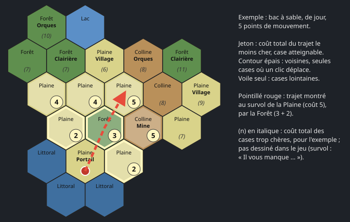

# 017 — Cases atteignables

- Statut : implémentée (2026-10-25)
- Jalon : J1
- Dépend de : 014 (déplacement), 015 (exploration), 016 (fin du tour : mode fin du tour)
- Livret : MKUE p. 7 (« Movement » 3 : case par case, coût de la case où l'on entre ; 3.a : cases infranchissables ; 4.a : site
  fortifié ; 6 : autant de cases qu'on peut payer)
- Crates touchées : arcanum-core, arcanum-ui, `assets/i18n/` (fr.json et en.json)
- Origine : demandé par Mathieu (spec 014), placé après la 016 (spec 015, Q4)

## Objectif

Aujourd'hui, seules les cases **voisines** de la figurine sont mises en évidence. Avec cette spec, le plateau de jeu montre **toutes les
cases que la figurine peut atteindre** avec ses points de mouvement, chacune avec le **coût du trajet le moins cher** pour y aller. Le
survol d'une case montre ce trajet. L'affichage est **informatif** : on se déplace toujours d'une case voisine à la fois (Q1).

Les règles ne changent pas : le moteur reçoit toujours un `MoveHero` par case (spec 014, Q4), et seul un clic sur une case voisine
déplace la figurine. Cette spec ajoute un calcul de trajets, pur, et ce que l'écran en montre.

## Règles

Aucune règle nouvelle ; on les applique sur plusieurs cases d'avance :

- **Case par case** (MKUE p. 7, 3) : un trajet coûte la **somme** des coûts des cases où l'on entre ; la case de départ ne coûte rien.
- **Autant qu'on peut payer** (MKUE p. 7, 6) : une case est **atteignable** si un trajet y mène dont le coût ne dépasse pas les points
  de mouvement disponibles.
- **Ce qu'un trajet ne traverse pas** : Lac, Montagne et Littoral (MKUE p. 7, 3.a), les sites fortifiés (spec 014 Q2 ; p. 7, 4.a) et les
  cases sans tuile. Les autres sites et les symboles d'ennemis imprimés se traversent (spec 014, C11 et C12).
- **Jour et nuit** (spec 014) : la nuit, le trajet le moins cher peut changer (C7).
- **Ce qui ne compte pas** (MKUE p. 7, 6.b) : les points que des cartes encore en main pourraient donner ; seuls les points **déjà
  disponibles** comptent, et l'écran se met à jour quand on en joue.

### Le trajet le moins cher, et le départage

Pour chaque case accessible reliée à la figurine par des cases accessibles, on retient **un** trajet :

1. le **moins cher** ;
2. à coût égal, celui qui a le **moins de cases** ;
3. à égalité encore, celui dont la suite de directions vient en premier dans l'ordre `E`, `NE`, `NW`, `W`, `SW`, `SE`
   (`Direction::ALL`), comparée direction par direction (Q3).

Le point 3 n'a pas de sens pour les règles : il rend le choix **déterministe**, donc testable et identique d'une partie rejouée à
l'autre. Une case voisine accessible a toujours pour trajet le pas direct : passer par une autre case ajoute au moins un coût, ou à coût
égal une case de plus.

### Exemple : bac à sable, de jour, 5 points de mouvement

Figurine sur le portail, tuile de départ A, tuiles de campagne 1 (en haut) et 2 (à droite) posées à la mise en place.

| Case | Terrain | Trajet retenu | Coût | Avec 5 points |
|---|---|---|---|---|
| (1, 0) E | Plaine | E | 2 | atteignable |
| (0, −1) N-O | Plaine | NW | 2 | atteignable |
| (1, −1) N-E | Forêt | NE | 3 | atteignable |
| (0, −2) | Plaine | NW, NW | 2 + 2 = 4 | atteignable |
| (1, −2) | Plaine | NW, NE | 2 + 2 = 4 | atteignable |
| (2, −2) | Plaine | NE, NE | 3 + 2 = 5 | atteignable |
| (2, −1) | Colline, mine verte | E, NE | 2 + 3 = 5 | atteignable |
| (2, −3) | Plaine, village | NW, NE, NE | 2 + 2 + 2 = 6 | il manque 1 point |
| (1, −3) | Forêt, clairière magique | NW, NE, NW | 2 + 2 + 3 = 7 | il manque 2 points |

Départage, sur la clairière magique (1, −3) : deux trajets de 3 cases coûtent 7, `NW, NW, NE` (par (0, −2)) et `NW, NE, NW` (par
(1, −2)). Ils diffèrent à la deuxième direction, et `NE` vient avant `NW` : on retient `NW, NE, NW`.

De nuit, la Forêt coûte 5 : (2, −2) passe à 6, par `NW, NE, E` (2 + 2 + 2) au lieu de `NE, NE` (5 + 2 = 7).

## Modèle

### Termes

Termes du glossaire déjà présents : Case (`Hex`), Adjacente, Coût de déplacement (`move_cost`), Infranchissable
(`MoveCost::Inaccessible`), Site fortifié (`Site::is_fortified`), Points de mouvement (`move_points`), Direction (`Direction`), Figurine.

Nouveaux termes, ajoutés au glossaire dans la même PR (à valider) :

| Français | Code | Sens |
|---|---|---|
| Trajet | `Route` | Suite de cases adjacentes accessibles depuis la figurine jusqu'à une case, avec son coût total. Pas un terme du livret. |
| Case atteignable | `reachable` | Case dont le trajet retenu coûte au plus les points de mouvement disponibles. |

### Contenu (arcanum-core, fonction pure)

- Une fonction pure donne, depuis une case de départ, sur un plateau de jeu et selon le moment de la journée, le **trajet retenu**
  vers chaque case qu'on peut rejoindre (règles et départage ci-dessus) : la case d'arrivée, les cases traversées dans l'ordre (sans
  la case de départ, avec l'arrivée) et le coût total. Elle **ne dépend pas des points** : le filtre « coût ≤ points » est fait par
  l'appelant, ce qui sert aussi le « il vous manque N points » du survol.
- Elle est dans arcanum-core et non dans l'écran, pour que les futurs joueurs automatiques (arcanum-players) s'en servent aussi, et parce que
  l'écran du plateau se sert déjà des fonctions du moteur (spec 015).
- Elle se sert de `move_cost` (spec 014) : un changement de coût (nuit, et plus tard les effets de J5) change les trajets sans autre
  code.

### Nouvelles données dans l'état

Aucune.

## Actions et événements

Aucun changement. Les actions légales ne changent pas : seules les cases **voisines** y figurent (spec 014). Pour aller plus
loin, le joueur suit le tracé case par case, un `MoveHero` à chaque fois.

## Comportements attendus

Chaque cas devient au moins un test (nom indicatif entre parenthèses). Sauf mention : bac à sable, tuile de départ A et tuiles de
campagne 1 et 2, figurine sur le portail, de jour.

Trajets (arcanum-core, fonction pure) :

- **C1** — Les trajets retenus vers les cases du tableau de l'exemple ont exactement les cases et les coûts du tableau
  (`routes_follow_the_cheapest_spaces`) — MKUE p. 7, 3 et 6.
- **C2** — Aucun trajet ne mène à une case de Littoral ou de Lac, ni n'en traverse ; le Lac de la tuile de campagne 1 (2, −4) n'a pas de
  trajet ; la case de départ non plus (`routes_avoid_inaccessible_spaces`) — MKUE p. 7, 3.a.
- **C3** — Tuile de campagne 3 posée en A à la place de la 2 : la forteresse (4, −3) n'a pas de trajet, et aucun trajet ne la
  traverse (`routes_avoid_fortified_sites`) — MKUE p. 7, 4.a ; spec 014 Q2.
- **C4** — Les sites non fortifiés et les symboles d'orques imprimés ne bloquent rien : la Colline aux orques (3, −3) a un trajet
  (coût 8) ; le trajet vers le village de la tuile 2 (4, −2) traverse la mine verte (2, −1) : `E, NE, E, NE`, coût 9 ; celui vers la
  Forêt aux orques (1, −4) traverse la clairière magique (1, −3) : `NW, NE, NW, NW`, coût 10
  (`routes_cross_non_fortified_sites_and_printed_enemies`) — MKUE p. 7, 4.b et 4.d.
- **C5** — Départage : vers la clairière magique (1, −3), le trajet retenu est `NW, NE, NW` (coût 7), pas `NW, NW, NE`
  (`equal_routes_are_broken_by_direction_order`).
- **C6** — Départage par le nombre de cases : sur une disposition de tuiles construite pour avoir deux trajets de même coût et de
  longueurs différentes, le plus court en cases est retenu (`equal_cost_prefers_fewer_spaces`).
- **C7** — De nuit, le trajet vers (2, −2) devient `NW, NE, E` pour 6 points (`night_costs_change_the_route`) — MKUE p. 7, 3.a, note.
- **C8** — Pour toute case voisine accessible, le trajet retenu est le pas direct, au coût de la case (`neighbor_route_is_the_direct_step`).
- **C9** — Après une exploration, les cases de la nouvelle tuile ont des trajets ; avant, aucune case sans tuile n'en a
  (`routes_only_cross_placed_tiles`) — MKUE p. 7, 5.
- **C10** — Cohérence avec le moteur, sur plusieurs positions et nombres de points : les `MoveHero` légaux sont exactement les
  premières cases des trajets d'une case de coût au plus les points ; et jouer les `MoveHero` d'un trajet atteignable, un par un, est
  accepté à chaque pas et retire son coût total (`affordable_routes_are_playable_step_by_step`) — MKUE p. 7, 3.

Affichage (arcanum-ui) :

- **C11** — Avec 5 points, l'écran du plateau marque les 7 cases atteignables de l'exemple, chacune avec un jeton du coût de son
  trajet ; les 3 voisines sont mises en évidence comme à la spec 014, les 4 autres n'ont que le voile ; les voisines viennent d'abord dans l'ordre des directions, puis les autres par coût croissant et, à coût égal, dans
  l'ordre de leur trajet ; aucune autre marque (`all_reachable_spaces_are_highlighted`).
- **C12** — Avec 2 points, le résultat de la spec 014 ne change pas : Plaine E et Plaine N-O mises en évidence, Forêt N-E avec son jeton
  grisé (3), rien d'autre (`two_points_highlight_only_neighbors`).
- **C13** — Survol de (2, −2) avec 5 points : l'écran donne le tracé du trajet (centre de la figurine, de la Forêt, puis de la Plaine,
  à l'écran) et les lignes « Coût de déplacement : 2 », « Trajet : 2 cases, 5 points de mouvement », et pas « Cliquez pour vous y
  déplacer » (`hover_shows_the_route`).
- **C14** — Survol d'une voisine atteignable : pas de ligne « Trajet » (un pas, le coût est déjà dit) ; le tracé va de la figurine à
  la case (`hover_on_a_neighbor_has_no_route_line`).
- **C15** — Survol du village (2, −3) avec 5 points : pas de tracé ni d'invitation, la ligne « Il vous manque 1 point(s) de
  mouvement » (`hover_on_a_far_space_tells_missing_points`).
- **C16** — Un clic sur une voisine atteignable donne l'action `MoveHero` de la spec 014, inchangée ; un clic sur une case lointaine,
  même atteignable, ne fait rien (Q1) (`clicking_a_far_space_does_nothing`).
- **C17** — En mode fin du tour (spec 016) : ni marque, ni tracé, et un clic ne fait rien (`end_turn_mode_hides_routes`).
- **C18** — Sous le zoom minimal des surimpressions (`OVERLAY_MIN_ZOOM`), ni marque ni tracé, comme à la spec 014
  (`routes_are_not_drawn_when_zoomed_out`).
- **C19** — Avec le vrai `fr.json`, calculer l'écran et le survol de chaque case du bac à sable avec 0, 2, 5 et 9 points ne relève
  aucun manque (`every_route_key_exists_in_french`).

Vérification manuelle : `cargo run -p arcanum-ui` sous Linux ; jouer Marche, Rapidité et une carte de côté (5 points) : sept cases en
évidence comme sur le schéma ; survoler la Plaine (2, −2) montre le tracé par la Forêt ; cliquer dessus ne fait rien ; cliquer la Forêt
puis la Plaine y amène la figurine, il reste 0 point.

## Cas limites et refus

- **L1** — Figurine absente du plateau de jeu : aucun trajet, aucune marque (`no_figure_no_routes`).
- **L2** — 0 point de mouvement : aucune case atteignable, aucune marque ; le survol d'une case accessible dit ce qui manque.

## Information cachée

Rien de nouveau : les trajets ne se servent que du plateau de jeu, de la position de la figurine, du moment de la journée et des points
de mouvement, tous publics.

## Libellés (i18n)

Ajoutée dans `fr.json` et `en.json` :

| Clé | Paramètres | Français | English |
|---|---|---|---|
| `board.hover.route` | `steps`, `cost` | Trajet : {steps} case(s), {cost} points de mouvement | Route: {steps} space(s), {cost} Move points |

`board.hover.missing_points` (spec 014) sert aussi aux cases lointaines.

## Interface

Pas de maquette séparée : le schéma de l'exemple montre le rendu, avec les marques de la spec 014.

- **Plateau de jeu**, quand le joueur a une décision en attente et qu'aucun mode ne l'empêche (fin du tour, spec 016) :
  - chaque **case atteignable** porte un **jeton** du coût de son trajet (Q2). Les **voisines** atteignables gardent la mise en
    évidence de la spec 014 (contour clair épais, voile lumineux) : ce sont les seules où un clic agit. Les cases **lointaines**
    atteignables n'ont que le voile lumineux, sans contour, pour qu'on ne les prenne pas pour des cases cliquables ;
  - une **voisine** accessible mais trop chère garde son jeton grisé (spec 014) ; une case **lointaine** trop chère n'a aucune marque
    (Q4) : seul le survol dit ce qui manque ;
  - au **survol** d'une case atteignable, le **tracé du trajet** est dessiné : une ligne pointillée qui relie les centres des cases, de
    la figurine à la case survolée, terminée par une flèche.
- **Panneau de survol** : la ligne « Coût de déplacement » (spec 014) reste celle de la case ; pour une case lointaine atteignable,
  on ajoute « Trajet : N cases, M points de mouvement », sans invitation à cliquer ; pour une case lointaine trop chère,
  « Il vous manque N point(s) de mouvement ». Les voisines gardent leurs lignes de la spec 014.
- **Clic** : inchangé (spec 014) : seul un clic sur une voisine atteignable déplace la figurine ; un clic sur une case lointaine ne
  fait rien (Q1).
- Tout se calcule dans l'écran du plateau, sans egui, donc testable (issue #2).

### Raccourcis clavier

Aucun (Q5). Rien de nouveau ne s'actionne : l'affichage est informatif ; les touches de la spec 016 (Fin, Entrée,
Échap) ne changent pas.

## Effets sur les specs déjà implémentées

Signalés ici parce que le sens de tests existants change (règle « jamais modifier un test sans le signaler ») :

- **014, `hover_shows_move_cost`** (C19) : il vérifie qu'une case non adjacente, avec 2 points, n'a « ni invitation ni manque ». Elle
  gagne maintenant la ligne « Il vous manque N point(s) de mouvement » (Q4) ; le test vérifiera cette ligne au lieu de son absence.
- **014, `reachable_neighbors_are_highlighted`** (C18) : inchangé, c'est C12 de cette spec (avec 2 points, aucune case lointaine n'est
  atteignable).
- **014, `clicking_a_highlighted_space_moves_the_hero`** (C20) : inchangé.
- **`MoveMark`** : son `cost` devient le coût du trajet ; pour une voisine, c'est le même nombre.

## Hors périmètre

- Cases atteignables **en jouant des cartes de la main** (portée potentielle) : pas demandé ; à rediscuter si le besoin se fait sentir.
- Aller **explorer plus loin** en un clic (trajet puis exploration) : les emplacements fantômes restent ceux qui touchent la figurine
  (spec 015, Q5).
- **Suivre un trajet en un clic** (Q1) : à revoir avec la spec 030. Les ennemis errants peuvent interrompre le déplacement
  (provocation, MKUE p. 7, 4.c), et un trajet choisi automatiquement pourrait en provoquer un sans que le joueur l'ait voulu. Avec
  la spec 030, le calcul des trajets devra aussi éviter les cases occupées par un jeton, et peut-être signaler les trajets qui provoquent.
- Effets qui changent les coûts, coût 0, entrée en terrain infranchissable, case sûre (MKUE p. 7, 7) : J5. Le calcul s'appuie sur
  `move_cost` et tolère un coût de 0.
- Animation du déplacement, cadrage qui suit la figurine.

## Décisions prises à la relecture

Réponses de Mathieu (2026-10-25) :

1. **Q1** — Affichage **informatif seulement** : un clic ne déplace que sur une voisine. Suivre tout un trajet en un clic compliquerait
   la spec 030 (un ennemi errant peut interrompre le déplacement, et un trajet automatique pourrait en provoquer un sans le vouloir) ;
   à revoir avec elle.
2. **Q2** — Le jeton porte le coût du trajet.
3. **Q3** — Départage : le moins de cases, puis l'ordre des directions.
4. **Q4** — Aucune marque sur les cases lointaines trop chères ; « Il vous manque N point(s) » au survol.
5. **Q5** — Aucun raccourci.

## Corrections pendant l'implémentation

- **API d'arcanum-core** : `Route { to, steps, cost }` et `routes(map, from, time_of_day)`, rendus dans l'ordre du départage (coût, nombre
  de cases, directions). L'écran du plateau s'en sert pour les marques, le tracé et le survol.
- **`MoveMark`** gagne `neighbor` (voisine : contour épais si atteignable) ; **`BoardScreen`** gagne `route` (tracé, vide sauf au
  survol d'une case atteignable).
- **Sans décision en attente** (actions légales vides), aucune case lointaine n'est marquée ni tracée, comme les voisines de la spec 014
  ne sont alors pas mises en évidence (`no_pending_decision_marks_no_far_space`). L2 est testé par `zero_points_mark_nothing_reachable`.
- **Test modifié** (règle « jamais modifier un test sans le signaler ») : spec 014, `hover_shows_move_cost` vérifie maintenant, pour la
  case non adjacente (1, −3) avec 2 points, la ligne « Il vous manque 5 point(s) de mouvement » au lieu de l'absence de manque (Q4).

Vérification manuelle sous Linux (Xvfb) : captures `spec-017-quatre-points.png` et `spec-017-trajet-survole.png` dans les fichiers du
projet. Un clic sur une case lointaine ne change rien ; Forêt puis Plaine amènent la figurine sur (2, −2), il reste 0 point.

## Questions ouvertes

Aucune.
