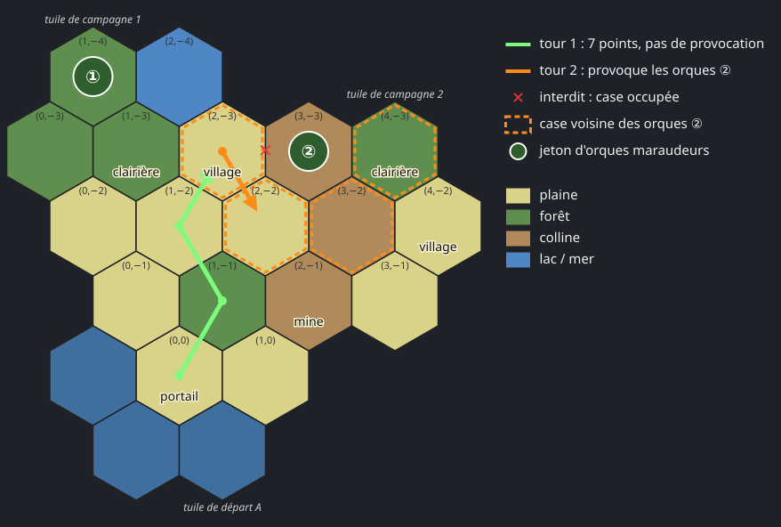

# 030 — Ennemis errants et provocation

- Statut : implémentée (2026-10-27)
- Jalon : J3
- Dépend de : 012 (mise en place), 014 (déplacement), 015 (exploration), 016 (fin du tour), 017 (cases atteignables), 024 (retour en arrière), 029
  (contenu en données)
- Livret : MKUE p. 3 (*Enemy and Ruin token piles* ; *Map*), p. 6 (6.b à 6.e), p. 7 (4.b, 4.c ; 5.f), p. 8 (*Combat with Enemies*
  1.d, 1.e et 2.a) ; cartes de site *Marauding Orcs* et *Draconum* (`docs/regles/cartes/sites-et-cites.md`) ; valeurs des jetons
  (`docs/regles/cartes/ennemis.md`) ; FAQ p2 (explorer ne provoque pas)
- Crates touchées : arcanum-core (dont `content/enemies.ron`), arcanum-ui, `assets/i18n/` (fr.json et en.json), `assets/images/enemy/` (10
  nouveaux SVG)

## Objectif

Les orques maraudeurs et les draconiens imprimés sur les tuiles deviennent de vrais **jetons d'ennemis**, tirés au hasard dans leur pile
et posés **face visible** quand la tuile est révélée. On ne peut plus entrer sur leur case, et passer d'une case voisine d'un ennemi
errant à une autre case voisine du même ennemi le **provoque** : le déplacement s'arrête net. Le combat lui-même vient avec la spec
031 ; d'ici là, le joueur voit qui il a provoqué et finit son tour (Q1).

## Règles

- **Piles d'ennemis** (MKUE p. 3, *Enemy and Ruin token piles*) : à la mise en place, les jetons sont triés par couleur de dos et
  mélangés en piles face cachée. On forme les **six piles d'ennemis** (vert, gris, violet, marron, rouge, blanc) ; la pile des jetons de
  ruines (jaune) attend la spec 044. Défausse et remélange d'une pile vide : pas de jeton défaussé avant la spec 031 (L5).
- **Contenu des jetons** (`docs/regles/cartes/ennemis.md`) : tous les jetons des six couleurs, avec leurs valeurs (armure, attaque,
  élément, capacités, gloire), dans `content/enemies.ron` (Q3). Version *Lost Legion* pour Altem Guardsmen (Attaque 5) et Altem
  Mages (pas Fortified), comme le veut `docs/regles/cartes/README.md`. Seules les couleurs **vert** (orques) et **rouge**
  (draconiens) sont tirées dans cette spec.
- **Tuile révélée** (MKUE p. 7, 5.f ; p. 3, *Map*, « For all revealed sites ») : pour chaque case de la tuile où est imprimé un
  ennemi errant, on tire le jeton du dessus de la pile de sa couleur et on le pose **face visible** sur la case (cartes de site
  *Marauding Orcs* : jeton vert ; *Draconum* : jeton rouge). Cela vaut pour les tuiles révélées à la mise en place comme pendant le
  jeu. Les autres sites (forteresses, tours de mage, sites d'aventure, cités) ne reçoivent rien encore (specs 043, 044, 062).
- **Case occupée** (MKUE p. 7, 4.b ; cartes de site, *Effect*) : on ne peut pas entrer sur une case où se trouve un jeton d'ennemi
  errant. Elle est infranchissable pour le déplacement **et** pour le calcul des trajets (spec 017).
- **Trajets et provocation** (choix de Mathieu à la relecture) : le calcul des trajets lointains (spec 017) **évite les
  provocations** : un trajet ne contient jamais un pas qui provoque. Une case qu'on n'atteint qu'en provoquant n'est donc proposée
  que si elle est voisine de la figurine (un seul pas, marqué comme tel, C24). La même règle servira au trajet en un clic (spec 036).
- **Provoquer** (MKUE p. 7, 4.c ; p. 8, 1.e) : un déplacement d'une case **voisine** d'un jeton vers une autre case **voisine du même
  jeton** le provoque. Entrer à côté d'un ennemi depuis une case qui ne le touche pas, ou s'en éloigner, ne provoque rien.
  **Explorer** à côté d'un ennemi ne le provoque pas (FAQ p2).
- **Plusieurs à la fois** (MKUE p. 8, 2.a) : un seul pas peut provoquer deux ennemis (ou plus) ; tous sont provoqués.
- **Fin du déplacement** (MKUE p. 7, 4.c ; p. 6, 6.b et 6.d) : la provocation arrête aussitôt le déplacement : plus de pas, plus
  d'exploration de tout le tour. Le combat contre les ennemis provoqués devient l'action obligatoire du tour.
- **Points perdus** (MKUE p. 6, 6.e) : l'action commence, les points de mouvement restants sont perdus aussitôt. Les points d'influence
  aussi, en principe ; on n'en gagne pas encore d'utilisables (spec 040), on les met donc à 0 en même temps, sans test dédié.
- **Combat** (MKUE p. 8, *Combat with Enemies*, 3) : **hors périmètre**, spec 031. En attendant (Q1), les ennemis provoqués restent
  inscrits comme « à combattre » jusqu'à la fin du tour, puis sont oubliés : ils restent sur leur case, sans dégâts ni gloire.
- **Défier** un ennemi errant voisin comme action (MKUE p. 6, 6.c ; p. 8, 1.d et 2.c) : spec 031, avec le combat.
- **Jour et Nuit** : un ennemi errant est face visible de jour comme de nuit ; rien ne dépend du moment de la journée ici.
- **Bac à sable** (Q2) : il reçoit les ennemis errants comme tout scénario. Les deux premières tuiles de campagne (1 et 2) ont chacune
  des orques : le joueur les voit dès la mise en place.

### Exemple : provoquer les orques de la tuile 2 dans le bac à sable

Mise en place du bac à sable (tuile de départ A, tuiles de campagne 1 et 2) : deux jetons verts sont tirés, un sur les orques de la
tuile 1 (côté N-O, forêt), un sur ceux de la tuile 2 (côté N-O, colline). Coordonnées des cases comme dans la spec 012.



En vert, le trajet du tour 1 ; en orange, le pas du tour 2 qui provoque les orques ② ; les cases en pointillés orange sont voisines des
orques ②.

| Pas | Points (Jour) | Provoque ? | Pourquoi |
|---|---|---|---|
| portail (0,0) → forêt (1,−1) | 3 | non | aucune des deux cases ne touche un jeton |
| forêt (1,−1) → plaine (1,−2) | 2 | non | idem |
| plaine (1,−2) → village (2,−3) | 2 | non | on **entre** à côté des orques ② depuis une case qui ne les touche pas |
| village (2,−3) → plaine (2,−2) | 2 | **oui** | les deux cases touchent les orques ② |
| village (2,−3) → orques ② (3,−3) | — | interdit | case occupée par un ennemi errant |

Avec 7 points de mouvement, le joueur atteint le village sans provoquer. Au tour suivant, aller du village à la plaine (2,−2) provoque les orques ② : la figurine est sur la plaine, ses points de
mouvement retombent à 0, il ne peut plus ni se déplacer ni explorer ; le panneau dit « Vous avez provoqué : Rôdeurs (orques
maraudeurs) ». Il peut encore jouer des cartes, puis finit son tour ; les orques restent sur leur case.

## Modèle

### Termes

Termes du glossaire déjà présents : Ennemi errant (`Rampaging`), Orques maraudeurs (`OrcMarauders`), Draconien (`Draconum`), Provoquer
(`Provoke`), Gloire (`Fame`), Attaque, Physique / Feu / Glace / Feu glacé (`Element`), Résistance (`Resistance`), Rapide / Brutal /
Poison / Paralysie (`Ability`).

Nouveaux termes, ajoutés au glossaire dans la même PR (à valider, Q6) :

| Livret (EN) | Français | Code |
|---|---|---|
| Enemy (token) | Jeton d'ennemi | `EnemyToken` (ennemi + numéro d'exemplaire, comme `CardId`) |
| (enemy type) | Ennemi | `Enemy` (`Prowlers`, `Diggers`…) |
| (token back color) | Couleur d'ennemi | `EnemyColor` (`Green`, `Grey`, `Violet`, `Brown`, `Red`, `White`) |
| Enemy token pile | Pile d'ennemis | `EnemyPile` |
| Face up / face down | Face visible / face cachée | — |
| Armor | Armure | `armor` |
| Fortified | Fortifié | `Ability::Fortified` (avec Rapide, Brutal…) |
| Summon | Invocation | `Attack::Summon` |
| Challenge | Défier | — (spec 031) |
| (enemies to fight) | Ennemis à combattre | `enemies_to_fight` |

Noms des 29 ennemis (60 jetons) (clés `enemy.<id>.name`) : ceux de la fiche récapitulative française
(`docs/regles/scans/unit_summary_fr.jpg`, issue privée 45), colonne « Nom français » de `docs/regles/cartes/ennemis.md`.

### Contenu (`crates/arcanum-core/content/enemies.ron`)

Un enregistrement par ennemi, lu et validé par `GameContent` comme les cartes et les tuiles (spec 029) :

```ron
// Jetons d'ennemis (spec 030). Valeurs : docs/regles/cartes/ennemis.md ; version Lost Legion pour les Altem.
[
    (id: Prowlers,   color: Green, count: 2, armor: 3, attack: Physical(4), abilities: [],        resistances: [], fame: 2),
    (id: Diggers,    color: Green, count: 2, armor: 3, attack: Physical(3), abilities: [Fortified], resistances: [], fame: 2),
    (id: CursedHags, color: Green, count: 2, armor: 5, attack: Physical(3), abilities: [Poison],   resistances: [], fame: 3),
    // …
    (id: OrcSummoners, color: Green, count: 2, armor: 4, attack: Summon, abilities: [], resistances: [], fame: 4),
    (id: HighDragon, color: Red, count: 2, armor: 9, attack: ColdFire(6), abilities: [Brutal], resistances: [Fire, Ice], fame: 9),
    // …
]
```

Validation (testée sur des textes de test, comme la spec 029) : identifiant manquant ou en double, nombre d'exemplaires nul. Un test
compare les totaux par couleur à `ennemis.md` : vert 12, gris 10, violet 10, marron 10, rouge 8, blanc 10.

### Nouvelles données dans l'état

- les **six piles d'ennemis**, chacune une suite ordonnée de jetons (le dessus en premier), cachée ;
- les **jetons sur le plateau de jeu** : case → jeton, face visible (un seul par case pour les ennemis errants) ;
- par joueur, **déplacement terminé** (vrai après une provocation, jusqu'à la fin du tour) et les **ennemis à combattre** (cases des
  jetons provoqués), vidés par `TurnEnded`.

## Actions et événements

| Action | Validation (refusée si…) | Événements produits |
|---|---|---|
| `MoveHero { to }` (014) | en plus : un jeton d'ennemi est sur `to` ; le déplacement est terminé | `HeroMoved`, puis `EnemiesProvoked` si le pas provoque |
| `Explore { position }` (015) | en plus : le déplacement est terminé | `Explored`, `TileRevealed`, puis un `EnemyTokenPlaced` par ennemi errant imprimé sur la tuile |

À la mise en place (`new_game`), **à la fin**, après le `SourceRolled` : un `EnemyPileShuffled` par couleur (ordre vert, gris, violet,
marron, rouge, blanc), puis les `EnemyTokenPlaced` des tuiles déjà posées (tuile de départ, puis tuiles révélées dans leur ordre).
Mélanger les piles en dernier laisse intacts la pioche de tuiles, le deck, la main et la Source qu'une graine donne aujourd'hui ; seuls
les tirages faits plus tard dans la partie (relance des dés, nouvelle manche) changent pour une même graine (voir « Effets sur les specs
déjà implémentées »).

| Événement | Effet de `apply` | Révèle une information ? | Point de non-retour ? |
|---|---|---|---|
| `EnemyPileShuffled { color, order }` | la pile de `color` devient `order` | le nombre de jetons seulement (comme `TileDeckFormed`) | oui : hasard, mise en place |
| `EnemyTokenPlaced { token, hex }` | retire `token` du dessus de sa pile et le pose face visible sur `hex` | oui, publique | oui : jeton révélé (MKUE p. 5, *Reverting* 2) ; il suit toujours un `TileRevealed`, déjà de non-retour |
| `EnemiesProvoked { player, enemies }` | déplacement terminé ; points de mouvement et d'influence à 0 ; `enemies` (cases) s'ajoutent aux ennemis à combattre | oui, publique | **non** : rien de caché, aucun hasard ; on peut revenir avant le pas qui a provoqué |
| `TurnEnded` (016) | en plus : déplacement terminé faux, ennemis à combattre vidés | inchangé | inchangé (oui) |

**Ordre des jetons d'une tuile.** Case centrale d'abord, puis les côtés dans l'ordre de `Direction::ALL` (E, N-E, N-O, O, S-O, S-E),
comme dans `tiles.ron` : la même graine donne les mêmes jetons aux mêmes cases.

**Hasard.** Seul le mélange des piles tire au hasard, dans `new_game`, en dernier. Poser un jeton ne fait que prendre le
dessus : `EnemyTokenPlaced` porte le jeton, `apply` ne tire rien. Un `EnemyTokenPlaced` dont le jeton n'est pas le dessus de sa pile, ou
dont la case est déjà occupée, ne change rien (`apply` reste infaillible).

**Provocation.** `decide` compare les jetons voisins de `from` et ceux de `to` : ceux qui touchent les deux sont provoqués. Un pas qui
provoque reste un pas normal (on paie le terrain, la figurine bouge), suivi de `EnemiesProvoked`.

**Actions légales.** Inchangées, sauf : aucun `MoveHero` vers une case occupée ; ni `MoveHero` ni `Explore` quand le déplacement est
terminé. Jouer des cartes et finir le tour restent possibles.

## Comportements attendus

Chaque cas devient au moins un test (nom indicatif entre parenthèses). Sauf mention, partie de bac à sable avec Arythea et une graine
fixe ; les états particuliers sont construits par événements.

Contenu (arcanum-core) :

- **C1** — `enemies.ron` se lit sans erreur ; les totaux par couleur sont vert 12, gris 10, violet 10, marron 10, rouge 8, blanc 10
  (`enemy_tokens_match_the_component_list`) — `cartes/ennemis.md`.
- **C2** — Rôdeurs : vert, armure 3, attaque physique 4, gloire 2 ; Dragons supérieurs : rouge, armure 9, feu glacé 6, Brutal, résistances
  feu et glace, gloire 9 (`enemy_values_are_read_from_content`).
- **C3** — Version *Lost Legion* : Gardiens d'Altem attaque 5, Mages d'Altem sans Fortifié (`altem_enemies_use_lost_legion_errata`).
- **C4** — Un identifiant en double ou un nombre d'exemplaires nul est refusé par `GameContent::parse` (`enemy_content_is_validated`).

Mise en place et révélation (arcanum-core) :

- **C5** — Mise en place : six `EnemyPileShuffled`, une par couleur, après le `SourceRolled` et avant le premier `EnemyTokenPlaced` ; chaque pile a tous les jetons de sa couleur
  (`setup_shuffles_six_enemy_piles`) — MKUE p. 3.
- **C6** — Bac à sable : après la mise en place, un jeton vert face visible sur les orques de la tuile 1 et un sur ceux de la tuile 2 ;
  la pile verte a 10 jetons (`setup_places_tokens_on_printed_orcs`) — MKUE p. 3, *Map* ; *Marauding Orcs*.
- **C7** — Même graine, même mise en place : mêmes jetons sur les mêmes cases ; graine différente : en général d'autres jetons
  (`enemy_draws_follow_the_seed`).
- **C8** — Explorer une tuile avec deux orques (royaume 5, état construit) : `Explored`, `TileRevealed`, puis deux `EnemyTokenPlaced`
  dans l'ordre centre puis côtés (`revealing_a_tile_places_its_rampaging_enemies`) — MKUE p. 7, 5.f.
- **C9** — Explorer une tuile avec un draconien : le jeton vient de la pile rouge (`draconum_comes_from_the_red_pile`) — *Draconum*.
- **C10** — Explorer une tuile sans ennemi errant : aucun `EnemyTokenPlaced` (`tile_without_rampaging_places_no_token`).

Déplacement (arcanum-core) :

- **C11** — La case d'un jeton n'est pas dans les actions légales ; `decide` refuse `MoveHero` vers elle
  (`cannot_enter_a_rampaging_enemy_space`) — MKUE p. 7, 4.b.
- **C12** — Village → plaine, toutes deux voisines des orques ② : `HeroMoved` puis `EnemiesProvoked` avec la case des orques ; points
  de mouvement à 0 (`moving_along_an_enemy_provokes_it`) — MKUE p. 7, 4.c.
- **C13** — Plaine (1,−2) → village : on entre à côté des orques sans venir d'une case voisine, pas de provocation
  (`entering_next_to_an_enemy_does_not_provoke`) — MKUE p. 7, 4.c.
- **C14** — Village → plaine (1,−2) : on s'éloigne, pas de provocation (`leaving_an_enemy_does_not_provoke`).
- **C15** — Un pas entre deux cases voisines de deux jetons différents (état construit) : les deux sont dans `EnemiesProvoked`
  (`one_step_can_provoke_two_enemies`) — MKUE p. 8, 2.a.
- **C16** — Après une provocation, avec des cartes en main : plus aucun `MoveHero` ni `Explore` légal, même en jouant Marche ; jouer une
  carte et finir le tour restent légaux (`provocation_ends_movement_for_the_turn`) — MKUE p. 7, 4.c ; p. 6, 6.d.
- **C17** — Explorer depuis une case voisine d'un ennemi ne provoque rien (`exploring_does_not_provoke`) — FAQ p2.
- **C18** — Après `TurnEnded`, le joueur peut de nouveau se déplacer ; les ennemis à combattre sont vidés, le jeton est toujours sur sa
  case (`provoked_enemies_stay_after_end_of_turn`) (Q1).
- **C19** — Les trajets (spec 017) ne traversent pas une case occupée et ne contiennent aucun pas qui provoque : du village, la mine
  verte est à 7 points par (1,−2) puis la plaine (2,−2), pas à 5 en allant droit à la plaine (2,−2) ; une case qu'on n'atteint qu'en
  provoquant n'a pas de trajet (`routes_avoid_enemies_and_provocations`) — MKUE p. 7, 4.b et 4.c.

Vue, journal et boucle (arcanum-core) :

- **C20** — La vue joueur montre les jetons du plateau de jeu (case, ennemi), le nombre de jetons de chaque pile, et les ennemis à
  combattre ; jamais l'ordre d'une pile (`view_shows_tokens_but_not_pile_order`).
- **C21** — Journal filtré : `EnemyPileShuffled` ne montre que le nombre de jetons ; `EnemyTokenPlaced` et `EnemiesProvoked` sont
  montrés en entier (`filtered_log_hides_enemy_pile_order`).
- **C22** — Rejouer le journal après une exploration et une provocation redonne le même état (`replaying_log_rebuilds_enemies`).

Affichage (arcanum-ui) :

- **C23** — Sur le plateau de jeu, une case avec jeton montre le jeton (image de son ennemi, C23 bis) ; le survol ajoute
  la ligne « Rôdeurs (orques maraudeurs) : armure 3, attaque 4, gloire 2 » et, s'il y en a, ses capacités et résistances
  (`hover_describes_the_enemy_token`).
- **C23 bis** — Chacun des 10 ennemis verts et rouges a son image `enemy/<id>.svg`, distincte des autres ; une case avec jeton
  demande l'image de **son** ennemi, pas celle du symbole imprimé (`each_rampaging_enemy_has_its_own_image`).
- **C24** — Une case voisine dont le pas provoque porte une marque **différente** : son jeton de coût est entouré d'un anneau orange,
  sans « ! » ; son survol dit « Provoque : Rôdeurs (orques maraudeurs) » (`provoking_moves_are_marked`).
- **C24 bis** — Le jeton d'un ennemi qu'un de ces pas provoquerait porte un « ! » orange ; un jeton qu'aucun pas voisin ne provoque
  n'en a pas (`threatened_enemy_is_marked`). Demandé par Mathieu le 2026-10-28.
- **C25** — La case d'un jeton n'a jamais de marque de déplacement ; son survol dit « Case occupée par un ennemi errant »
  (`enemy_space_has_no_move_mark`).
- **C26** — Après une provocation, le panneau affiche « Vous avez provoqué : Rôdeurs (orques maraudeurs). Le combat n'est pas encore
  disponible : finissez votre tour. » ; plus aucune marque de déplacement (donc plus d'anneau), plus de fantôme d'exploration ; le
  « ! » reste sur les jetons provoqués jusqu'à la fin du tour, et seulement sur eux (`panel_lists_provoked_enemies`).
- **C26 bis** — Une fois le déplacement fini (provocation, ou défi de la spec 031 : MKUE p. 6, 6.c), le survol d'une case garde
  son coût, mais remplace ce qu'un pas ou un trajet ferait (« Cliquez pour vous y déplacer », « Provoque : … », « Trajet : … »,
  « Il vous manque N point(s) de mouvement ») par la ligne « Déplacement terminé pour ce tour ». De même pour un emplacement
  libre qu'on pourrait explorer : la ligne remplace le clic ou le manque de points
  (`hover_says_movement_is_over`, `hover_says_exploration_is_over`). Ajouté le 2026-10-29 (issue privée 65).
- **C27** — Revenir en arrière après une provocation rend l'état d'avant le pas (spec 024, `undo`), sans toucher au générateur
  (`provoking_step_can_be_taken_back`) — MKUE p. 5, *Reverting*.
- **C28** — Avec le vrai `fr.json`, calculer le plateau et le panneau avec des jetons, une marque de provocation et des ennemis à
  combattre ne relève aucun manque (`every_enemy_key_exists_in_french`).

Vérification manuelle : `cargo run -p arcanum-ui` sous Linux (Xvfb, `scripts/verif-manuelle.sh`) ; captures du survol d'un jeton, d'une
marque de provocation et du panneau après la provocation.

Faite le 2026-10-27 (écran 1600×1400) : `spec-030-debut.png` (jetons Chevaucheurs de loups sur les deux tuiles), `spec-030-survol-jeton.png`,
`spec-030-marque-provocation.png` (anneau orange sur le village et la colline, « ! » sur l'ennemi), `spec-030-apres-provocation.png` (bandeau,
plus de marque ni de fantôme) et `spec-030-annulation.png` (Ctrl+Z : figurine et points rendus), dans les fichiers du projet
(`captures/`). Ajout constaté à l'œil : après une provocation, les jetons de coût grisés restaient affichés ; le plateau n'en montre
plus aucun (C26).

## Cas limites et refus

- **L1** — `MoveHero` vers une case occupée, ou après une provocation : `ActionError::NotLegal`, aucun événement (C11, C16).
- **L2** — `Explore` après une provocation : `ActionError::NotLegal` (C16).
- **L3** — Un pas qui provoque et qui finit sur une case sans pas suivant possible : rien de particulier, la provocation suffit à finir
  le déplacement.
- **L4** — Un jeton révélé à côté de la figurine par une exploration : rien ne se passe ; un pas suivant qui reste à côté de lui le
  provoque (C17 puis C12).
- **L5** — Pile vide au moment de poser un jeton : impossible dans cette spec (10 orques imprimés pour 12 jetons verts, 6 draconiens
  pour 8 rouges, et aucun jeton n'est encore défaussé) ; un test de contenu le garantit. Défausse et remélange (MKUE p. 3) : spec 031.
- **L6** — Un ennemi errant provoqué puis la manche qui finit au tour suivant : il reste sur sa case ; une nouvelle manche ne touche pas
  aux jetons (MKUE p. 4, 2 n'en parle pas).
- **L7** — Revenir en arrière (spec 024) : un pas qui provoque se reprend (Ctrl+Z) ; la figurine revient, les points de mouvement
  aussi, le déplacement n'est plus terminé et les ennemis à combattre sont retirés
  (C27). Une exploration qui pose des jetons ne se reprend pas (`TileRevealed`, déjà le cas).

## Information cachée

- Cachés : l'ordre de chaque pile d'ennemis.
- Publics : le nombre de jetons de chaque pile, les jetons face visible sur le plateau de jeu et leurs valeurs, les provocations, les
  ennemis à combattre.

## Libellés (i18n)

| Clé | Paramètres | fr | en |
|---|---|---|---|
| `enemy.<id>.name` (29 clés) | — | voir Q4 (ex. « Rôdeurs ») | ex. « Prowlers » |
| `enemy.color.<couleur>` (6 clés) | — | orques maraudeurs, gardes de forteresse, tour de mage, donjon, draconien, cité | marauding orcs, keep, mage tower, dungeon, draconum, city |
| `enemy.token` | `name`, `group` | {name} ({group}) | {name} ({group}) |
| `enemy.values` | `armor`, `attack`, `fame` | armure {armor}, attaque {attack}, gloire {fame} | armor {armor}, attack {attack}, fame {fame} |
| `enemy.description` | `token`, `values` | {token} : {values} | {token}: {values} |
| `enemy.summon` | — | invocation | summon |
| `enemy.abilities` | `list` | Capacités : {list} | Abilities: {list} |
| `enemy.resistances` | `list` | Résistances : {list} | Resistances: {list} |
| `enemy.ability.<capacité>` (5 clés) | — | fortifié, rapide, brutal, poison, paralysie | fortified, swift, brutal, poison, paralyze |
| `enemy.element.<élément>` (4 clés) | — | physique, feu, glace, feu glacé | physical, fire, ice, cold fire |
| `board.hover.enemy_space` | — | Case occupée par un ennemi errant | Space occupied by a rampaging enemy |
| `board.hover.provokes` | `enemies` | Provoque : {enemies} | Provokes: {enemies} |
| `combat.provoked` | `enemies` | Vous avez provoqué : {enemies}. Le combat n'est pas encore disponible : finissez votre tour. | You provoked: {enemies}. Combat is not available yet: end your turn. |

L'attaque s'écrit avec son élément : « attaque 4 », « attaque feu 6 », « attaque feu glacé 6 », « invocation ». Les clés
`enemy.orc_marauders.name` et `enemy.draconum.name` (spec 011) restent pour le symbole imprimé.

## Interface

- **Plateau de jeu** : un jeton est dessiné avec **son propre visuel**, à la place du symbole imprimé. Le survol décrit le jeton
  (C23).
- **Visuels des jetons** (demande de Mathieu à la relecture) : un SVG par ennemi, créé par nous (`assets/images/enemy/<id>.svg`,
  ex. `prowlers.svg`), même gabarit que les visuels actuels (`orc_marauders.svg`) : un disque dont le **fond est la couleur de son
  type**, vert foncé pour les orques maraudeurs (`#2E5E2E`, celui d'aujourd'hui), rouge bordeaux pour les draconiens (`#6E1E2A`), et
  au centre un pictogramme propre à l'ennemi, qui le distingue d'un coup d'œil des autres de sa couleur. Pistes, à juger sur les
  captures :

  | Ennemi | Pictogramme |
  |---|---|
  | Rôdeurs | tête d'orque encapuchonnée, dague |
  | Creuseurs | tête d'orque, pioche |
  | Sorcières maudites | visage de vieille orque, fiole de poison |
  | Chevaucheurs de loups | tête de loup |
  | Cogneurs | casque d'orque fermé |
  | Invocateurs orques | bâton levé, spirale |
  | Dragons des marais | tête de dragon verte, gouttes de poison |
  | Dragons de feu | tête de dragon, flammes |
  | Dragons de glace | tête de dragon bleue, cristaux de glace |
  | Dragons supérieurs | tête de dragon couronnée, moitié feu moitié glace |

  Seuls ces 10 ennemis (vert et rouge) peuvent être posés dans cette spec ; les visuels des autres couleurs viendront avec la spec qui
  les pose (043, 044, 062). Une image manquante se dessine comme aujourd'hui, en disque de la couleur de repli de sa pile, et est
  signalée une fois dans les logs (spec 011). Les visuels `orc_marauders.svg` et `draconum.svg` restent pour le symbole imprimé
  d'une case sans jeton (ennemi vaincu, spec 031).
- **Marques de déplacement** : un pas qui provoque garde son jeton de coût, entouré d'un anneau orange (C24). Le « ! » orange va
  sur le jeton de l'ennemi concerné : l'anneau dit **où** on provoquerait, le « ! » **qui** (C24 bis). Après une provocation, le
  « ! » reste sur les ennemis provoqués jusqu'à la fin du tour (C26). Les trajets plus longs ne provoquent jamais (C19) : ils n'ont
  pas cette marque.
- **Panneau latéral** : après une provocation, un bandeau (style du bandeau d'annonce de la spec 023) liste les ennemis à combattre
  (C26). Il disparaît à la fin du tour.
- **Pas de confirmation** avant un pas qui provoque (Q5) : la marque et le survol préviennent, et le bouton « Revenir en arrière »
  (Ctrl+Z, spec 024) reprend le pas si le joueur s'est trompé.

```
 Survol d'une plaine voisine des orques, depuis le village :

   ┌──────────────────────────────────────────┐
   │ Tuile de campagne 2                      │
   │ Plaine                                   │
   │ Coût : 2 point(s) de mouvement           │
   │ Provoque : Rôdeurs (orques maraudeurs)   │
   └──────────────────────────────────────────┘

 Survol des orques :

   ┌──────────────────────────────────────────┐
   │ Tuile de campagne 2                      │
   │ Colline                                  │
   │ Rôdeurs (orques maraudeurs) :            │
   │ armure 3, attaque 4, gloire 2            │
   │ Case occupée par un ennemi errant        │
   └──────────────────────────────────────────┘
```

### Raccourcis clavier

Aucun (Q7). Les actions ajoutées sont des clics sur le plateau de jeu, déjà couverts ; la provocation n'est pas une action à part.

## Effets sur les specs déjà implémentées

Signalés ici parce que le sens de tests existants change (règle « jamais modifier un test sans le signaler ») :

- **014**, `printed_rampaging_symbol_does_not_block` (C12) : le symbole seul ne bloque toujours pas, mais dans une partie réelle il y a
  désormais un jeton. Le test, sur état construit sans jeton, reste vrai ; on ajoute C11 pour le jeton.
- **012** : `setup_events_come_in_order` gagne les six `EnemyPileShuffled` et les `EnemyTokenPlaced` des tuiles 1 et 2 ; la définition
  du bac à sable au glossaire perd « sans ennemis » (Q2).
- **015** : les tests qui comptent les événements d'une exploration gagnent les `EnemyTokenPlaced` d'une tuile avec orques.
- **017** : `routes_avoiding` reçoit les cases des jetons (cases occupées et provocation) ; `routes` reste le calcul sans jeton, et les
  tests existants ne changent pas.
- **011** : le survol d'une case d'ennemi errant gagne la description du jeton.
- **024** : `Event::blocks_undo` gagne les trois événements (colonne « Point de non-retour ? ») ; le `match` sans joker l'impose. Les
  sauvegardes faites avant cette spec ne se relisent plus (la mise en place a changé) : c'est attendu, pas de migration avant la fin du
  J6 (spec 024, « Versions »).
- **028**, parcours du J2 (`parcours_j2.rs`) : il joue dans le bac à sable, qui a maintenant des orques sur les tuiles 1 et 2. Le trajet
  portail → village (6 points) ne touche pas les orques ; mais du village à la mine verte, le trajet le plus court (par la plaine
  (2,−2), 5 points) longe les orques ② et les provoquerait. Avec C19, `routes` le remplace par un trajet sans provocation, plus cher
  (7 points, par (1,−2) puis (2,−2)), ce qui peut manquer de points au moment du parcours. Et les tirages faits après la mise en place
  changent pour une même graine. Si une précondition ne tient plus, la spec 028 prévoit de rechoisir la
  graine (L2) ; sinon, adapter le trajet scripté pour éviter les orques, en le signalant dans la PR.
- **`PlayerView`**, construit champ par champ dans des tests (arcanum-ui), gagne les jetons, les tailles de piles et les ennemis à
  combattre.

## Hors périmètre

- Combat contre les ennemis provoqués, défier un ennemi errant voisin, ennemi vaincu retiré, gloire et réputation : specs 031 à 035
  et 040.
- Défausse des jetons et remélange d'une pile vide (MKUE p. 3) : spec 031, premier moment où un jeton est défaussé.
- Jetons face cachée des forteresses et tours de mage, révélés de jour à côté du joueur (cartes de site *Keep*, *Mage Tower*) : spec
  043. Donjons, tombeaux, antres, Sombre Terrier, ruines : spec 044. Défenseurs des cités : spec 062.
- Combattre plusieurs ennemis de cases différentes, assaut qui provoque (MKUE p. 8, 2.b et 2.c) : specs 031 et 043.
- Suivre un trajet entier en un clic (spec 017, Q1) : spec 036, ajoutée au plan à la relecture ; elle reprendra la règle « éviter
  les provocations » de C19 pour le trajet suivi.
- Variantes « Rampaging » (MKUE p. 17) : hors périmètre du plan.

## Décisions prises à la relecture

Mathieu a validé la spec le 2026-10-27 (« validé ; tu peux continuer »), avec les propositions :

1. **Q1** — Tant que le combat n'existe pas, une provocation arrête le déplacement, les points sont perdus, le panneau liste les
   ennemis provoqués et le joueur finit son tour ; les ennemis restent sur leur case.
2. **Q2** — Le bac à sable a les ennemis errants, comme tout scénario.
3. **Q3** — Toutes les couleurs et toutes leurs valeurs dans `enemies.ron` dès cette spec.
4. **Q4** — Noms français proposés gardés ; leur vérification sur le matériel est suivie par l'issue privée 45 (une correction ne
   touchera que `fr.json` et le glossaire). *Fait (issue privée 45) : noms de la fiche récapitulative française, sept corrigés.*
5. **Q5** — Pas de confirmation avant de provoquer ; Ctrl+Z reprend le pas.
6. **Q6** — Termes du glossaire acceptés ; le trajet en un clic est la spec 036.
7. **Q7** — Aucun raccourci.

Ajouts demandés à la relecture : schéma d'exemple en image, un visuel par ennemi (fond aux couleurs de son type), trajets qui
évitent les provocations, spec 036 au plan.

## Questions ouvertes

Aucune.
