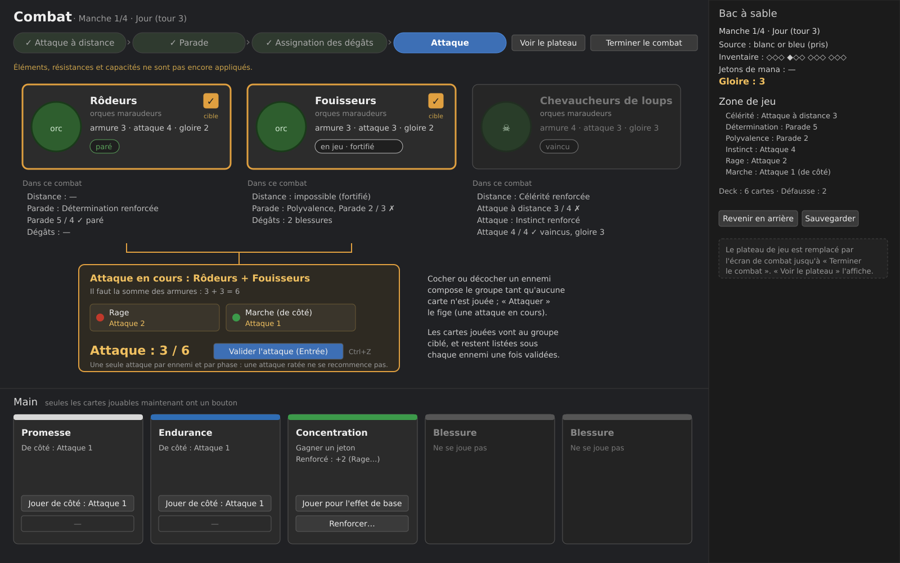
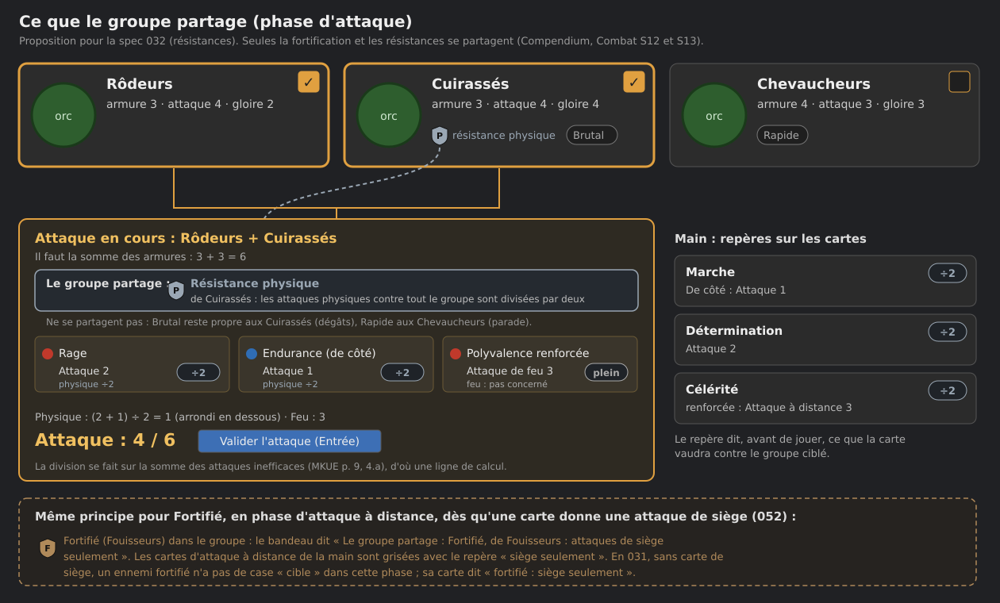

# 031 — Déroulé d'un combat

- Statut : implémentée (2026-10-29)
- Jalon : J3
- Dépend de : 013 (jouer des cartes), 016 (fin du tour), 022 (effets renforcés), 024 (retour en arrière), 030 (ennemis errants et
  provocation)
- Livret : MKUE p. 6 (6.b à 6.e), p. 8 (*Combat with Enemies* 1.d, 1.e, 2.a, 2.c, 3 à 6), p. 9 (*Ranged and Siege Attack Phase*,
  *Block Phase*, *Assign Damage Phase* 1 à 5.b), p. 10 (*Attack Phase* ; *Combat Outcomes* 1, 2.a, 3.a), p. 11 (*Wounds and
  Healing* 1), p. 3 (*Enemy and Ruin token piles* ; *Wound pile* ; niveau 1 : armure 2), p. 4 (*Deed Cards* 3.d, 3.e, 6.a), p. 5
  (*Reverting*) ; FAQ p2 (*Cartes*, les points d'une carte ne se partagent pas entre deux parades) ; Compendium, *Combat* Q1, S4,
  S12, S13, S28, S38, S41, S44, O46 (`docs/regles/faq/compendium/07-combat.md`)
- Crates touchées : arcanum-core, arcanum-ui, `assets/i18n/` (fr.json et en.json)

## Objectif

Le joueur combat enfin les ennemis errants qu'il a provoqués (spec 030) ou qu'il défie depuis une case voisine. Le combat suit les
quatre phases du livret : attaque à distance, parade, dégâts, attaque. Un ennemi vaincu quitte le plateau de jeu et rapporte sa
gloire ; un ennemi qui n'est ni vaincu ni paré blesse le héros, et les cartes Blessure arrivent dans la main.

Éléments et résistances (032), capacités des ennemis (033), assommé et soins (034), montée de niveau (035) viennent ensuite : en
attendant, ce qu'ils changent est **ignoré**, et dit comme tel (Q1).

## Règles

### Engager le combat

- **Ennemis provoqués** (MKUE p. 8, 1.e et 2.a ; p. 6, 6.b) : déjà inscrits à combattre par la spec 030. Le combat devient
  **obligatoire** : on ne peut plus finir son tour sans l'avoir mené (fin du provisoire de la spec 030, Q1).
- **Défier** (MKUE p. 6, 6.c ; p. 8, 1.d) : depuis une case voisine d'un jeton d'ennemi errant, le joueur peut le défier ; il
  rejoint les ennemis à combattre. On peut en défier plusieurs, un par un.
- **Défier après une provocation** (MKUE p. 8, 2.c, première puce) : après une provocation, la figurine est sur la case où elle est
  entrée ; défier un ennemi voisin de la figurine, c'est donc défier un ennemi voisin de cette case. Même action que ci-dessus.
- **Fin du déplacement** (MKUE p. 6, 6.d et 6.e) : défier commence l'action du tour, comme une provocation : plus de déplacement
  ni d'exploration, points de mouvement et d'influence perdus.
- **Un seul combat par tour** (MKUE p. 8, 2) : une fois le combat terminé, plus de défi ni de combat jusqu'à la fin du tour.
- **Début du combat** (MKUE p. 8, 3) : le joueur **engage le combat** quand il a fini de défier (Q4). Les ennemis errants sont déjà
  face visible : rien n'est tiré. Les ennemis du combat sont alors fixés. Pour le Compendium (*Combat* Q1), le combat commence dès
  la provocation ou le défi, et on ne peut plus s'en retirer (S4) : « Engager le combat » n'est donc qu'un temps pour déclarer les
  défis, rien d'autre n'y est jouable.

### Les quatre phases

- **Ordre** (MKUE p. 8, 3.a à 3.d) : attaque à distance et de siège, parade, dégâts, attaque. Le joueur passe d'une phase à la
  suivante quand il veut (« Phase suivante »), sauf la phase d'assignation des dégâts, qui se résout seule (Q3).
- **Une attaque** (MKUE p. 9, *Ranged and Siege Attack Phase* 2, 5, 6 et 7) : le joueur choisit d'abord les **cibles** (un ou
  plusieurs ennemis encore en jeu), puis joue les cartes de l'attaque, puis la **valide**. Si le total atteint la somme des armures
  des cibles, elles sont toutes vaincues ; sinon, rien, et les cartes jouées restent jouées. Une seule attaque en cours à la fois ;
  autant d'attaques que le joueur veut dans une phase.
- **Pas de réserve de points** (MKUE p. 9, *Ranged and Siege Attack Phase* 8 ; *Block Phase* 10 ; FAQ p2) : on ne joue une carte
  d'attaque que dans une attaque en cours, une carte de parade que dans une parade en cours ; ses points y restent, ils ne se
  partagent pas entre deux attaques ou deux parades. Le gabarit « cibles d'abord » l'impose sans compter les points. Les points en
  trop sont perdus, et une attaque ratée ne laisse rien pour la suite (Compendium, *Combat* S44). Un groupe de cibles est vaincu en
  entier ou pas du tout (S13). **Une seule attaque par ennemi et par phase** (décision de Mathieu, Q10, avec l'avis du
  Compendium, *Combat* S28) : un ennemi ciblé par une attaque ratée ne peut plus être ciblé avant la phase suivante.
- **Reprendre** (MKUE p. 9, *Ranged and Siege Attack Phase* 6.a ; p. 5, *Reverting*) : retirer les cartes et annuler une attaque,
  c'est revenir en arrière (Ctrl+Z, spec 024). Aucun événement du combat n'est un point de non-retour (Q9).
- **Phase d'attaque à distance et de siège** (MKUE p. 9, *Ranged and Siege Attack Phase* 3) : seulement des effets d'**attaque à
  distance** (Célérité renforcée, Polyvalence), jamais une carte de côté (3.b). Un ennemi **fortifié** (capacité imprimée
  sur le jeton, Creuseurs) ne peut être ciblé que par des attaques de siège (3.a) ; aucune carte du jeu actuel n'en donne, donc
  un ennemi fortifié n'est pas une cible possible dans cette phase, ni seul ni dans un groupe (Compendium, *Combat* S12 et S13 ;
  Q1). Les sites fortifiés : spec 043.
- **Phase de parade** (MKUE p. 9, *Block Phase* 1, 3 à 10) : le joueur choisit **un** ennemi encore en jeu qui attaque, joue des
  parades (cartes ou de côté, Parade 1 physique) et valide. Si le total atteint l'attaque de l'ennemi, il est **paré** ; sinon,
  rien (pas de demi-parade, 8). Un ennemi paré n'inflige pas de dégâts mais reste en jeu (7). Un ennemi par parade, autant de
  parades que d'ennemis (9).
- **Phase d'assignation des dégâts** (MKUE p. 9, *Assign Damage Phase* 1 à 3 et 5.a, 5.b) : chaque ennemi en jeu, qui attaque et n'est pas paré,
  inflige son attaque au héros : une Blessure par tranche entamée de 2 points (armure 2 au niveau 1, MKUE p. 3 ; la spec 035 la
  fera varier). Chaque ennemi se compte à part : attaques 3 et 5 donnent 2 + 3 Blessures, pas 4 (Compendium, *Combat* S38). Sans
  unité (spec 042), il n'y a rien à choisir : la phase se résout seule, ennemi par ennemi dans l'ordre du
  combat (Q3). S'il n'y a aucun dégât, elle est sautée (1.a).
- **Phase d'attaque** (MKUE p. 10, *Attack Phase*) : comme la première phase, mais toute attaque compte (mêlée et distance
  ensemble, 1.a), la fortification ne compte plus, et une carte de côté donne Attaque 1 physique (1.b). Les ennemis parés sont des
  cibles comme les autres.
- **Autres cartes en combat** (MKUE p. 8, *Combat with Enemies* 4 à 6) : les effets qui font gagner du mana (jetons, cristaux, dés)
  se jouent dans toutes les phases. Mouvement et Influence ne se jouent pas pendant le combat (ni effet ni de côté) : l'action a
  commencé, ces points seraient perdus (MKUE p. 6, 6.e).

### Ennemi vaincu, gloire, fin du combat

- **Ennemi vaincu** (MKUE p. 9, *Ranged and Siege Attack Phase* 5.a) : son jeton quitte aussitôt le plateau de jeu et va dans la
  **défausse de sa couleur** ; il ne prend plus part au combat. Sa case redevient une case vide (MKUE p. 10, *Combat Outcomes* 2.a) :
  on peut y entrer, elle ne provoque plus. La figurine ne va pas sur la case de l'ennemi vaincu (Compendium, *Combat* S41).
- **Gloire** (MKUE p. 9, *Ranged and Siege Attack Phase* 5.b) : le joueur gagne la gloire imprimée sur chaque jeton vaincu. Elle
  s'additionne dans un total de gloire, affiché ; piste de gloire et montée de niveau : spec 035.
- **Fin du combat** (MKUE p. 10, *Combat Outcomes* 1 et 3.a) : le joueur termine le combat depuis la phase d'attaque. Un ennemi
  errant non vaincu reste sur sa case, face visible. Après le combat, le joueur peut encore jouer des cartes, mais plus pour
  du Mouvement (MKUE p. 6, 5, dernier tiret, et 6.d ; issue privée 164), puis finit son tour.
- **Réputation** des ennemis errants vaincus (+1 par orque, +2 par draconien, MKUE p. 10, *Combat Outcomes* 2.a) : spec 040 (Q6).
- **Défausse et remélange** (MKUE p. 3, *Enemy and Ruin token piles*) : quand une tuile révélée demande un jeton à une pile vide, sa
  défausse est mélangée pour refaire la pile, puis le jeton est tiré (reporté par la spec 030, L5).

### Blessures

- **Blessure en main** (MKUE p. 11, *Wounds and Healing* 1 ; p. 3, *Wound pile*) : chaque blessure du héros est une carte
  Blessure prise dans la pile de blessures (illimitée) et mise dans la main.
- **Ce qu'on ne fait pas d'une Blessure** (MKUE p. 4, 3.d, 3.e et 6.a ; p. 11, *Wounds and Healing* 1.a ; p. 11, *End of the Turn*
  7.a) : elle ne se joue pas, ni pour un effet ni de côté ; elle ne paie pas le coût « défausser une autre carte » (Improvisation)
  ; elle ne se défausse pas à la fin du tour. Elle compte dans la main : on repioche moins (MKUE p. 11, *End of the Turn* 7.b et 7.c).
- **Nouvelle manche** (MKUE p. 11, *Wounds and Healing* 1.c) : les Blessures de la main sont mélangées dans le deck avec les autres
  cartes (déjà le cas : la spec 023 mélange main, défausse et zone de jeu).
- **Repos long** (MKUE p. 6, 7.a, *Slow Recovery*) : si la main ne contient que des Blessures et qu'aucune carte n'a été
  jouée ce tour, la seule fin de tour défausse une Blessure, au choix ; sans cela, aucune action ne serait légale (Q12).
- **Assommé**, repos normal, soins : spec 034 (Q2).

### Ce qui reste ignoré jusqu'aux specs 032 et 033 (Q1)

| Règle | Livret | En attendant | Spec |
|---|---|---|---|
| Parade efficace ou inefficace selon l'élément de l'attaque | p. 9, *Block Phase* 5 | toute parade compte pleinement | 032 (fait) |
| Résistances : attaque inefficace, divisée par deux | p. 9, *Ranged and Siege Attack Phase* 4 | toute attaque compte pleinement | 032 (fait) |
| Rapide (attaque doublée pour la parade) | p. 9, *Block Phase* 6.a | attaque normale | 033 (fait) |
| Brutal (dégâts doublés) | p. 9, *Assign Damage Phase* 2.a | dégâts normaux | 033 (fait) |
| Poison, Paralysie | p. 10, 6.a et 6.b | sans effet | 033 (fait) |
| Invocation (Invocateurs orques) | p. 9, *Block Phase* 2 ; p. 10, 6.c | l'ennemi n'attaque pas : ni parade ni dégâts ; on peut le vaincre | 033 (fait) |

Fortifié, lui, s'applique dès cette spec (phase d'attaque à distance ci-dessus).

### Exemple : combattre les Rôdeurs provoqués depuis le village

État construit, bac à sable, Jour : la figurine est au village (2,−3), des Rôdeurs (armure 3, attaque 4, gloire 2) sur les orques ②
(3,−3). En main : Rage, Détermination, Endurance, Marche, Célérité. Un dé bleu est libre dans la Source.

| Étape | Action du joueur | Résultat |
|---|---|---|
| 1 | village → plaine (2,−2) | les Rôdeurs sont provoqués (spec 030) ; le déplacement est fini |
| 2 | « Engager le combat » | phase d'attaque à distance |
| 3 | « Phase suivante » | pas d'attaque à distance (Célérité renforcée demanderait un mana blanc) ; phase de parade |
| 4 | « Parer » les Rôdeurs, Détermination renforcée (dé bleu) : Parade 5, « Valider la parade » | 5 ≥ 4 : Rôdeurs parés |
| 5 | « Phase suivante » | aucun dégât, la phase d'assignation des dégâts est sautée ; phase d'attaque |
| 6 | cocher les Rôdeurs, « Attaquer », Rage (Attaque 2), Endurance de côté (Attaque 1), « Valider l'attaque » | 3 ≥ 3 : Rôdeurs vaincus, gloire 2 ; le jeton va dans la défausse verte, la case (3,−3) est vide |
| 7 | « Terminer le combat », puis finir le tour | Marche et Célérité restent en main |

Variante sans parade à l'étape 4 : les Rôdeurs infligent 4 points, soit 2 Blessures (armure 2), mises dans la main. Elles y restent
à la fin du tour et prennent 2 des 5 places de la limite de main.

```
 Déroulé (une flèche = une action du joueur, sauf ⚙ = automatique)

  provoquer / défier ──► Engager le combat
                               │
             ┌─────────────────▼──────────────────┐
             │ Attaque à distance                  │  Cibler ─► cartes ─► Valider (×n)
             └─────────────────┬──────────────────┘
                     Phase suivante
             ┌─────────────────▼──────────────────┐
             │ Parade                              │  Parer un ennemi ─► cartes ─► Valider (×n)
             └─────────────────┬──────────────────┘
                     Phase suivante
             ┌─────────────────▼──────────────────┐
             │ Dégâts ⚙                            │  Blessures en main (sautée sans dégât)
             └─────────────────┬──────────────────┘
             ┌─────────────────▼──────────────────┐
             │ Attaque                             │  Cibler ─► cartes ─► Valider (×n)
             └─────────────────┬──────────────────┘
                     Terminer le combat ──► jouer des cartes, finir le tour
```

## Modèle

### Termes

Termes du glossaire déjà présents : Ennemi errant, Provoquer, Ennemis à combattre, Jeton d'ennemi, Armure, Fortifié, Invocation,
Attaque, Attaque à distance, Attaque de siège, Parade, Gloire, Blessure, Jouée de côté.

Nouveaux termes, ajoutés au glossaire dans la même PR (à valider, Q7) :

| Livret (EN) | Français | Code |
|---|---|---|
| Combat (with enemies) | Combat | `Combat` |
| Challenge (a rampaging enemy) | Défier | `Action::Challenge`, `EnemyChallenged` (remplace « — (spec 031) ») |
| (start the combat) | Engager le combat | `Action::StartCombat`, `CombatStarted` |
| Ranged and Siege Attack phase | Phase d'attaque à distance | `CombatPhase::RangedAndSiege` |
| Block phase | Phase de parade | `CombatPhase::Block` |
| Assign Damage phase | Phase d'assignation des dégâts | `CombatPhase::AssignDamage` |
| Attack phase | Phase d'attaque | `CombatPhase::Attack` |
| (an) attack, its targets | Attaque (en cours), cibles | `Action::DeclareAttack { targets }`, `open_attack` |
| (a) block | Parade (en cours) | `Action::DeclareBlock { target }`, `open_block` |
| Defeat (an enemy) | Vaincre ; ennemi vaincu | `EnemiesDefeated` |
| Blocked (enemy) | Paré | `EnemyBlocked` |
| Enemy discard pile | Défausse d'ennemis | `enemy_discards` (une par `EnemyColor`) |
| Wound pile | Pile de blessures | — (illimitée, rien à modéliser) |
| Wound (card) | Blessure | `DeedCard::Wound` |

« Colonne » est déjà pris par les colonnes de tuiles : le livret range les cartes d'une attaque « en colonne », la spec dit « une
attaque » ou « une parade ».

### Nouvelles données dans l'état

- par joueur, le **combat** en cours ou fini ce tour, vidé par `TurnEnded` :
  - ses **ennemis** (case et jeton, dans l'ordre des ennemis à combattre), chacun en jeu, paré ou vaincu, et s'il a déjà été
    ciblé dans la phase en cours (Q10) ;
  - sa **phase** ;
  - l'**attaque en cours** (cibles, total de points) ou la **parade en cours** (cible, total), au plus une des deux ;
  - **terminé** ou non ;
  - son **historique**, pour l'écran de combat (« Dans ce combat », C36 bis) : chaque attaque et chaque parade validées (phase,
    cibles, cartes jouées, total, à atteindre, résultat) et les Blessures infligées par chaque ennemi, dans l'ordre ; ajouté à
    l'implémentation de l'écran, le journal filtré ne disant pas quelles cartes vont à quelle attaque ;
- par joueur, la **gloire** (total, jamais remis à zéro) ;
- les **six défausses d'ennemis**, publiques ;
- la carte **Blessure** : une nouvelle sorte de carte (`DeedCard::Wound`), chaque Blessure prise a son propre numéro d'exemplaire,
  comme `CardId` aujourd'hui (le moteur compte les Blessures déjà données). Le numéro tient sur 16 bits (65 535 exemplaires) :
  une longue partie, Toxique compris, dépasse 255 Blessures données (issue privée 76, décision de Mathieu du 2026-10-29).

Les points d'une attaque à distance, de siège ou de mêlée se distinguent déjà (`AttackKind`) ; l'élément (`Element`) est gardé sur
chaque carte jouée pour la spec 032, mais n'entre pas dans les totaux.

## Actions et événements

| Action | Validation (refusée si…) | Événements produits |
|---|---|---|
| `Challenge { enemy }` | pas de jeton d'ennemi errant sur `enemy`, ou case non voisine de la figurine ; déjà à combattre ; combat déjà engagé ce tour | `EnemyChallenged` |
| `StartCombat` | aucun ennemi à combattre ; combat déjà engagé ce tour | `CombatStarted` |
| `DeclareAttack { targets }` | pas en phase d'attaque à distance ni d'attaque ; une attaque ou une parade déjà en cours ; `targets` vide, ou une cible pas en jeu dans ce combat ; phase d'attaque à distance et une cible fortifiée ; une cible déjà ciblée dans cette phase (Q10) | `AttackDeclared` |
| `DeclareBlock { target }` | pas en phase de parade ; une parade déjà en cours ; `target` pas en jeu, déjà paré ou déjà visé par une parade ratée (Q10), ou qui n'attaque pas (invocation, Q1) | `BlockDeclared` |
| `PlayCard { card, play }` (013) | en plus, pendant le combat : une Attaque hors attaque en cours, ou de mêlée (ou de côté) en phase d'attaque à distance ; une Parade hors parade en cours ; Mouvement ou Influence ; partout : une Blessure | `CardPlayed` (inchangé ; ses points vont à l'attaque ou à la parade en cours) |
| `ResolveAttack` | pas d'attaque en cours | `EnemiesDefeated` si le total atteint la somme des armures, sinon `AttackFailed` |
| `ResolveBlock` | pas de parade en cours | `EnemyBlocked` si le total atteint l'attaque, sinon `BlockFailed` |
| `NextCombatPhase` | pas de combat en cours ; une attaque ou une parade en cours ; phase d'attaque (on termine le combat) | `CombatPhaseStarted`, et depuis la parade : un `WoundsTaken` par ennemi qui inflige des dégâts, puis `CombatPhaseStarted { Attack }` |
| `EndCombat` | pas en phase d'attaque ; une attaque en cours | `CombatEnded` |
| `EndTurn` (016) | en plus : des ennemis à combattre et le combat pas terminé ; une Blessure dans `discard`, sauf le repos long (une seule Blessure, la main n'en contenant que des Blessures et aucune carte jouée, Q12) | inchangé |
| `Explore` (015) | inchangé | en plus, si une pile est vide au moment de poser un jeton : `EnemyPileReshuffled` avant ce `EnemyTokenPlaced` |

| Événement | Effet de `apply` | Révèle une information ? | Point de non-retour ? |
|---|---|---|---|
| `EnemyChallenged { player, enemy }` | `enemy` s'ajoute aux ennemis à combattre ; déplacement terminé ; points de mouvement et d'influence à 0 | oui, publique | non |
| `CombatStarted { player, enemies }` | combat créé, ennemis (case, jeton) en jeu, phase d'attaque à distance | oui, publique | non |
| `AttackDeclared { player, targets }` | attaque en cours sur `targets`, total 0 | oui, publique | non |
| `BlockDeclared { player, target }` | parade en cours sur `target`, total 0 | oui, publique | non |
| `CardPlayed` (013) | en plus : les points d'une Attaque ou d'une Parade s'ajoutent au total en cours | inchangé | inchangé (non) |
| `EnemiesDefeated { player, enemies, fame }` | ennemis vaincus, jetons retirés du plateau et mis dans la défausse de leur couleur ; gloire + `fame` ; plus d'attaque en cours | oui, publique | non |
| `AttackFailed { player }` | plus d'attaque en cours ; ses cibles restent marquées « déjà ciblées » jusqu'au prochain `CombatPhaseStarted` | oui, publique | non |
| `EnemyBlocked { player, enemy }` | ennemi paré ; plus de parade en cours | oui, publique | non |
| `BlockFailed { player }` | plus de parade en cours ; l'ennemi visé ne peut plus être paré dans ce combat (Q10) | oui, publique | non |
| `CombatPhaseStarted { player, phase }` | phase du combat | oui, publique | non |
| `WoundsTaken { player, enemy, wounds }` | les Blessures `wounds` (cartes) vont dans la main | oui, publique (nombre de Blessures) | non : la pile de blessures est face visible, rien n'est tiré |
| `CombatEnded { player }` | combat terminé | oui, publique | non |
| `EnemyPileReshuffled { color, order }` | la pile de `color` devient `order`, sa défausse est vidée | le nombre de jetons seulement | oui : hasard |
| `TurnEnded` (016) | en plus : combat vidé | inchangé | inchangé (oui) |

**Hasard.** Seul `EnemyPileReshuffled` tire au hasard, avec le générateur de la pile de cette couleur (spec 038) ; il suit toujours un
`TileRevealed`, déjà de non-retour.

**Dégâts.** `decide` calcule, pour chaque ennemi en jeu qui attaque et n'est pas paré, `ceil(attaque / 2)` Blessures, avec des numéros
d'exemplaire neufs, dans l'ordre des ennemis du combat.

**Actions légales**, pendant le combat, dans cet ordre : les cartes jouables (013, filtrées comme ci-dessus), puis les
`DeclareAttack` (sous-ensembles non vides des cibles possibles, par taille croissante puis dans l'ordre du combat) ou les
`DeclareBlock` (dans l'ordre du combat), puis `ResolveAttack` / `ResolveBlock`, puis `NextCombatPhase` ou `EndCombat`. Hors combat :
les `Challenge` (dans l'ordre de `Hex::neighbors`) après les explorations, puis `StartCombat`, avant les fins de tour. Entre une
provocation ou un premier défi et `StartCombat`, seuls `Challenge` et `StartCombat` sont légaux (Compendium, *Combat* Q1). Aucune fin de
tour tant qu'un combat obligatoire n'est pas terminé. Toujours au moins une action légale : `ResolveAttack`, `ResolveBlock`,
`NextCombatPhase` ou `EndCombat` selon le moment.

## Comportements attendus

Chaque cas devient au moins un test (nom indicatif entre parenthèses). Sauf mention, bac à sable avec Arythea, état construit par
événements, des Rôdeurs (armure 3, attaque 4, gloire 2) sur (3,−3).

Engager le combat (arcanum-core) :

- **C1** — Après une provocation, aucune fin de tour n'est légale ; `StartCombat` l'est (`provoked_combat_is_mandatory`) — MKUE
  p. 6, 6.b.
- **C2** — Figurine voisine d'un jeton, sans provocation : `Challenge` est légal ; il produit `EnemyChallenged`, les points de
  mouvement tombent à 0, plus de `MoveHero` ni d'`Explore` (`challenging_starts_the_action`) — MKUE p. 8, 1.d ; p. 6, 6.d et 6.e.
- **C3** — Après une provocation, un second jeton voisin de la figurine peut être défié ; `CombatStarted` contient les deux, dans
  l'ordre (`challenge_after_provocation_joins_the_fight`) — MKUE p. 8, 2.c.
- **C4** — Un jeton non voisin, ou déjà à combattre, n'est pas défiable (`only_adjacent_new_enemies_can_be_challenged`).
- **C5** — Après `CombatEnded`, plus de `Challenge` ni de `StartCombat` jusqu'à la fin du tour (`one_combat_per_turn`) — MKUE p. 8, 2.

Phase d'attaque à distance (arcanum-core) :

- **C6** — Célérité renforcée (Attaque à distance 3) dans une attaque sur les Rôdeurs, validée : `EnemiesDefeated` avec gloire 2 ; le
  jeton n'est plus sur le plateau de jeu, il est dans la défausse verte ; la gloire du joueur vaut 2
  (`ranged_attack_defeats_enemy_and_gains_fame`) — MKUE p. 9, 5.
- **C7** — Polyvalence (Attaque à distance 1) seule : `AttackFailed`, la carte reste dans la zone de jeu, l'ennemi est en
  jeu (`insufficient_attack_has_no_effect`) — MKUE p. 9, 6.
- **C8** — En phase d'attaque à distance, ni Attaque de mêlée ni carte de côté ne sont légales, même avec une attaque en cours
  (`ranged_phase_accepts_only_ranged_attacks`) — MKUE p. 9, 3 et 3.b.
- **C9** — Des Creuseurs (fortifiés) ne sont pas une cible possible en phase d'attaque à distance, mais le sont en phase d'attaque
  (`fortified_enemy_cannot_be_targeted_at_range`) — MKUE p. 9, 3.a ; p. 10, 1.a.
- **C10** — Sans attaque en cours, aucune carte d'Attaque n'est légale ; une carte qui fait gagner du mana l'est
  (`attack_cards_need_an_open_attack`) — MKUE p. 9, 8 ; p. 8, 6.
- **C11** — Deux ennemis (armures 3 et 4) ciblés ensemble : il faut 7 ; avec 7, les deux sont vaincus et la gloire est la somme
  (`one_attack_can_defeat_several_enemies`) — MKUE p. 9, 5 et 7.
- **C11 bis** — Après une attaque ratée sur les Rôdeurs, aucun `DeclareAttack` ne les contient plus dans cette phase ; en phase
  d'attaque, ils sont de nouveau une cible possible (`failed_target_cannot_be_attacked_again_this_phase`) — Q10 ; Compendium,
  *Combat* S28.

Phase de parade (arcanum-core) :

- **C12** — Parer les Rôdeurs avec Détermination renforcée (Parade 5) : `EnemyBlocked` ; ils restent en jeu
  (`block_equal_or_above_attack_blocks_enemy`) — MKUE p. 9, *Block Phase* 6 et 7.
- **C13** — Parade 2 + une carte de côté (Parade 1) contre attaque 4 : `BlockFailed`, les deux cartes restent jouées, l'ennemi n'est
  pas paré (`insufficient_block_has_no_effect`) — MKUE p. 9, *Block Phase* 4.b et 8.
- **C14** — Une parade ne cible qu'un ennemi ; un ennemi déjà paré n'est plus une cible de parade
  (`block_targets_one_unblocked_enemy`) — MKUE p. 9, *Block Phase* 3 et 9.
- **C14 bis** — Après une parade ratée contre les Rôdeurs, aucun `DeclareBlock` ne les vise plus
  (`failed_block_cannot_be_retried`) — Q10.
- **C15** — Sans parade en cours, aucune carte de Parade n'est légale (`block_cards_need_an_open_block`) — MKUE p. 9, *Block
  Phase* 10.

Phase d'assignation des dégâts (arcanum-core) :

- **C16** — Rôdeurs non parés : en passant à la phase suivante, `WoundsTaken` avec 2 Blessures (4 points, armure 2), dans la main
  (`unblocked_enemy_wounds_the_hero`) — MKUE p. 9, *Assign Damage Phase* 2 et 5.
- **C17** — Attaque 3 : 2 Blessures (tranche entamée) ; attaque 5 : 3 ; les deux ennemis non parés dans le même combat : 5
  Blessures, comptées ennemi par ennemi (`wounds_round_up_against_armor`) — MKUE p. 9, 5.b ; Compendium, *Combat* S38.
- **C18** — Ennemi paré ou vaincu : aucun `WoundsTaken` ; la phase d'assignation des dégâts est sautée, on arrive en phase d'attaque
  (`no_damage_skips_the_phase`) — MKUE p. 9, *Assign Damage Phase* 1.a.

Phase d'attaque et fin du combat (arcanum-core) :

- **C19** — Rage (Attaque 2) + une carte de côté (Attaque 1) sur les Rôdeurs parés : vaincus (`melee_and_sideways_attack_in_attack_phase`)
  — MKUE p. 10, 1.b.
- **C20** — Célérité renforcée (à distance) jouée en phase d'attaque compte avec les attaques de mêlée
  (`ranged_attack_counts_in_attack_phase`) — MKUE p. 10, 1.a.
- **C21** — `EndCombat` sans avoir vaincu : le jeton reste sur sa case ; le joueur peut finir son tour
  (`undefeated_rampaging_enemy_stays`) — MKUE p. 10, *Combat Outcomes* 3.a.
- **C22** — Après la victoire, la case de l'ennemi n'est plus occupée : on peut y entrer au tour suivant et longer la case ne
  provoque rien (`defeated_enemy_space_is_empty`) — MKUE p. 10, *Combat Outcomes* 2.a.
- **C23** — Pendant le combat, ni Mouvement ni Influence ne sont légaux, ni pour l'effet ni de côté
  (`move_and_influence_are_not_played_in_combat`) — MKUE p. 6, 6.e.

Provisoire jusqu'aux specs 032 et 033 (arcanum-core, Q1) :

- **C24** — Des Invocateurs orques n'attaquent pas : pas de cible de parade, aucune Blessure ; ils se vainquent en phase d'attaque
  (`summoner_does_not_attack_yet`).
- **C25** — Une Parade de glace compte pleinement contre une attaque physique, et une attaque physique compte pleinement contre des
  Cogneurs (résistance physique) (`elements_and_resistances_are_ignored_yet`).

Blessures (arcanum-core) :

- **C26** — Une Blessure en main n'a aucune action `PlayCard`, ni pour un effet ni de côté (`wound_cannot_be_played`) — MKUE p. 4,
  3.d.
- **C27** — Improvisation ne peut pas défausser une Blessure pour son coût (`wound_cannot_pay_a_discard_cost`) — MKUE p. 4, 6.a.
- **C28** — À la fin du tour, aucune fin de tour ne défausse une Blessure ; avec 2 Blessures et 1 autre carte en main, la repioche
  s'arrête à 5 cartes en main (`wounds_stay_in_hand_and_count_for_drawing`) — MKUE p. 11, 7.a à 7.c.
- **C28 bis** — Main de 2 Blessures seulement, deck non vide, aucune carte jouée : les seules fins de tour sont `EndTurn` qui
  défausse l'une ou l'autre Blessure (une chacune) ; celle choisie va dans la défausse, l'autre reste en main
  (`only_wounds_in_hand_allow_slow_recovery`) — MKUE p. 6, 7.a.
- **C29** — À la nouvelle manche, les Blessures de la main sont dans le deck mélangé (`wounds_are_shuffled_into_the_new_deck`) —
  MKUE p. 11, *Wounds and Healing* 1.c.

Piles, vue, journal, retour en arrière (arcanum-core) :

- **C30** — Pile verte vide, défausse verte de 2 jetons, une tuile révélée avec des orques : `EnemyPileReshuffled` (2 jetons) puis
  `EnemyTokenPlaced` (`empty_pile_reshuffles_its_discard`) — MKUE p. 3.
- **C31** — La vue montre le combat (ennemis et leur état, phase, attaque ou parade en cours et son total), la gloire, les défausses
  d'ennemis ; jamais l'ordre d'une pile (`view_shows_combat_and_fame`).
- **C32** — Journal filtré : `EnemyPileReshuffled` ne montre que le nombre de jetons ; les autres événements du combat sont montrés
  en entier (`filtered_log_hides_reshuffled_order`).
- **C33** — Rejouer le journal d'un combat complet redonne le même état (`replaying_log_rebuilds_combat`).
- **C34** — Revenir en arrière d'une décision depuis la phase d'attaque, après une victoire, jusqu'à avant `StartCombat` : chaque
  décision se reprend (`whole_combat_can_be_taken_back`) — MKUE p. 5, *Reverting* 1.

Affichage (arcanum-ui) :

- **C35** — Figurine voisine d'un jeton : le panneau propose « Défier Rôdeurs (orques maraudeurs) » ; avec des ennemis à combattre,
  le bandeau « À combattre : … » et « Engager le combat » ; en combat, plus aucun de ces boutons dans le panneau, les phases sont
  sur l'écran de combat (`panel_offers_challenge_and_start`).
- **C36** — Après `CombatStarted` et jusqu'à `CombatEnded`, l'écran calculé est l'écran de combat, pas le plateau de jeu ; « Voir
  le plateau » montre le plateau sans marque de déplacement, « Retour au combat » revient (`combat_screen_replaces_the_board`) — Q11.
- **C36 bis** — L'écran de combat montre les phases (faites, en cours), chaque ennemi avec ses valeurs et son état (en jeu, paré,
  vaincu), l'attaque ou la parade en cours avec « total / à atteindre » (« Attaque : 3 / 6 ») et les boutons légaux seulement ; sous
  chaque ennemi, les lignes « Dans ce combat » de ses attaques, parades et dégâts (`combat_screen_lists_enemies_totals_and_history`).
- **C37** — En phase d'attaque, cocher des ennemis puis « Attaquer » joue `DeclareAttack` avec les cases cochées ; « Attaquer » est
  grisé sans case cochée, et seuls les ennemis ciblables ont une case à cocher (`target_selection_declares_the_attack`).
- **C38** — Une Blessure s'affiche dans la main, sans bouton pour la jouer ; la gloire s'affiche dans le panneau
  (« Gloire : 2 ») (`hand_shows_wounds_and_panel_shows_fame`).
- **C39** — La case d'un ennemi vaincu ne montre plus le symbole imprimé des orques ; son survol ne parle plus d'ennemi
  (`defeated_enemy_space_shows_plain_terrain`) (Q5).
- **C40** — Avec le vrai `fr.json`, calculer le panneau dans chaque phase, avec une Blessure en main et un ennemi vaincu, ne relève
  aucun manque (`every_combat_key_exists_in_french`).

Vérification manuelle : `cargo run -p arcanum-ui` sous Linux (Xvfb, `scripts/verif-manuelle.sh`) ; captures du défi, de chaque phase, d'une
parade réussie, des Blessures en main et de la case vide après la victoire.

Faite le 2026-10-29 sous Xvfb, depuis une sauvegarde de l'arène des tests (Rôdeurs et Creuseurs voisins du village), captures
dans les fichiers du projet (`captures/`) : `spec-031-arene` (défis proposés), `spec-031-defi` (bandeau « À combattre »),
`spec-031-combat-distance` (Creuseurs fortifiés, sans case cible), `spec-031-parade-reussie`, `spec-031-cibles` et
`spec-031-attaque-groupee` (3 + 3 = 6), `spec-031-attaque-en-cours`, `spec-031-victoire` (Rôdeurs vaincus, gloire 2, Blessures en
main), `spec-031-voir-plateau`, `spec-031-case-vaincue` (colline sans symbole). Elle a fait corriger : la main proposait encore
« Renforcer : Mouvement 4 » en combat, le bandeau doublait l'écran de combat, l'historique d'un ennemi s'étalait à l'horizontale,
et ✓ / ✗ manquent aux polices d'egui.

## Cas limites et refus

- **L1** — Toute action de combat hors de son moment (cibler hors phase, valider sans attaque en cours, phase suivante avec une
  attaque en cours, `EndCombat` hors phase d'attaque) : `ActionError::NotLegal`, aucun événement.
- **L2** — Attaque validée à 0 point (cibles choisies, aucune carte) : `AttackFailed` ; aucune carte n'est perdue, mais ces cibles ne
  peuvent plus être attaquées dans cette phase (Q10). Pour changer d'avis sans cela : Ctrl+Z.
- **L3** — Héros sans carte en main pendant le combat : il passe les phases, prend ses Blessures, termine le combat.
- **L4** — Tous les ennemis vaincus avant la phase d'attaque (par exemple en phase d'attaque à distance) : les phases suivantes
  n'auraient plus de cible, donc seul `EndCombat` est légal (« Terminer le combat ») ; plus de « Phase suivante »
  (`combat_can_end_once_every_enemy_is_defeated`). Amendé le 2026-10-29 à la demande de Mathieu : la spec validée menait à la
  phase d'attaque avant de terminer.
- **L5** — Une carte à deux options (Rage : Attaque 2 ou Parade 2) : seule l'option qui sert dans le moment présent est légale.
- **L6** — Concentration renforcée sur une carte d'Attaque pendant une attaque en cours : les points renforcés (avec le bonus) vont à
  cette attaque (spec 025).
- **L7** — Beaucoup de Blessures : rien de particulier dans cette spec (assommé : spec 034). La main peut dépasser la limite de main ;
  on ne repioche pas (MKUE p. 11, 7.c).
- **L8** — Fin de manche annoncée par un autre joueur : hors périmètre (solo).
- **L9** — Défier un ennemi puis revenir en arrière : le défi se reprend, le déplacement aussi s'il n'y a pas eu de provocation.

## Information cachée

- Cachés : l'ordre de chaque pile d'ennemis (inchangé), y compris après un remélange ; le contenu de la main (inchangé).
- Publics : le combat entier (ennemis, phase, cibles, totaux, résultats), la gloire, les défausses d'ennemis, le nombre de Blessures
  reçues.

## Libellés (i18n)

| Clé | Paramètres | fr | en |
|---|---|---|---|
| `combat.challenge` | `enemy` | Défier {enemy} | Challenge {enemy} |
| `combat.start` | — | Engager le combat | Start the combat |
| `combat.to_fight` | `enemies` | À combattre : {enemies} | To fight: {enemies} |
| `combat.phase.ranged` | — | Phase d'attaque à distance | Ranged and siege attack phase |
| `combat.phase.block` | — | Phase de parade | Block phase |
| `combat.phase.damage` | — | Phase d'assignation des dégâts | Assign damage phase |
| `combat.phase.attack` | — | Phase d'attaque | Attack phase |
| `combat.enemy.in_play` | — | en jeu | in play |
| `combat.enemy.blocked` | — | paré | blocked |
| `combat.enemy.defeated` | — | vaincu | defeated |
| `combat.enemy.siege_only` | — | fortifié : siège seulement | fortified: siege only |
| `combat.enemy.no_attack` | — | n'attaque pas (invocation pas encore gérée) | does not attack (summon not handled yet) |
| `combat.attack` | — | Attaquer | Attack |
| `combat.block` | `enemy` | Parer {enemy} | Block {enemy} |
| `combat.attack_total` | `total`, `needed` | Attaque : {total} / {needed} | Attack: {total} / {needed} |
| `combat.block_total` | `total`, `needed` | Parade : {total} / {needed} | Block: {total} / {needed} |
| `combat.resolve_attack` | — | Valider l'attaque | Resolve the attack |
| `combat.resolve_block` | — | Valider la parade | Resolve the block |
| `combat.next_phase` | — | Phase suivante | Next phase |
| `combat.end` | — | Terminer le combat | End the combat |
| `combat.wounds` | `enemy`, `count` | {enemy} : {count} blessure(s) | {enemy}: {count} wound(s) |
| `combat.title` | — | Combat | Combat |
| `combat.show_board` | — | Voir le plateau | Show the map |
| `combat.back` | — | Retour au combat | Back to combat |
| `combat.target` | — | cible | target |
| `combat.needed_armor` | `sum` | Il faut la somme des armures : {sum} | Total armor needed: {sum} |
| `combat.history.title` | — | Dans ce combat | In this combat |
| `combat.history.attack` | `phase`, `cards`, `total`, `needed`, `result` | {phase} : {cards}, {total} / {needed} {result} | {phase}: {cards}, {total} / {needed} {result} |
| `combat.history.success` | — | réussie | succeeded |
| `combat.history.failure` | — | ratée | failed |
| `combat.history.damage` | `count` | Dégâts : {count} blessure(s) | Damage: {count} wound(s) |
| `combat.ignored` | — | Éléments, résistances et capacités ne sont pas encore appliqués. | Elements, resistances and abilities are not applied yet. |
| `card.wound.name` | — | Blessure | Wound |
| `fame.line` | `fame` | Gloire : {fame} | Fame: {fame} |

Le résultat d'une ligne « Dans ce combat » s'écrit en toutes lettres (`combat.history.success`, `combat.history.failure`) :
les polices fournies avec egui n'ont ni ✓ ni ✗ (constaté à la vérification à l'œil) ; la coche des phases faites est dessinée.

`combat.provoked` (spec 030) est remplacé par `combat.to_fight` : le bandeau liste aussi les ennemis défiés, que la vue ne
distingue pas des provoqués (« À combattre : Rôdeurs (orques maraudeurs) »). Les noms d'ennemis passent par `enemy.token`
(spec 030).

## Interface

- **Hors combat** : quand la figurine est voisine d'un jeton défiable, le panneau latéral ajoute un bouton « Défier … » par jeton ;
  avec des ennemis à combattre, le bandeau de la spec 030 liste les ennemis et porte « Engager le combat ». Le « ! » orange (spec
  030) va aussi sur les ennemis défiés.
- **Écran de combat** (demande de Mathieu à la relecture, Q11) : de « Engager le combat » à « Terminer le combat », la zone
  centrale n'affiche plus le plateau de jeu mais un **écran de combat**. Le panneau latéral reste (manche, Source, inventaire,
  jetons, gloire, zone de jeu, Revenir en arrière, Sauvegarder). Maquette (visuels provisoires, ennemis d'un état construit) :

  

  - **En haut** : les quatre phases en étapes (faites ✓, en cours en bleu, à venir grisées), « Phase suivante » ou « Terminer le
    combat » selon la phase, et « Voir le plateau », qui montre le plateau de jeu sans rien y permettre, puis « Retour au combat ».
    Dessous, la ligne « Éléments, résistances et capacités ne sont pas encore appliqués » (Q1).
  - **Une carte par ennemi** : son jeton (même visuel que sur le plateau de jeu), son nom et son groupe, ses valeurs, son état (en
    jeu, paré, vaincu, fortifié, n'attaque pas). Un ennemi vaincu reste affiché, grisé, jusqu'à la fin du combat.
  - **Grouper** (phases d'attaque) : chaque ennemi ciblable a une case « cible » ; cocher compose le groupe, « Attaquer » le fige
    (`DeclareAttack`). Un lien relie les ennemis du groupe à l'**attaque en cours**, qui liste les cartes jouées, donne « Il faut la
    somme des armures : 3 + 3 = 6 » et le total « Attaque : 3 / 6 », avec « Valider l'attaque (Entrée) ». Un ennemi déjà ciblé dans la
    phase n'a plus de case (Q10).
  - **Parer** (phase de parade) : chaque ennemi qui attaque et n'est pas paré a un bouton « Parer » sur sa carte ; la parade en cours
    s'affiche de la même façon, sous cet ennemi seul (« Parade : 2 / 4 »).
  - **Dans ce combat** : sous chaque ennemi, ce qui lui est arrivé, phase par phase : cartes jouées contre lui et résultat (« Parade :
    Détermination renforcée, Parade 5 / 4 ✓ paré »), Blessures infligées (« Dégâts : 2 blessures »). Une attaque de groupe s'inscrit
    sous chacun de ses ennemis. La phase d'assignation des dégâts, automatique, ne laisse que ces lignes.
  - **En bas, la main** : les cartes en grand, chacune avec les boutons des jeux possibles maintenant (effet de base, renforcer, de
    côté) ; une Blessure est grisée, sans bouton. Hors combat, la main reste où elle est aujourd'hui, dans le panneau latéral.
- **Main** : une Blessure s'affiche comme une carte, sans couleur ni bouton.
- **Ce que le groupe partage** (question de Mathieu à la relecture ; **pour la spec 032**, rien à afficher dans la 031) : seules la
  fortification et les résistances d'un ennemi s'étendent à tout son groupe (Compendium, *Combat* S12 et S13) ; Rapide, Brutal,
  Poison, Paralysie restent propres à leur ennemi. Proposition : un bandeau « Le groupe partage : » dans l'attaque en cours, une
  pastille par effet partagé (résistance physique, au feu, à la glace ; plus tard Fortifié avec les attaques de siège) reliée au
  badge de l'ennemi qui l'apporte ; chaque carte jouée porte « ÷2 » ou « plein », une ligne de calcul montre la division de la somme
  des attaques inefficaces (MKUE p. 9, 4.a), et les cartes de la main portent le même repère avant d'être jouées.

  

  Dans la 031, un ennemi fortifié n'a pas de case « cible » en phase d'attaque à distance ; sa carte dit « fortifié : siège
  seulement ».
- **Gloire** : une ligne « Gloire : N » sous les points de mouvement et d'influence.
- **Plateau de jeu** : la case d'un ennemi errant vaincu se dessine comme son terrain seul, sans le symbole imprimé (Q5).
- Pas de confirmation avant « Valider » ni « Phase suivante » : Ctrl+Z reprend (spec 024).

### Raccourcis clavier

Proposition (Q8), à reporter dans `docs/raccourcis.md` :

| Touche | Effet | Contexte |
|---|---|---|
| Entrée | Valider l'attaque ou la parade en cours | Partie, en combat, avec une attaque ou une parade en cours |

« Phase suivante », « Terminer le combat », « Défier » et « Engager le combat » n'ont pas de touche : un appui de trop sauterait une
phase ; Ctrl+Z le rattraperait, mais un bouton suffit pour une action par phase.

## Effets sur les specs déjà implémentées

Signalés ici parce que le sens de tests existants change :

- **030** : C18 (`provoked_enemies_stay_after_end_of_turn`) ne tient plus : après une provocation, on ne finit plus son tour sans
  combattre. Le test devient « combat terminé sans victoire, puis fin du tour : le jeton reste » (C21). C26
  (`panel_lists_provoked_enemies`) perd la phrase « Le combat n'est pas encore disponible… ». C16
  (`provocation_ends_movement_for_the_turn`) : jouer une carte après une provocation n'est plus légal avant « Engager le combat » ;
  le test vérifie à la place que seuls `Challenge` et `StartCombat` le sont.
- **011** : C16 (`printed_sites_and_enemies_get_an_overlay`) : le symbole imprimé d'un ennemi errant ne se dessine plus. En
  partie, un jeton le couvre toujours (spec 030) ; sans jeton, c'est un ennemi vaincu, dont la case se dessine comme son terrain
  seul (Q5). Le plateau de démonstration du test, sans jeton, n'a donc plus d'image sur les orques (constaté à l'implémentation).
- **013** : les cartes de côté gagnent Attaque 1 et Parade 1, seulement en combat ; hors combat, rien ne change. `playable_options`
  accepte Attaque et Parade en combat.
- **016** : les fins de tour ne proposent jamais de défausser une Blessure, sauf le repos long (Q12) ; sans Blessure, la
  liste des fins de tour est inchangée.
- **024** : `Event::blocks_undo` gagne les nouveaux événements (colonne « Point de non-retour ? »). Les sauvegardes d'avant restent
  lisibles tant qu'il n'y a pas eu de combat (aucun événement existant ne change de forme) ; pas de migration avant la fin du J6.
- **019** (parcours J1) : au tour 3, le pas vers le nouveau village longe les orques de la tuile 2 et les provoque (inoffensif
  avec la spec 030). Le parcours mène désormais ce combat sans jouer de carte et prend ses Blessures ; ses comptes de cartes
  tiennent compte des Blessures (corrigé à l'implémentation : la spec disait que le parcours ne provoquait rien).
- **028** (parcours J2) : il ne provoque ni ne défie ; inchangé.
- **`PlayerView`**, construit champ par champ dans des tests (arcanum-ui), gagne le combat, la gloire et les défausses d'ennemis.

## Hors périmètre

- Éléments et résistances : spec 032. Capacités Rapide, Brutal, Poison, Paralysie, Invocation (et le tirage d'un jeton marron) :
  spec 033.
- Assommé, repos, soins (et Tranquillité, Rajeunissement) : spec 034.
- Piste de gloire, montée de niveau, armure et limite de main selon le niveau : spec 035.
- Réputation gagnée en battant un ennemi errant : spec 040.
- Unités en combat (dégâts aux unités, choix de l'ordre des dégâts) : spec 042.
- Assaut d'un site fortifié, défenseurs fortifiés, double fortification, retraite après un assaut raté, ennemis errants qui
  rejoignent un assaut (MKUE p. 8, 1.a, 2.b et 2.c seconde puce) : spec 043. Sites d'aventure, monastère brûlé, récompenses de
  combat : spec 044.
- Attaques de siège : aucune carte du jeu actuel n'en donne ; elles viendront avec la première qui en a (052).
- Trajet en un clic : spec 036. Parcours du J3 : spec 039.
- Combat entre joueurs : hors périmètre du plan.

## Décisions prises à la relecture

Mathieu a validé la spec le 2026-10-29 (« Ok avec tes propositions : spec validée »), avec toutes les propositions :

1. **Q1** — Combat avec les ennemis verts et rouges dès la 031 ; éléments, résistances et capacités ignorés jusqu'à 032 et 033, sauf
   Fortifié ; un Invocateur orque n'attaque pas jusqu'à la 033 ; une ligne de l'écran le dit.
2. **Q2** — Blessures en main dans la 031 ; assommé, repos et soins dans la 034.
3. **Q3** — Phase d'assignation des dégâts automatique tant qu'il n'y a pas d'unité (042).
4. **Q4** — « Engager le combat » est une action à part, qui ne permet que de déclarer d'autres défis.
5. **Q5** — La case d'un ennemi errant vaincu se dessine comme son terrain seul.
6. **Q6** — Réputation : rien avant la spec 040.
7. **Q7** — Termes du glossaire acceptés.
8. **Q8** — Entrée valide l'attaque ou la parade en cours ; pas de touche pour « Phase suivante ».
9. **Q9** — Aucun événement du combat n'est un point de non-retour, sauf le remélange d'une pile d'ennemis.
10. **Q10** (sur la PR privée 62) — Une seule attaque par ennemi et par phase, comme le propose l'auteur du Compendium (*Combat* S28) :
    après une attaque ratée, ses cibles ne peuvent plus être attaquées avant la phase suivante (C11 bis, L2). De même pour la parade :
    après une parade ratée, l'ennemi ne peut plus être paré (C14 bis).
11. **Q11** — Écran de combat à part, comme la maquette : main en bas pendant le combat seulement, « Voir le plateau » en simple
    consultation, ennemi vaincu grisé jusqu'à la fin du combat, historique rangé par ennemi.

12. **Q12** (pendant l'implémentation, 2026-10-29) — Une main faite seulement de Blessures, sans carte jouée, bloquait la partie :
    le repos long (MKUE p. 6, 7.a) vient dès la 031 (C28 bis) ; le repos normal reste pour la 034.

Autres choix de relecture : *Challenge* reste « défier » ; *Assign Damage phase* se dit « phase d'assignation des dégâts » ; le
bandeau « Le groupe partage » va avec la spec 032. Plan de développement : [`plans/031-deroule-combat.md`](plans/031-deroule-combat.md).

## Questions ouvertes

Aucune.
