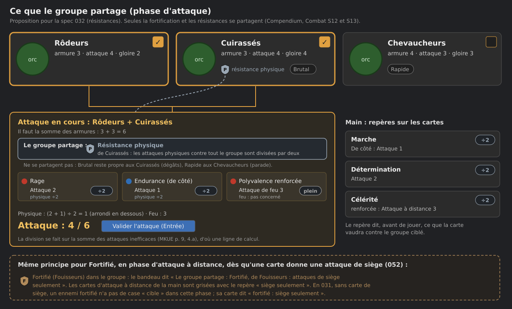
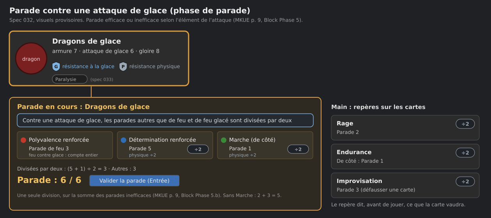

# 032 — Éléments et résistances

- Statut : implémentée (2026-10-29)
- Jalon : J3
- Dépend de : 031 (déroulé d'un combat), 029 (contenu en données), 025 (Concentration)
- Livret : MKUE p. 9 (*Ranged and Siege Attack Phase* 3, 3.a, 4, 7.b ; *Block Phase* 4.b, 5, 6), p. 10 (*Attack Phase* 1.b, 2), p. 24
  (*Offensive* : attaques de feu, de glace, de feu glacé ; *Defensive* : résistances) ; Compendium, *Combat* S4a, S4b, S4c, S5,
  S12, S37, S48 (`docs/regles/faq/compendium/07-combat.md`), *Concentration* S2 et S3 (`23-basic-action-cards.md`). La FAQ
  officielle ne dit rien des éléments.
- Crates touchées : arcanum-core (règles, contenu), arcanum-ui, arcanum-persistance (une partie préparée), `assets/i18n/` (fr.json et en.json)

## Objectif

Les éléments comptent enfin dans le combat. Une parade qui n'est pas du bon élément ne vaut que la moitié, et une attaque contre un
ennemi résistant à son élément aussi. La résistance d'un ennemi pèse sur tout le groupe qu'il rejoint dans une attaque. L'écran de
combat marque « ÷2 » une carte qui comptera à moitié, avant qu'elle soit jouée, et montre le calcul.

Avec la Polyvalence renforcée d'Arythea (Q1), le joueur a ses premières attaques et parades de feu, et sa première attaque de siège.

## Règles

### Éléments des attaques et des parades

- **Quatre éléments** (MKUE p. 9, *Ranged and Siege Attack Phase* 3 ; *Block Phase* 4) : physique, feu, glace, feu glacé. Une
  Attaque ou une Parade sans élément écrit est physique (Compendium, *Combat* S5) ; une carte jouée de côté donne toujours une
  Attaque 1 ou une Parade 1 physique (MKUE p. 9, *Block Phase* 4.b ; p. 10, *Attack Phase* 1.b).
- **Ce qui donne un élément aujourd'hui** : la Parade de glace 3 d'Endurance au froid (Tovak, déjà dans le contenu), et la Polyvalence
  renforcée d'Arythea : Attaque 4, Parade 4, Attaque de feu 3, Parade de feu 3, Attaque à distance 3 ou Attaque de siège 2
  (`docs/regles/cartes/actions-de-base.md`, Q1). Aucune carte n'en donne de feu glacé : le calcul le prévoit quand même, testé sans
  carte (C9, C14).
- **Concentration renforcée** (spec 025) garde l'élément de la carte renforcée : Attaque de feu 3 + 2 donne une Attaque de feu 5
  (Compendium, *Concentration* S2 et S3).
- **Dégâts au héros** : l'élément ne change rien, une attaque de feu glacé de 9 inflige 9 points (Compendium, *Combat* S4b). Les
  résistances des unités (MKUE p. 9, *Assign Damage Phase* 4.b) : spec 042.

### Parade efficace ou inefficace

- **Quelle parade est efficace** (MKUE p. 9, *Block Phase* 5.a ; p. 24, *Offensive*) :

  | Attaque de l'ennemi | Parades efficaces | Parades inefficaces |
  |---|---|---|
  | Physique | toutes | aucune |
  | Feu | glace, feu glacé | physique, feu |
  | Glace | feu, feu glacé | physique, glace |
  | Feu glacé | feu glacé | physique, feu, glace |

- **Total de la parade** (MKUE p. 9, *Block Phase* 5.b) : la somme des parades inefficaces, divisée par deux et arrondie en
  dessous, plus la somme des parades efficaces. Une seule division, toutes parades inefficaces confondues. La parade réussit si ce
  total atteint l'attaque de l'ennemi (6), comme dans la 031.

### Attaque contre une résistance

- **Résistances** (MKUE p. 24, *Defensive*) : la résistance physique rend inefficaces les attaques physiques (cartes de côté
  comprises), la résistance au feu les attaques de feu, la résistance à la glace les attaques de glace. Une attaque de feu glacé n'est
  inefficace que si un **même** ennemi ciblé résiste au feu et à la glace (MKUE p. 9, *Ranged and Siege Attack Phase* 4.a, puce).
- **Le groupe partage les résistances** (MKUE p. 9, *Ranged and Siege Attack Phase* 4.a et 7.b ; Compendium, *Combat* S12) : il
  suffit qu'**un** ennemi ciblé ait la résistance pour que l'attaque de cet élément soit inefficace contre tout le groupe. Une
  attaque de feu glacé sur un groupe dont un ennemi résiste au feu et un autre à la glace reste efficace : aucun des deux n'a les
  deux résistances.
- **Total de l'attaque** (MKUE p. 9, *Ranged and Siege Attack Phase* 4.a) : la somme des attaques inefficaces, divisée par deux et
  arrondie en dessous, plus la somme des autres. Une seule division, comme pour la parade. Le reste ne change pas : il faut atteindre
  la somme des armures des cibles (5).
- **Dans les deux phases d'attaque** (MKUE p. 10, *Attack Phase* 2 ; Compendium, *Combat* S37) : mêmes règles en phase d'attaque à
  distance et en phase d'attaque. Seules la fortification et les résistances s'étendent au groupe ; les capacités (Rapide, Brutal…)
  restent propres à leur ennemi (Compendium, *Combat* S12, déjà dit par la 031).
- **Effets autres qu'Attaque ou Parade des cartes rouges ou bleues** (MKUE p. 8, *Combat with Enemies* 5.a à 5.c ; Compendium,
  *Combat* S48) : aucune carte du jeu actuel n'en a qui vise un ennemi. Rien à faire ici ; la règle viendra avec la première carte
  qui en a (052, sorts et actions avancées).

### Attaque de siège (Q1)

- **Siège** (MKUE p. 9, *Ranged and Siege Attack Phase* 3 et 3.a) : la Polyvalence renforcée donne la première attaque de siège du
  jeu. En phase d'attaque à distance, une attaque de siège se joue toujours ; une attaque à distance seulement si aucune cible n'est
  fortifiée. En phase d'attaque, siège et distance comptent comme des attaques ordinaires (MKUE p. 10, *Attack Phase* 1.a).
- **Un ennemi fortifié redevient une cible en phase d'attaque à distance** : la 031 l'excluait parce qu'aucune carte ne donnait
  de siège. Il peut être ciblé, seul ou dans un groupe ; l'attaque en cours n'accepte alors que des attaques de siège (le groupe
  partage la fortification, Compendium, *Combat* S12). Le jeu ne vérifie pas que le joueur a une attaque de siège en main : comme
  pour toute attaque, valider sans assez de points la rate (spec 031, L2), et Ctrl+Z reprend.

### Exemples

**Attaque d'un groupe avec une résistance physique.** Phase d'attaque, Rôdeurs (armure 3) et Cogneurs (armure 3, résistance
physique) ciblés ensemble : il faut 6. Rage (Attaque 2), Endurance de côté (Attaque 1), Polyvalence renforcée (Attaque de feu 3) :

| Carte | Points | Compte |
|---|---|---|
| Rage | Attaque 2 (physique) | divisée par deux (les Cogneurs résistent au physique) |
| Endurance, de côté | Attaque 1 (physique) | divisée par deux |
| Polyvalence renforcée | Attaque de feu 3 | en plein (personne ne résiste au feu) |
| **Total** | (2 + 1) ÷ 2 = 1, arrondi en dessous, + 3 | **4 / 6** : attaque ratée |

Les Rôdeurs seuls (Rage + Endurance de côté, 3 / 3) seraient vaincus : séparer les ennemis résistants vaut souvent mieux (MKUE p. 9,
7.b).

**Parade contre une attaque de glace.** Phase de parade, Dragons de glace (attaque de glace 6) :

| Carte | Points | Compte |
|---|---|---|
| Polyvalence renforcée | Parade de feu 3 | en plein (le feu pare la glace) |
| Détermination renforcée | Parade 5 (physique) | divisée par deux |
| Marche, de côté | Parade 1 (physique) | divisée par deux |
| **Total** | 3 + (5 + 1) ÷ 2 = 3 + 3 | **6 / 6** : dragon paré |

Sans Marche, (5 ÷ 2 = 2) + 3 = 5 : parade ratée.

## Modèle

### Termes

Termes du glossaire déjà présents : Physique, Feu, Glace, Feu glacé (`Element`), Résistance, Attaque à distance, Attaque de siège,
Attaque de glace, Parade de glace, Fortifié.

Nouveaux termes, ajoutés au glossaire dans la même PR (à valider, Q4) :

| Livret (EN) | Français | Code |
|---|---|---|
| Efficient (block, attack) | Efficace | `Efficiency::Full` |
| Inefficient (halved) | Inefficace (divisée par deux) | `Efficiency::Halved` |
| Fire Attack / Fire Block | Attaque de feu / Parade de feu | `Attack` / `Block` avec `Element::Fire` |
| Cold Fire Attack / Cold Fire Block | Attaque de feu glacé / Parade de feu glacé | `Attack` / `Block` avec `Element::ColdFire` |

Le glossaire gagne une ligne pour le feu et une pour le feu glacé, à côté de celle de la glace.

### Données

- `Element` gagne `Fire` et `ColdFire` ; `AttackKind` gagne `Siege`. Le contenu (`basic_actions.ron`) gagne de quoi écrire une
  attaque ou une parade de chaque élément et une attaque de siège ; la Polyvalence renforcée y est décrite.
- L'**attaque ou la parade en cours** garde ses points **par élément** au lieu d'un seul total. Le total qui compte se calcule
  depuis ces points et les ennemis visés ; c'est lui qui est comparé à l'armure ou à l'attaque, montré par la vue et inscrit dans
  l'historique du combat (spec 031, C36 bis).
- Le moteur expose, pour l'écran, si un effet compterait en plein ou divisé par deux contre l'attaque ou la parade en cours, ou
  contre un ennemi visé (repères de la main, Interface). L'interface ne refait pas la règle.
- Aucun événement nouveau : `CardPlayed` porte déjà l'effet joué, avec son élément. Les sauvegardes d'avant restent lisibles
  (variantes ajoutées seulement).

## Actions et événements

| Action | Validation (refusée si…) | Événements produits |
|---|---|---|
| `DeclareAttack { targets }` (031) | inchangée, sauf : en phase d'attaque à distance, une cible fortifiée est permise (Q1) | `AttackDeclared` (inchangé) |
| `PlayCard { card, play }` (013, 031) | en plus, en phase d'attaque à distance : une Attaque à distance quand une cible de l'attaque en cours est fortifiée | `CardPlayed` (inchangé) |
| `ResolveAttack` (031) | inchangée | `EnemiesDefeated` si le total, inefficaces divisées par deux, atteint la somme des armures ; sinon `AttackFailed` |
| `ResolveBlock` (031) | inchangée | `EnemyBlocked` si le total, inefficaces divisées par deux, atteint l'attaque ; sinon `BlockFailed` |

| Événement | Effet de `apply` | Révèle une information ? | Point de non-retour ? |
|---|---|---|---|
| `CardPlayed` (013, 031) | les points d'une Attaque ou d'une Parade s'ajoutent à l'élément de l'effet, dans l'attaque ou la parade en cours | inchangé | inchangé (non) |

**Actions légales** : comme la 031, avec les `DeclareAttack` qui incluent les ennemis fortifiés en phase d'attaque à distance.

## Comportements attendus

Chaque cas devient au moins un test (nom indicatif entre parenthèses). Sauf mention, bac à sable avec Arythea, état construit par
événements comme les tests de la 031 (arène près du village) ; Cogneurs (armure 3, attaque 4, résistance physique), Dragon de
glace (armure 7, attaque de glace 6, résistances glace et physique), Dragons de feu (armure 7, attaque de feu 9, résistances feu et
physique), Dragons supérieurs (armure 9, attaque de feu glacé 6, résistances feu et glace).

Parade (arcanum-core) :

- **C1** — Contre une attaque physique (Rôdeurs, 4), une Parade de glace 3 (Endurance au froid) et une carte de côté comptent en
  plein : 4, parés (`any_block_is_efficient_against_physical`) — MKUE p. 9, *Block Phase* 5.a.
- **C2** — Contre les Dragons de feu (feu 9), la Parade de glace 3 compte en plein, Détermination renforcée (Parade 5) et la Parade de
  feu 3 de la Polyvalence renforcée sont divisées : 3 + (5 + 3) ÷ 2 = 7, parade ratée (`fire_attack_needs_ice_or_cold_fire_block`) —
  MKUE p. 9, *Block Phase* 5.a et 5.b.
- **C3** — Contre les Dragons de glace (glace 6), l'exemple ci-dessus : Parade de feu 3 + (5 + 1) ÷ 2 = 6, paré ; sans la carte de
  côté, 5, ratée (`ice_attack_needs_fire_or_cold_fire_block`) — MKUE p. 9, *Block Phase* 5.a.
- **C4** — Contre les Dragons supérieurs (feu glacé 6), la Parade de feu 3 et la Parade de glace 3 sont toutes deux divisées : (3 + 3) ÷ 2 =
  3 (`cold_fire_attack_needs_cold_fire_block`) — MKUE p. 9, *Block Phase* 5.a.
- **C5** — Une seule division pour toutes les parades inefficaces : contre le feu, Parade 1 de côté et Parade 1 de côté donnent
  (1 + 1) ÷ 2 = 1, pas 0 + 0 (`inefficient_blocks_are_halved_together`) — MKUE p. 9, *Block Phase* 5.b.

Attaque (arcanum-core) :

- **C6** — Phase d'attaque, Cogneurs seuls : Rage (Attaque 2) + une carte de côté (Attaque 1) donnent (2 + 1) ÷ 2 = 1 ; avec
  l'Attaque de feu 3 en plus, 4 ≥ 3, vaincus (`physical_resistance_halves_physical_attacks`) — MKUE p. 9, 4.a ; p. 24.
- **C7** — L'exemple ci-dessus : Rôdeurs et Cogneurs ciblés ensemble, Rage, côté, Attaque de feu 3 : 4 / 6, `AttackFailed` ; les
  Rôdeurs seuls avec Rage et côté : 3 / 3, vaincus (`group_shares_resistances`) — MKUE p. 9, 4.a et 7.b ; Compendium, *Combat* S12.
- **C8** — Dragons de feu (résistances feu et physique) : l'Attaque de feu 3 et l'Attaque 4 sont divisées ensemble, (3 + 4) ÷ 2 = 3
  (`resistances_halve_all_matching_attacks_together`) — MKUE p. 9, 4.a.
- **C9** — Feu glacé (test du calcul, aucune carte n'en donne) : une attaque de feu glacé 6 est divisée contre les Dragons supérieurs (feu et
  glace), entière contre les Dragons de feu (feu seulement), et entière contre un groupe Dragons de feu + Dragons de glace, aucun n'ayant
  les deux résistances (`cold_fire_attack_halved_only_by_both_resistances_on_one_enemy`) — MKUE p. 9, 4.a, puce.
- **C10** — Les résistances comptent aussi en phase d'attaque à distance : Célérité renforcée (Attaque à distance 3) contre les
  Cogneurs donne 1 (`resistances_apply_in_ranged_phase`) — Compendium, *Combat* S37.
- **C11** — Concentration renforcée sur la Polyvalence renforcée (Attaque de feu 3) donne une Attaque de feu 5, entière contre les
  Cogneurs (`concentration_keeps_the_element`) — Compendium, *Concentration* S2.

Siège et fortifiés (arcanum-core, Q1) :

- **C12** — Phase d'attaque à distance, Creuseurs (fortifiés) : `DeclareAttack` qui les cible est légal ; dans cette attaque,
  l'Attaque de siège 2 de la Polyvalence renforcée se joue, la Célérité renforcée (à distance) non
  (`fortified_enemy_takes_only_siege_attacks_at_range`) — MKUE p. 9, 3.a.
- **C13** — Phase d'attaque à distance, Rôdeurs seuls : l'Attaque de siège 2 et l'Attaque à distance 3 se jouent toutes les deux ;
  en phase d'attaque, l'Attaque de siège compte avec les attaques de mêlée (`siege_attack_counts_as_ranged_and_as_attack`) — MKUE
  p. 9, 3 ; p. 10, 1.a.

Calcul, vue, journal (arcanum-core) :

- **C14** — Pour chaque élément d'attaque d'ennemi et chaque élément de parade, l'efficacité suit le tableau de la section Règles
  (16 combinaisons) ; pour chaque jeu de résistances, celle des attaques aussi (`efficiency_table`) — MKUE p. 9, 4.a et 5.a.
- **C15** — Les dégâts au héros ne dépendent pas de l'élément : Dragons de feu non paré, 9 points, 5 Blessures
  (`element_does_not_change_damage_to_hero`) — Compendium, *Combat* S4b.
- **C16** — La vue de l'attaque ou de la parade en cours donne les points par élément et le total qui compte ; l'historique inscrit ce
  total (`view_shows_points_by_element_and_effective_total`).
- **C17** — Rejouer le journal d'un combat avec des cartes de feu redonne le même état ; une sauvegarde d'avant la spec se recharge
  (`replaying_elemental_combat_rebuilds_state`) — spec 024.

Affichage (arcanum-ui) :

- **C18** — Attaque en cours sur Rôdeurs et Cogneurs : le bandeau « Le groupe partage : résistance physique (Cogneurs) »
  s'affiche ; Rage et la carte de côté portent « ÷2 », l'Attaque de feu 3 aucun repère ; la ligne de calcul dit « Divisées par
  deux : (2 + 1) ÷ 2 = 1 · Autres : 3 » et le total « Attaque : 4 / 6 » (`attack_shows_shared_resistances_and_calculation`).
- **C19** — Pendant cette attaque, les cartes de la main portent le même repère que si elles étaient jouées (Rage : « ÷2 » ;
  Polyvalence renforcée, Attaque de feu 3 : aucun repère) (`hand_marks_how_cards_will_count`).
- **C20** — Parade en cours contre les Dragons de glace : la ligne « Contre une attaque de glace, les parades autres que de feu et de
  feu glacé sont divisées par deux » s'affiche, avec les repères et la ligne de calcul (`block_shows_efficient_elements`).
- **C21** — Phase d'attaque à distance, groupe avec des Creuseurs : le bandeau dit « Le groupe partage : fortifié (Creuseurs) :
  attaques de siège seulement » ; une Attaque à distance de la main porte « siège seulement » et n'a pas de bouton
  (`fortified_group_marks_ranged_cards`).
- **C22** — Chaque effet d'attaque (distance, siège ou mêlée, de chaque élément) et de parade (de chaque élément) a son libellé ; la
  Polyvalence renforcée affiche ses six options (`every_elemental_effect_has_a_label`).
- **C23** — Avec le vrai `fr.json`, calculer l'écran de combat avec une attaque, puis une parade, contre des ennemis résistants ne
  relève aucun manque (`every_element_key_exists_in_french`).

Vérification manuelle : `cargo run -p arcanum-ui` sous Linux (Xvfb, `scripts/verif-manuelle.sh`), depuis une nouvelle partie préparée
`combat-elements` (Cogneurs et Dragons de glace voisins du village ; en main Polyvalence, Rage, Détermination, Endurance, Marche ; un
cristal rouge et un cristal bleu, pour renforcer deux cartes dans le tour) ; captures de l'attaque groupée avec le bandeau, de la
parade contre le dragon et des repères
de la main.

Faite le 2026-10-29 sous Xvfb, depuis `combat-elements`, captures dans les fichiers du projet (`captures/`) : `spec-032-badges`
(résistances des deux ennemis), `spec-032-menu-de-cote` (« Parade 1 ÷2 » de côté), `spec-032-parade-dragon` (l'exemple de la parade :
6 / 6, ligne de calcul), `spec-032-main-reperes` (repères de la main contre le groupe), `spec-032-attaque-groupee` (bandeau du groupe,
Rage ÷2, Polyvalence en plein, 4 / 10). Elle a fait changer le bandeau : une résistance partagée par deux cibles s'écrivait deux
fois (« résistance physique, des Dragons de glace ; résistance physique, des Cogneurs ») ; elle s'écrit maintenant une fois, avec
les ennemis entre parenthèses.

## Cas limites et refus

- **L1** — Ennemi sans résistance : toute attaque compte en plein, comme dans la 031 (Compendium, *Combat* S4c).
- **L2** — Attaque en cours avec des cibles toutes vaincues d'avance : impossible, rien ne change (031).
- **L3** — Arrondi : une seule attaque inefficace de 1 compte 0. Le total peut rester 0 avec des cartes jouées ; la carte reste jouée
  (031, C7).
- **L4** — Invocateurs orques : ils n'attaquent toujours pas (spec 033) ; ni parade ni élément à leur appliquer. Leur résistance (aucune)
  ne change rien.
- **L5** — Une carte à plusieurs options d'éléments (Polyvalence renforcée) : chaque option légale à ce moment est proposée, avec son
  repère ; le joueur choisit (spec 031, L5).
- **L6** — Fortifié et résistant dans le même groupe (aucun ennemi vert ou rouge ne l'est, mais les gris et les blancs, oui) : les deux
  restrictions s'additionnent, siège seulement et inefficaces divisées.

## Information cachée

Rien de nouveau : le combat entier est public (spec 031), points par élément compris.

## Libellés (i18n)

| Clé | Paramètres | fr | en |
|---|---|---|---|
| `effect.fire_attack` | `amount` | Attaque de feu {amount} | Fire Attack {amount} |
| `effect.cold_fire_attack` | `amount` | Attaque de feu glacé {amount} | Cold Fire Attack {amount} |
| `effect.ranged_fire_attack` | `amount` | Attaque à distance de feu {amount} | Ranged Fire Attack {amount} |
| `effect.ranged_ice_attack` | `amount` | Attaque à distance de glace {amount} | Ranged Ice Attack {amount} |
| `effect.ranged_cold_fire_attack` | `amount` | Attaque à distance de feu glacé {amount} | Ranged Cold Fire Attack {amount} |
| `effect.siege_attack` | `amount` | Attaque de siège {amount} | Siege Attack {amount} |
| `effect.siege_fire_attack` | `amount` | Attaque de siège de feu {amount} | Siege Fire Attack {amount} |
| `effect.siege_ice_attack` | `amount` | Attaque de siège de glace {amount} | Siege Ice Attack {amount} |
| `effect.siege_cold_fire_attack` | `amount` | Attaque de siège de feu glacé {amount} | Siege Cold Fire Attack {amount} |
| `effect.fire_block` | `amount` | Parade de feu {amount} | Fire Block {amount} |
| `effect.cold_fire_block` | `amount` | Parade de feu glacé {amount} | Cold Fire Block {amount} |
| `combat.shared.title` | — | Le groupe partage : | The group shares: |
| `combat.shared.physical` | `enemies` | résistance physique ({enemies}) | physical resistance ({enemies}) |
| `combat.shared.fire` | `enemies` | résistance au feu ({enemies}) | fire resistance ({enemies}) |
| `combat.shared.ice` | `enemies` | résistance à la glace ({enemies}) | ice resistance ({enemies}) |
| `combat.shared.fortified` | `enemies` | fortifié ({enemies}) : attaques de siège seulement | fortified ({enemies}): siege attacks only |
| `combat.block_efficient.fire` | — | Contre une attaque de feu, les parades autres que de glace et de feu glacé sont divisées par deux | Against a Fire attack, blocks other than Ice and Cold Fire are halved |
| `combat.block_efficient.ice` | — | Contre une attaque de glace, les parades autres que de feu et de feu glacé sont divisées par deux | Against an Ice attack, blocks other than Fire and Cold Fire are halved |
| `combat.block_efficient.cold_fire` | — | Contre une attaque de feu glacé, les parades autres que de feu glacé sont divisées par deux | Against a Cold Fire attack, blocks other than Cold Fire are halved |
| `combat.mark.halved` | — | ÷2 | ÷2 |
| `combat.mark.siege_only` | — | siège seulement | siege only |
| `combat.calculation` | `halved`, `halved_sum`, `full` | Divisées par deux : {halved} ÷ 2 = {halved_sum} · Autres : {full} | Halved: {halved} ÷ 2 = {halved_sum} · Others: {full} |

Une clé par résistance et par élément d'attaque plutôt qu'un paramètre `{element}` : « au feu », « à la glace » ne se composent pas
en français. `{enemies}` liste les noms des ennemis qui l'apportent (`enemy.*.name`), séparés par des virgules : une résistance
partagée par deux cibles ne s'écrit qu'une fois (changé à l'implémentation, la version validée écrivait « résistance physique, des
Cogneurs » par ennemi, ce qui répétait la résistance et donnait « des Dragons de glace »). `combat.ignored` (spec 031) devient « Les
capacités des ennemis ne sont pas
encore appliquées. » (« Enemy abilities are not applied yet. ») : les éléments et les résistances le sont.

## Interface

C'est la proposition « Le groupe partage » de la spec 031, reprise telle quelle pour l'attaque, et étendue à la parade :

- **Carte d'un ennemi** : son attaque avec son élément (« attaque de glace 6 », déjà écrit par le survol de la 030) et un badge par
  résistance (P, F, G, comme sur la maquette).
- **Attaque en cours** : sous « Il faut la somme des armures », le bandeau « Le groupe partage : » liste chaque résistance et la
  fortification (phase d'attaque à distance) des cibles, avec l'ennemi qui l'apporte ; absent si le groupe ne partage rien. Chaque
  carte jouée qui compte à moitié porte « ÷2 », les autres rien (Q3) ; la ligne de calcul vient avant le total, seulement s'il y a
  une carte divisée.
- **Parade en cours** : sous l'ennemi paré, la ligne « Contre une attaque de feu, les parades autres que de glace et de feu glacé
  sont divisées par deux » (absente contre une attaque physique), puis les mêmes repères, la ligne de calcul et « Parade : 6 / 6 ».
- **Main** : pendant une attaque ou une parade en cours, chaque option jouable qui compterait à moitié porte « ÷2 » ;
  une Attaque à distance quand le groupe est fortifié porte « siège seulement », sans bouton. Hors attaque et parade en cours, pas de
  repère.
- **Dans ce combat** (031) : les lignes de l'historique donnent le total qui compte, sans détail du calcul.

### Raccourcis clavier

Aucun : la spec n'ajoute pas d'action, seulement des repères.

## Effets sur les specs déjà implémentées

- **031** : C25 (`elements_and_resistances_are_ignored_yet`) ne tient plus ; il est remplacé par C1 et C6. C9
  (`fortified_enemy_cannot_be_targeted_at_range`) change : les Creuseurs sont une cible possible en phase d'attaque à distance, et
  l'attaque n'accepte que du siège (C12). La ligne « Éléments, résistances et capacités ne sont pas encore appliqués » ne parle plus
  que des capacités. Le tableau « Ce qui reste ignoré » de la 031 perd ses deux premières lignes.
- **013 / 022** : la Polyvalence renforcée devient jouable (elle affichait « Renforcé : pas encore disponible ») ; Endurance au froid
  renforcée reste indisponible (hors périmètre).
- **019 et 028** (parcours) : le combat du parcours J1 ne joue aucune carte ; inchangés.
- **Parties préparées** (issue privée 64) : une partie `combat-elements` s'ajoute ; les deux existantes ne changent pas.

## Hors périmètre

- Capacités des ennemis (Rapide, Brutal, Poison, Paralysie, Invocation) : spec 033. Rapide double l'attaque à parer ; l'efficacité des
  parades s'appliquera au double.
- Endurance au froid renforcée (Parade de glace 5, +1 par capacité, élément d'attaque et résistance de l'ennemi paré) : elle compte
  les capacités imprimées sur le jeton, avec la spec 033.
- Effets autres qu'Attaque ou Parade des cartes rouges ou bleues sans effet sur un ennemi résistant (MKUE p. 8, 5.a à 5.c) : avec la
  première carte qui en a (052).
- Résistances des unités, dégâts réduits sans Blessure (MKUE p. 9, *Assign Damage Phase* 4.b ; p. 24, *Unit Resistances*) : spec 042.
- Défenseurs d'un site fortifié, double fortification : spec 043.
- Combat entre joueurs (p. 24, *Unit Resistances*, second paragraphe) : hors périmètre du plan.

## Décisions prises à la relecture

Mathieu a validé la spec le 2026-10-29 (« ok avec tes propositions »), avec une remarque sur l'écran :

1. **Q1** — La Polyvalence renforcée est jouable en entier dès la 032, attaque de siège comprise : les ennemis fortifiés sont
   ciblables en phase d'attaque à distance (C12, C13).
2. **Q2** — Une cible fortifiée se déclare même sans attaque de siège en main ; les repères « siège seulement » avertissent, Ctrl+Z
   reprend.
3. **Q3** — Écran comme les maquettes, mais **sans le repère « plein »** (remarque de Mathieu : superflu) : seule une carte qui compte
   à moitié porte « ÷2 », les autres n'ont pas de repère. La ligne de calcul dit « Divisées par deux : … · Autres : … ». Une seule
   division sur la somme des inefficaces. La maquette de la 031 garde son ancien repère : celle de la 032 et ce texte font foi.
4. **Q4** — Termes « efficace » et « inefficace (divisée par deux) » acceptés.

## Questions ouvertes

Aucune.
