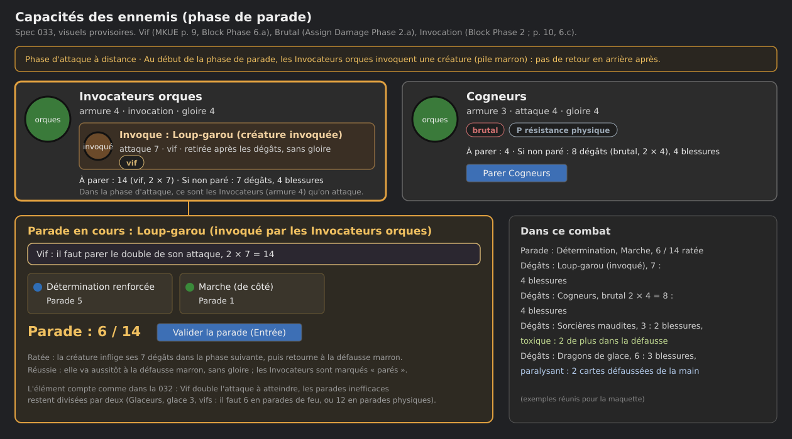

# 033 — Capacités des ennemis

- Statut : implémentée (2026-10-29)
- Jalon : J3
- Dépend de : 031 (déroulé d'un combat), 032 (éléments et résistances), 030 (piles d'ennemis), 038 (un générateur par pile),
  024 (points de non-retour), 016 (fin du tour)
- Livret : MKUE p. 9 (*Block Phase* 2, 2.a, 2.b, 6.a, 7.a ; *Assign Damage Phase* 2.a), p. 10 (*Assign Damage Phase* 6.a à 6.c),
  p. 24 (*Offensive* : Summon Attack, Swift, Brutal, Poison, Paralyze) ; Compendium, *Combat* S20, Q22, S23, S34
  (`docs/regles/faq/compendium/07-combat.md`), *Scenarios* S5, *Volkare* Q9, *ORC SUMMONERS* S1 (`33-enemy-tokens.md`), *Cold Toughness* S1 et O4
  (`23-basic-action-cards.md`) ; FAQ p2 (*Endurance Givrée*)
- Crates touchées : arcanum-core (règles, contenu), arcanum-ui, arcanum-persistance (une partie préparée), `assets/i18n/` (fr.json et en.json)

## Objectif

Les ennemis du jeu de base ont enfin toutes leurs capacités. Un ennemi **vif** demande une parade double, un ennemi **brutal**
inflige des dégâts doubles, un ennemi **toxique** met des Blessures de plus dans la défausse, un ennemi **paralysant** fait
défausser la main, et les Invocateurs **invoquent** une créature marron qui attaque à leur place. L'écran de combat dit, pour chaque ennemi qui attaque, ce
qu'il faut parer et ce qu'il coûtera s'il ne l'est pas.

Avec Endurance givrée renforcée (Tovak), qui compte les capacités de l'ennemi paré, une carte de base « pas encore disponible »
devient jouable (Q3).

## Règles

Les capacités offensives du jeu de base sont Vif, Brutal, Toxique, Paralysant et l'attaque d'invocation (`cartes/ennemis.md`).
Fortifié est appliqué depuis la 031 et la 032. Les autres capacités de la p. 24 (Assassinat, Encombrant, Vampire, Insaisissable,
Non fortifié, Immunité arcanique, Défense) et les attaques multiples n'existent que sur des ennemis des extensions : hors périmètre.

Les capacités restent propres à leur ennemi : contrairement à la fortification et aux résistances, elles ne s'étendent pas au
groupe ciblé (Compendium, *Combat* S12, déjà dit par la 031 et la 032). Elles ne jouent qu'en phase de parade et d'assignation des
dégâts.

### Vif

- **Parade doublée** (MKUE p. 9, *Block Phase* 6.a ; p. 24, *Swift*) : pour parer un ennemi vif, le total de la parade doit
  atteindre le **double** de son attaque. Le total se calcule comme dans la 032 (parades inefficaces divisées par deux), puis se
  compare au double : contre les Glaceurs (glace 3, vifs), 6 points de parade de feu suffisent, il en faut 12 de parade physique.
- **Dégâts inchangés** : un ennemi vif non paré inflige son attaque simple (la p. 24 ne double que la parade).

### Brutal

- **Dégâts doublés** (MKUE p. 9, *Assign Damage Phase* 2.a ; p. 24, *Brutal*) : non paré, il inflige le double de son attaque.
  Les Cogneurs (attaque 4) infligent 8 points, soit 4 Blessures avec l'armure 2 (Compendium, *Combat* S34).
- **Parade inchangée** : on pare l'attaque simple.

### Toxique

- **Blessures dans la défausse** (MKUE p. 10, *Assign Damage Phase* 6.a, seconde puce ; p. 24, *Poison*) : pour chaque Blessure
  qu'un ennemi toxique met dans la main du héros, une autre Blessure va dans sa **défausse**. Elle sera piochée plus tard, comme
  toute carte de la défausse (fin de manche, spec 023).
- **Avec Brutal** (Mages d'Altem) : Toxique compte les Blessures mises en main, dégâts doublés compris.
- **Assommé** : ces Blessures de la défausse ne comptent pas pour être assommé (Compendium, *Combat* S20). Rien à faire ici : être
  assommé arrive avec la spec 034, qui devra le respecter.
- Unités touchées par une attaque toxique (deux Blessures) : spec 042.

### Paralysant

- **Main défaussée** (MKUE p. 10, *Assign Damage Phase* 6.b, seconde puce ; p. 24, *Paralyze*) : si un ennemi paralysant met au
  moins une Blessure dans la main du héros, le héros défausse aussitôt toutes les cartes de sa main **qui ne sont pas des
  Blessures**. Elles vont dans la défausse, comme une carte défaussée en fin de tour (spec 016).
- **Après** : le combat continue (les cartes déjà jouées restent jouées) ; en fin de tour, le héros repioche jusqu'à sa limite de
  main, Blessures comprises (spec 016). Comme pour un héros assommé, les effets déjà joués et le mana restent utilisables
  (Compendium, *Combat* Q22).
- Unités détruites par une attaque paralysante : spec 042.

### Invocation

- **Tirage au début de la phase de parade** (MKUE p. 9, *Block Phase* 2 ; p. 24, *Summon Attack*) : pour chaque Invocateur encore
  en jeu, dans l'ordre du combat, un jeton **marron** est tiré de la pile des donjons et posé face visible : c'est la **créature
  invoquée** (FAQ p2). Pile vide : sa défausse est remélangée d'abord (spec 031). Pile et défausse vides : le jeton vient d'une autre pile (Q2,
  ci-dessous).
- **Il remplace l'Invocateur** (MKUE p. 9, *Block Phase* 2.a ; p. 10, 6.c) pendant les phases de parade et d'assignation des
  dégâts : on pare l'attaque de la créature, avec ses capacités (un Loup-garou invoqué est vif), et c'est elle qui inflige ses dégâts,
  avec ses capacités (un Minotaure invoqué est brutal). Aucun effet ne vise l'Invocateur pendant ces deux phases. L'invocation n'est
  pas un second ennemi : c'est l'attaque de l'Invocateur (Compendium, *Combat* S23).
- **La créature repart** : parée, elle va aussitôt dans la défausse marron, **sans gloire** (MKUE p. 9, *Block Phase* 7.a) ; non
  parée, elle y va après avoir infligé ses dégâts (MKUE p. 10, 6.c). L'Invocateur dont la créature est parée est marqué « paré ».
- **Retour de l'Invocateur** (MKUE p. 9, *Block Phase* 2.b) : en phase d'attaque, l'Invocateur est une cible comme une autre, avec
  sa propre armure et sa gloire.
- **Vaincu avant** (Compendium, *ORC SUMMONERS* S1) : un Invocateur vaincu en phase d'attaque à distance n'invoque rien.
- **Point de non-retour** (spec 024) : le tirage révèle un jeton. Passer en phase de parade avec un Invocateur en jeu ne se reprend
  donc plus par Ctrl+Z. L'écran le dit en phase d'attaque à distance (Q1).
- **Ennemis concernés aujourd'hui** : les Invocateurs orques (verts), seuls invocateurs qu'on peut rencontrer avant les tours de
  mage (Illusionnistes, spec 043). Les ennemis marron n'ont aucun invocateur parmi eux.

### Plus de jetons dans une pile (Q2, décision de Mathieu)

- **Règle générale, pour toute pile de jetons d'ennemis** : quand un tirage trouve la pile vide, sa défausse est remélangée pour la
  reconstituer (MKUE p. 3, *Enemy and Ruin token piles*, déjà fait par la 031). Si la défausse est vide elle aussi, le jeton est
  tiré d'une **autre pile**, choisie au hasard parmi celles qui ont encore des jetons (dans la pile ou dans sa défausse, remélangée
  s'il le faut). C'est l'avis du Compendium pour les extensions (*Scenarios* S5 ; *Volkare* Q9 : le manque de jetons n'est pas
  censé être une limite), étendu par Mathieu à toute pile.
- **Hasard** : le choix de la pile de secours passe par le générateur de la pile vide (spec 038, un générateur par pile) : un
  tirage de secours ne décale aucun autre usage du hasard.
- **Où cela joue** : la créature invoquée (elle peut alors être verte, rouge… ; on applique ses capacités à elle, et elle va ensuite dans
  la défausse de **sa** couleur) et les jetons posés à la révélation d'une tuile (spec 030). Toutes les piles et défausses vides
  à la fois : rien n'est tiré (impossible avec les jetons du jeu de base en jeu).

### Endurance givrée renforcée (Q3)

- **Texte** (`docs/regles/cartes/actions-de-base.md`, *Cold Toughness*, version *Lost Legion* qui fait foi) : Parade de glace 5,
  plus 1 par capacité ou couleur d'attaque **imprimée sur le jeton** de l'ennemi paré. L'Immunité arcanique et l'effet contre un
  autre joueur n'existent pas dans le jeu actuel.
- **Ce qui compte** (Compendium, *Cold Toughness* S1 ; FAQ p2, *Endurance Givrée*) : +1 par capacité (Vif, Brutal, Toxique,
  Paralysant, Fortifié), +1 par résistance (physique, feu, glace), +1 pour une attaque de feu ou de glace, +2 pour une attaque de feu
  glacé (deux couleurs). Une attaque physique et l'invocation ne comptent pas (l'invocation n'est pas une capacité, FAQ p2).
- **Contre une créature invoquée** (Compendium, *Cold Toughness* O4) : ce sont les icônes de la créature qui comptent.
- **Quand** : c'est une Parade, donc jouable seulement dans une parade en cours (spec 031) ; sa valeur se calcule contre l'ennemi
  de cette parade au moment où elle est jouée. Elle reste de glace : contre une attaque de glace ou de feu glacé, elle est divisée
  par deux (032).

| Ennemi paré (exemples) | Compte | Parade de glace | Contre |
|---|---|---|---|
| Rôdeurs | — | 5 | 4, paré |
| Chevaucheurs de loups | vif | 6 | 3 × 2 = 6, paré |
| Cogneurs | brutal, résistance physique | 7 | 4, paré |
| Dragons de feu | feu, résistances feu et physique | 8 | 9, raté |
| Dragons de glace | glace, paralysant, résistances glace et physique | 9, divisée : 4 | 6, raté |
| Dragons supérieurs | feu glacé (2), brutal, résistances feu et glace | 10, divisée : 5 | 6, raté |

### Exemple : un combat contre trois ennemis

Bac à sable, Jour, Arythea au village (2,−3), un cristal bleu. En main : Détermination, Rage, Marche, Endurance, Célérité.
Ennemis provoqués : Invocateurs orques (armure 4, gloire 4) et Sorcières maudites (armure 5, attaque 3, toxiques).

| Étape | Action du joueur | Résultat |
|---|---|---|
| 1 | « Engager le combat » | phase d'attaque à distance ; la ligne d'avertissement d'invocation s'affiche |
| 2 | « Phase suivante » | ⚙ un jeton marron est tiré : Minotaure (attaque 5, brutal). Point de non-retour |
| 3 | « Parer Minotaure (invoqué) », Détermination renforcée (cristal bleu) : Parade 5, valider | 5 / 5 : paré ; le Minotaure va dans la défausse marron, sans gloire |
| 4 | « Phase suivante » | ⚙ dégâts : Sorcières maudites 3, 2 Blessures en main et 2 dans la défausse (toxique) |
| 5 | cocher les Invocateurs, « Attaquer », Rage (Attaque 2) + Marche et Endurance de côté, valider | 4 / 4 : Invocateurs vaincus, gloire 4 |

Sans parade à l'étape 3, le Minotaure aurait infligé 2 × 5 = 10 points, soit 5 Blessures en main, avant de partir dans la
défausse marron.

## Modèle

### Termes

Termes du glossaire déjà présents : Brutal, Invocation, Blessure, Défausse, Défausse d'ennemis, Paré,
Endurance givrée (la 032 l'appelait « Endurance au froid » par erreur ; le jeu et le glossaire disent « givrée »).

Nouveaux termes, ajoutés au glossaire dans la même PR (Q5) :

| Livret (EN) | Français | Code |
|---|---|---|
| Summoner (enemy with Summon Attack) | Invocateur | ennemi dont l'attaque est `EnemyAttack::Summon` |
| Summoned monster | Créature invoquée (FAQ p2) | `CombatEnemy::summoned` |

La ligne « Swift / Brutal / Poison / Paralyze » du glossaire passe aux termes de la FAQ française, Vif / Brutal / Toxique /
Paralysant (Q5), et au code réel, `EnemyAbility::Swift` / … . Le libellé `enemy.ability.*` de `fr.json` suit (« vif », « brutal »,
« toxique », « paralysant »).

### Données

- Un ennemi du combat peut porter une **créature invoquée** (un jeton marron) pendant les phases de parade et d'assignation des
  dégâts. L'attaque, l'élément et les capacités qui comptent pour la parade et les dégâts sont alors ceux de la créature ; la case reste
  celle de l'Invocateur, qui sert de repère aux actions.
- Le moteur expose, pour chaque ennemi qui attaque : la parade à atteindre (double si vif) et les dégâts s'il n'est pas paré
  (double si brutal) avec les Blessures qu'ils donneraient. L'écran ne refait pas la règle.
- Le contenu (`basic_actions.ron`) décrit l'effet renforcé d'Endurance givrée (Parade de glace 5 + le compte de l'ennemi paré),
  qui n'était pas pris en charge.

## Actions et événements

Aucune action nouvelle.

| Action | Validation (refusée si…) | Événements produits |
|---|---|---|
| `NextCombatPhase` (031) | inchangée | depuis la phase d'attaque à distance : `CombatPhaseStarted { Block }`, puis un `EnemySummoned` par Invocateur en jeu (précédé d'un `EnemyPileReshuffled` marron si la pile est vide) ; depuis la phase de parade, les dégâts comme dans la 031, avec attaques toxiques et paralysantes, puis un `SummonedEnemyDiscarded` par créature encore là |
| `DeclareBlock { target }` (031) | inchangée ; un Invocateur est une cible s'il a une créature invoquée, plus s'il n'en a pas | `BlockDeclared` |
| `PlayCard` (013) | Endurance givrée renforcée : comme toute Parade, seulement dans une parade en cours | `CardPlayed` ; la Parade de glace se calcule à l'application, contre l'ennemi de la parade en cours (changé à l'implémentation : `CardPlayed` porte l'effet, pas son total) |
| `ResolveBlock` (031) | inchangée | `EnemyBlocked` si le total atteint la parade à atteindre (double si vif), puis `SummonedEnemyDiscarded` si c'était une créature invoquée ; sinon `BlockFailed` |

| Événement | Effet de `apply` | Révèle une information ? | Point de non-retour ? |
|---|---|---|---|
| `EnemySummoned { player, summoner, token }` (nouveau) | le jeton quitte la pile marron et devient la créature invoquée de l'Invocateur de la case `summoner` | oui : le jeton tiré, public | **oui** (révélation) |
| `SummonedEnemyDiscarded { player, summoner }` (nouveau) | la créature invoquée va dans la défausse de sa couleur ; l'Invocateur n'en a plus | non | non |
| `PoisonWoundsDiscarded { player, enemy, wounds }` (nouveau) | les Blessures d'une attaque toxique vont dans la défausse. Changé à l'implémentation : un événement à part plutôt qu'un champ `poisoned` de `WoundsTaken`, qui aurait changé toutes les écritures de cet événement (tests, sauvegardes) | non | non |
| `HandParalyzed { player, cards }` (nouveau) | les cartes de la main qui ne sont pas des Blessures vont dans la défausse | non (la main est déjà connue du joueur ; en solo, rien à filtrer) | non |

**Actions légales** : comme la 032, avec `DeclareBlock` sur un Invocateur qui a une créature invoquée.

## Comportements attendus

Chaque cas devient au moins un test (nom indicatif entre parenthèses). Sauf mention, arène de combat des tests (spec 032,
`crates/arcanum-core/tests/arene`), Jour, armure du héros 2.

Vif (arcanum-core) :

- **C1** — Chevaucheurs de loups (attaque 3, vifs) : une Parade 5 est ratée (5 < 6), une Parade 6 réussit
  (`swift_enemy_needs_double_block`) — MKUE p. 9, *Block Phase* 6.a.
- **C2** — Glaceurs (glace 3, vifs) : Parade de feu 3 + Parade 5 donne 3 + 5 ÷ 2 = 5 < 6, ratée ; Parade de feu 3 + Parade 5 +
  Parade 1 donne 3 + 6 ÷ 2 = 6, parés (`swift_doubles_the_target_not_the_block_efficiency`) — MKUE p. 9, 5.b et 6.a.
- **C3** — Chevaucheurs de loups non parés : 3 points, 2 Blessures (`swift_does_not_double_damage`) — MKUE p. 24.

Brutal (arcanum-core) :

- **C4** — Cogneurs non parés : 8 points, 4 Blessures (`brutal_enemy_deals_double_damage`) — MKUE p. 9, *Assign Damage Phase*
  2.a ; Compendium, *Combat* S34.
- **C5** — Cogneurs : une Parade 4 les pare (`brutal_does_not_change_block`) — MKUE p. 24.
- **C6** — Dragons supérieurs (feu glacé 6, brutaux) non parés : 12 points, 6 Blessures (`brutal_doubles_elemental_damage`).

Toxique (arcanum-core) :

- **C7** — Sorcières maudites (attaque 3, toxiques) non parées : 2 Blessures dans la main et 2 dans la défausse ; la limite de main
  ne voit que les 2 de la main à la fin du tour (`poison_puts_as_many_wounds_in_discard_pile`) — MKUE p. 10, 6.a.
- **C8** — Mages d'Altem (feu glacé 4, brutaux, toxiques) non parés : 8 points, 4 Blessures en main, 4 dans la défausse
  (`poison_counts_brutal_wounds`) — MKUE p. 10, 6.a ; p. 9, 2.a.
- **C9** — Sorcières maudites parées : aucune Blessure nulle part (`blocked_poisonous_enemy_deals_nothing`).

Paralysant (arcanum-core) :

- **C10** — Dragons de glace (glace 6, paralysants) non parés, main de 3 cartes : 3 Blessures en main, puis les 3 autres cartes vont
  dans la défausse ; il ne reste que les Blessures (`paralyze_discards_non_wound_cards_from_hand`) — MKUE p. 10, 6.b.
- **C11** — Dragons de glace parés : la main ne change pas (`blocked_paralyzing_enemy_discards_nothing`).
- **C11b** — Après C10, sans carte jouée, combat fini : la seule fin de tour légale est sans défausse ; les cartes défaussées
  par Paralysant comptent pour le tour minimum (`paralyzed_hero_ends_turn_without_discard`) — MKUE p. 6, 5.a et 7 (issue privée 85,
  voir la spec 034).
- **C12** — Après C10, en fin de tour, le héros repioche 2 cartes (limite 5, 3 Blessures en main)
  (`paralyzed_hero_redraws_at_end_of_turn`) — spec 016. Le test joue une carte avant les dégâts : sans carte jouée et une main
  de Blessures seulement, le repos long s'impose (spec 031, Q12).
- **C13** — Après C10, en phase d'attaque, plus aucune carte en main ne se joue ; les cartes jouées avant comptent toujours
  (`paralyzed_hero_keeps_played_effects`) — Compendium, *Combat* Q22.

Invocation (arcanum-core) :

- **C14** — Invocateurs orques en jeu : passer en phase de parade tire le premier jeton de la pile marron (générateur de cette
  pile, spec 038) ; `EnemySummoned` le donne, la pile marron a un jeton de moins
  (`summoner_draws_a_brown_token_at_block_phase`) — MKUE p. 9, *Block Phase* 2.
- **C15** — Invocateurs vaincus en phase d'attaque à distance : pas de tirage (`defeated_summoner_does_not_summon`) —
  Compendium, *ORC SUMMONERS* S1.
- **C16** — Créature invoquée Loup-garou (attaque 7, vif) : la parade à atteindre est 14 ; une Parade 14 le pare, il va dans la
  défausse marron, aucune gloire, l'Invocateur est marqué paré (`summoned_monster_is_blocked_with_its_own_abilities`) — MKUE
  p. 9, *Block Phase* 2.a et 7.a.
- **C17** — Créature invoquée Minotaure (attaque 5, brutal) non paré : 10 points, 5 Blessures, puis il va dans la défausse marron
  (`summoned_monster_deals_damage_then_is_discarded`) — MKUE p. 10, 6.c.
- **C18** — Phase d'attaque après C17 : l'Invocateur est une cible (armure 4) ; vaincu, il rapporte sa gloire (4) ; la créature
  n'est plus nulle part dans le combat (`summoner_is_back_in_attack_phase`) — MKUE p. 9, *Block Phase* 2.b.
- **C19** — Deux Invocateurs : deux tirages, dans l'ordre du combat (`each_summoner_draws_its_own_monster`).
- **C20** — Pile marron vide, défausse non vide : `EnemyPileReshuffled` puis le tirage
  (`summon_reshuffles_the_brown_discard_pile`) — MKUE p. 3, *Enemy and Ruin token piles*.
- **C20 bis** — Pile marron et défausse marron vides : la créature est tirée d'une autre pile, choisie au hasard parmi celles qui
  ont des jetons, avec le générateur de la pile marron ; à la même graine, la même pile ; paré ou après ses dégâts, il va dans la
  défausse de sa couleur (`summon_draws_from_another_pile_when_brown_runs_out`) — Q2 ; Compendium, *Scenarios* S5.
- **C20 ter** — Révélation d'une tuile dont la pile d'ennemis et sa défausse sont vides : le jeton vient aussi d'une autre pile,
  même règle (`revealed_tile_draws_from_another_pile_when_its_own_runs_out`) — Q2.
- **C21** — Après le tirage, Ctrl+Z ne revient pas avant `EnemySummoned` ; sans Invocateur en jeu, passer en phase de parade se
  reprend comme avant (`summon_is_a_point_of_no_return`) — spec 024.

Endurance givrée renforcée (arcanum-core, Q3) :

- **C22** — Pour chaque ennemi du jeu de base, le bonus suit la règle de la section Règles (Chevaucheurs 1, Cogneurs 2, Dragons
  supérieurs 5, Rôdeurs 0…) (`cold_toughness_bonus_per_enemy`) — Compendium, *Cold Toughness* S1.
- **C23** — Tovak, parade sur les Chevaucheurs de loups : Endurance givrée renforcée donne une Parade de glace 6 et les pare
  (`cold_toughness_counts_the_blocked_enemy`).
- **C24** — Contre un Minotaure invoqué par des Invocateurs orques, c'est le Minotaure qui compte : Parade de glace 6
  (`cold_toughness_counts_the_summoned_monster`) — Compendium, *Cold Toughness* O4.
- **C25** — Hors d'une parade en cours, l'effet renforcé ne se propose pas (`cold_toughness_needs_a_block_in_progress`).

Vue, journal (arcanum-core) :

- **C26** — En phase de parade, la vue donne pour chaque ennemi qui attaque la parade à atteindre et, s'il n'est pas paré, les
  dégâts et les Blessures, avec la capacité qui double ; pour un Invocateur, la créature invoquée
  (`view_shows_block_needed_and_damage_if_unblocked`).
- **C27** — Rejouer le journal d'un combat avec invocation, attaques toxique et paralysante redonne le même état ; une sauvegarde d'avant la
  spec se recharge (`replaying_combat_with_abilities_rebuilds_state`) — spec 024.

Affichage (arcanum-ui) :

- **C28** — Phase d'attaque à distance avec des Invocateurs en jeu : la ligne d'avertissement d'invocation s'affiche ; sans
  Invocateur, non (`ranged_phase_warns_about_summon`).
- **C29** — Phase de parade : la carte des Invocateurs montre la créature invoquée, le bouton dit « Parer Minotaure (invoqué) » ;
  chaque carte d'ennemi qui attaque a sa ligne « À parer : … · Si non paré : … » (`block_phase_shows_summoned_monster_and_stakes`).
- **C30** — Parade en cours contre un ennemi vif : la ligne « Vif : il faut parer le double de son attaque, 2 × 3 = 6 » et
  « Parade : 5 / 6 » (`swift_block_shows_doubled_target`).
- **C31** — Historique « Dans ce combat » : les lignes de dégâts disent brutal, toxique et paralysant comme sur la maquette
  (`history_shows_ability_effects`).
- **C32** — La ligne « Les capacités des ennemis ne sont pas encore appliquées » et « n'attaque pas (invocation pas encore gérée) »
  ont disparu ; avec le vrai `fr.json`, l'écran de combat de C28 à C31 ne relève aucun manque (`every_ability_key_exists_in_french`).

Parcours :

- **C33** — Parcours du J1 (spec 019) : les Sorcières maudites provoquées sont toxiques ; le combat sans carte donne 2 Blessures
  en main **et 2 dans la défausse** ; le parcours le vérifie et continue (`parcours_j1`).

Vérification manuelle : `cargo run -p arcanum-ui` sous Linux (Xvfb, `scripts/verif-manuelle.sh`), depuis une nouvelle partie préparée
`combat-capacites` (Invocateurs orques et Chevaucheurs de loups voisins de la plaine (2, −2), un Minotaure sur la pile marron ; en
main Détermination, Rage, Marche, Endurance, Célérité ; un cristal bleu) ; captures de l'avertissement d'invocation, de la créature
invoquée en phase de parade, d'une parade contre un ennemi vif et de l'historique des dégâts.

Faite le 2026-10-29 sous Xvfb, captures dans les fichiers du projet (`captures/`) : `spec-033-avertissement`,
`spec-033-creature-invoquee`, `spec-033-parade-vif`, `spec-033-degats`. Elle a fait ajouter la ligne « Capacités : … » aux cartes
d'ennemis et à la créature invoquée : sans elle, on ne voyait pas qu'un ennemi est vif ou brutal avant la phase de parade (la
maquette les montrait, le texte de la spec ne le disait pas). Les Chevaucheurs de loups remplacent les Cogneurs prévus : leur parade
doublée se voit mieux.

## Cas limites et refus

- **L1** — Ennemi à plusieurs capacités (Dragons des marais : vifs et toxiques ; Glaceurs : vifs et paralysants) : chacune joue à
  son moment, parade doublée puis Blessures toxiques ou main défaussée.
- **L2** — Plusieurs ennemis non parés, dont un paralysant : la phase se résout seule dans l'ordre du combat (031, Q3) ; la main est
  défaussée dès la première Blessure de l'ennemi paralysant, et les Blessures des ennemis suivants arrivent ensuite dans la main.
  L'ordre ne change rien au résultat : à la fin, la main ne contient que des Blessures.
- **L3** — Attaque paralysante quand la main ne contient que des Blessures : rien à défausser, `HandParalyzed` n'est pas produit.
- **L4** — Parade ratée contre une créature invoquée (Q10 de la 031) : l'Invocateur ne peut plus être visé par une parade dans ce
  combat ; sa créature inflige ses dégâts.
- **L5** — Combat terminé sans parade contre une créature invoquée : impossible, la phase d'assignation des dégâts passe toujours
  avant la phase d'attaque ; à la fin du combat, aucune créature invoquée ne reste.
- **L6** — Une créature invoquée fortifiée (Ver des cryptes) ou résistante (Gargouille) : sans effet, elle n'est jamais attaquée.
- **L7** — Endurance givrée renforcée jouée puis l'ennemi paré change : impossible, une parade ne vise qu'un ennemi (031) ; la
  valeur est fixée par `CardPlayed`.

## Information cachée

La créature invoquée est tirée face visible : public, comme tout le combat (spec 031). La pile marron reste cachée (spec 030). Les
cartes défaussées par une attaque paralysante sont connues du joueur ; en solo, rien d'autre à filtrer.

## Libellés (i18n)

| Clé | Paramètres | fr | en |
|---|---|---|---|
| `combat.summon_warning` | `enemies` | Au début de la phase de parade, {enemies} invoquent une créature (pile marron) : pas de retour en arrière après. | At the start of the Block phase, {enemies} summon a monster (brown pile): no undo past that point. |
| `combat.enemy.summons` | `monster` | Invoque : {monster} | Summons: {monster} |
| `combat.enemy.summoned_note` | — | retirée après les dégâts, sans gloire | removed after damage, no Fame |
| `combat.enemy.summoned_name` | `monster` | {monster} (invoqué) | {monster} (summoned) |
| `combat.enemy.stakes` | `block`, `damage`, `wounds` | À parer : {block} · Si non paré : {damage} dégâts, {wounds} blessure(s) | To block: {block} · If unblocked: {damage} damage, {wounds} wound(s) |
| `combat.enemy.swift_block` | `attack`, `block` | {block} (vif, 2 × {attack}) | {block} (swift, 2 × {attack}) |
| `combat.enemy.brutal_damage` | `attack`, `damage` | {damage} (brutal, 2 × {attack}) | {damage} (brutal, 2 × {attack}) |
| `combat.swift_line` | `attack`, `block` | Vif : il faut parer le double de son attaque, 2 × {attack} = {block} | Swift: you must block twice its attack, 2 × {attack} = {block} |
| `combat.history.damage_enemy` | `enemy`, `damage`, `count` | Dégâts : {enemy}, {damage} : {count} blessure(s) | Damage: {enemy}, {damage}: {count} wound(s) |
| `combat.history.brutal` | `attack`, `damage` | brutal 2 × {attack} = {damage} | brutal 2 × {attack} = {damage} |
| `combat.history.poison` | `count` | toxique : {count} de plus dans la défausse | poison: {count} more in the discard pile |
| `combat.history.paralyze` | `count` | paralysant : {count} carte(s) défaussée(s) de la main | paralysis: {count} card(s) discarded from hand |
| `effect.cold_toughness_strong` | `base`, `bonus` | Parade de glace {base} + {bonus} (capacités de l'ennemi paré) | Ice Block {base} + {bonus} (blocked enemy's abilities) |
| `effect.ice_block_per_ability` | `amount` | Parade de glace {amount}, +1 par capacité de l'ennemi paré | Ice Block {amount}, +1 per ability of the blocked enemy |

`effect.ice_block_per_ability` (ajoutée à l'implémentation) : Endurance givrée renforcée hors parade en cours, quand l'ennemi paré
n'est pas encore connu.

Modifiées (Q5) : `enemy.ability.swift` « vif », `enemy.ability.poison` « toxique », `enemy.ability.paralyze` « paralysant »
(en.json inchangé).

Supprimées : `combat.ignored`, `combat.enemy.no_attack`. `combat.history.damage` (031) est remplacée par
`combat.history.damage_enemy`, qui nomme l'ennemi.

## Interface

- **Phase d'attaque à distance** : si un Invocateur est en jeu, la ligne d'avertissement d'invocation s'affiche sous le titre de la
  phase (Q1). Pas de fenêtre de confirmation.
- **Carte d'un ennemi** : sous ses valeurs, « Capacités : vif » s'il en a (ajouté à la vérification à l'œil).
- **Carte d'un ennemi, en phase de parade** : sous ses valeurs, la ligne « À parer : … · Si non paré : … » pour chaque ennemi qui
  attaque et n'est ni paré ni vaincu (Q4) ; le doublement est expliqué entre parenthèses (vif, brutal). Un Invocateur montre
  sa créature invoquée dans un encart (nom, attaque, capacités, « retirée après les dégâts, sans gloire ») ; ses propres valeurs
  restent affichées. Le bouton de parade nomme la créature : « Parer Minotaure (invoqué) ».
- **Parade en cours** contre un ennemi vif : la ligne « Vif : il faut parer le double de son attaque, 2 × 7 = 14 », placée
  comme la ligne d'efficacité de la 032 (les deux s'empilent contre les Glaceurs) ; le total devient « Parade : 6 / 14 ».
- **Historique « Dans ce combat »** : une ligne de dégâts par ennemi, qui le nomme, avec « brutal 2 × 4 = 8 », « toxique : 2 de plus
  dans la défausse » ou « paralysant : 2 cartes défaussées de la main ».
- **Main** : Endurance givrée renforcée affiche, dans une parade en cours, « Parade de glace 5 + 1 (capacités de l'ennemi paré) »,
  avec le repère « ÷2 » de la 032 s'il y a lieu ; elle n'affiche plus « Renforcé : pas encore disponible ».
- La ligne « Les capacités des ennemis ne sont pas encore appliquées » disparaît.

### Raccourcis clavier

Aucun : la spec n'ajoute pas d'action. La parade d'une créature invoquée passe par la même touche que les autres parades (031).

## Effets sur les specs déjà implémentées

- **030 / 031** : la révélation d'une tuile suit la règle de la pile de secours quand une pile et sa défausse sont vides
  (C20 ter).
- **031** : C24 (`summoner_does_not_attack_yet`) ne tient plus ; il est remplacé par C14 à C18. Le tableau « Ce qui reste ignoré »
  de la 031 est entièrement traité (Vif, Brutal, Toxique, Paralysant, Invocation). L'écran perd la ligne `combat.ignored`.
- **Tests changés à l'implémentation** (signalés dans la PR) : 031 C17 (`wounds_round_up_against_armor`) prend une Gargouille au lieu
  des Moines, devenus toxiques ; 031 C30 (pile et défausse vides, rien n'était posé) devient C20 ter ; l'historique des dégâts de
  l'écran nomme l'ennemi (« Dégâts : Rôdeurs, 4 : 2 blessure(s) ») ; le joueur « premier choix » de `logs_moteur.rs` ne défie plus,
  sinon il défiait chaque tour les mêmes Invocateurs sans les vaincre et la partie ne finissait plus.
- **032** : L4 (Invocateurs qui n'attaquent pas) ne tient plus. Endurance givrée renforcée, reportée par la 032, devient jouable.
- **019** (parcours J1) : les Sorcières maudites du parcours sont toxiques, 2 Blessures vont aussi dans la défausse (C33). Les
  tours suivants du parcours peuvent piocher ces Blessures : le parcours s'ajuste, en le signalant dans la PR (ADR 0006, découpage
  indicatif).
- **028** (parcours J2) : pas de combat, inchangé.
- **Parties préparées** (issue privée 64) : `combat-capacites` s'ajoute ; les existantes ne changent pas, sauf si leurs ennemis ont des
  capacités (les Cogneurs de `combat-elements` deviennent brutaux : rien à changer dans la partie, seulement dans ce qu'on y voit).

## Hors périmètre

- Capacités des ennemis des extensions (Assassinat, Encombrant, Vampire, Insaisissable, Non fortifié, Immunité arcanique,
  Défense) et attaques multiples : pas d'ennemi du jeu de base, transcrits en réserve dans `cartes/ennemis-extensions.md`.
- Attaques toxique et paralysante sur les unités (deux Blessures, unité détruite), résistances des unités : spec 042.
- Assommé, et les Blessures toxiques de la défausse qui n'y comptent pas (Compendium, *Combat* S20) : spec 034.
- Capacités données par une cité (cité rouge : brutal ; cité verte : toxique), y compris aux créatures invoquées (FAQ p2) : spec 062.
- Illusionnistes (invocateurs des tours de mage) et ennemis des sites : specs 043 et 044 ; la règle d'invocation de cette spec
  leur servira telle quelle.
- Effets qui annulent une attaque d'invocation avant le tirage (Compendium, *Combat* S23) : avec la première carte qui en a (052).

## Décisions prises à la relecture

Mathieu a validé la spec le 2026-10-29 (« ok pour tes autres propositions »), avec deux changements :

1. **Q1** — Avertir avant l'invocation : une ligne à l'écran en phase d'attaque à distance, sans fenêtre de confirmation.
2. **Q2** — Pile et défausse vides : tirer un jeton d'une autre pile, principe généralisé à toute pile de jetons d'ennemis
   (section « Plus de jetons dans une pile », C20 bis, C20 ter). Changé à la demande de Mathieu ; la proposition était « pas
   d'invocation ».
3. **Q3** — Endurance givrée renforcée jouable dès cette spec (texte *Lost Legion*, compte du Compendium).
4. **Q4** — Ligne « À parer · Si non paré » pour chaque ennemi qui attaque, en phase de parade.
5. **Q5** — Termes de la FAQ française (demande de Mathieu) : Vif, Brutal, Toxique, Paralysant, Invocateur, Créature invoquée. Le
   glossaire et les libellés des capacités (`enemy.ability.*` de `fr.json` : « rapide », « poison », « paralysie ») passent à ces
   termes ; la proposition était de garder ceux du glossaire.

## Questions ouvertes

Aucune.
