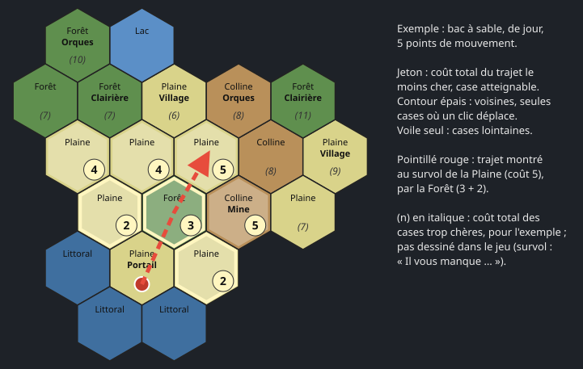
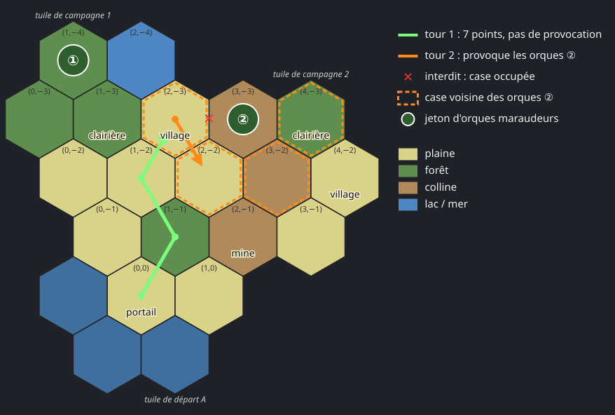

# 036 — Trajet en un clic

- Statut : implémentée (2026-10-30) (reporter tout changement dans la colonne Statut de `PLAN.md`)
- Jalon : J3
- Dépend de : 014 (déplacement), 017 (cases atteignables, trajet retenu), 024 (revenir en arrière), 030 (provocation, trajets qui
  l'évitent)
- Livret : MKUE p. 7 (« Movement » 3 : case par case ; 4.b et 4.c : case occupée, provocation ; 6 : autant de cases qu'on peut payer)
- Crates touchées : arcanum-core, arcanum-ui, `assets/i18n/` (fr.json et en.json)
- Origine : spec 017 Q1 (« à revoir avec la spec 030 ») et spec 030 C19 ; demandé par Mathieu le 2026-10-27

## Objectif

Aujourd'hui, le plateau de jeu montre les cases atteignables lointaines et le tracé de leur trajet (spec 017), mais il faut cliquer
chaque case du trajet l'une après l'autre. Avec cette spec, **un clic sur une case atteignable lointaine y amène la figurine** en
suivant le trajet tracé, case par case, en payant chaque case comme si on l'avait cliquée. Le trajet suivi ne provoque jamais : c'est
celui que l'écran montre déjà (spec 030, C19).

## Règles

Aucune règle nouvelle : suivre un trajet, c'est enchaîner les pas de la spec 014.

- **Case par case** (MKUE p. 7, 3) : la figurine passe par chaque case du trajet, et chaque pas paie le coût de la case où l'on
  entre. Le journal garde un `HeroMoved` par case, comme si le joueur les avait cliquées une à une : rejouer la partie, la vue et le
  bilan ne voient pas la différence.
- **Le trajet suivi** : c'est le **trajet retenu** de la spec 017 (le moins cher, puis le moins de cases, puis l'ordre des
  directions), calculé comme l'écran le fait depuis la spec 030 (`routes_avoiding`) : il ne traverse ni case infranchissable, ni site
  fortifié, ni case occupée par un ennemi errant (MKUE p. 7, 4.a et 4.b), et **ne contient aucun pas qui provoque** (MKUE p. 7, 4.c ;
  spec 030, C19). Le joueur qui veut un autre trajet du même coût, ou qui veut provoquer, clique case par case.
- **Autant qu'on peut payer** (MKUE p. 7, 6) : seule une case dont le trajet coûte au plus les points de mouvement **déjà
  disponibles** se suit en un clic. Les points des cartes encore en main ne comptent pas (MKUE p. 7, 6.b, comme à la spec 017).
- **Voisines** : un clic sur une case voisine reste le `MoveHero` de la spec 014, y compris quand le pas provoque (spec 030, C24).
  Suivre un trajet ne sert qu'aux cases **lointaines** (au moins deux cases), pour qu'un même déplacement n'ait pas deux actions
  légales.
- **Pendant le trajet, on ne fait rien d'autre** : ni carte jouée, ni exploration entre deux cases. Rien ne l'empêche dans les
  règles (MKUE p. 7, 6.a et 6.b) : le joueur qui le veut clique case par case. Comme aucun pas du trajet ne provoque et qu'aucun ne
  révèle d'information dans les specs actuelles, s'arrêter en chemin ne changerait rien à ce qu'il sait.
- **Déplacement terminé** (spec 030, C16 ; spec 031) : après une provocation ou un défi, plus de trajet, comme plus de pas.

### Exemple : bac à sable, de jour

Mise en place du bac à sable (tuile de départ A, tuiles de campagne 1 et 2, orques ① en (1, −4) et ② en (3, −3)). Les cases et les
trajets sont ceux des schémas des specs 017 et 030 :





| Départ | Points | Clic sur | Trajet suivi | `HeroMoved` produits | Points restants |
|---|---|---|---|---|---|
| portail (0, 0) | 5 | Plaine (2, −2) | NE, NE | (0, 0)→(1, −1) coût 3, (1, −1)→(2, −2) coût 2 | 0 |
| portail (0, 0) | 6 | village (2, −3) | NW, NE, NE | (0, 0)→(0, −1) 2, (0, −1)→(1, −2) 2, (1, −2)→(2, −3) 2 | 0 |
| village (2, −3) | 7 | mine verte (2, −1) | par (1, −2) puis (2, −2) | (2, −3)→(1, −2) 2, (1, −2)→(2, −2) 2, (2, −2)→(2, −1) 3 | 0 |
| village (2, −3) | 5 | mine verte (2, −1) | aucun : le trajet sans provocation coûte 7 | — (le clic ne fait rien) | 5 |

Dernière ligne : du village, aller droit à la Plaine (2, −2) longerait les orques ② et les provoquerait (spec 030, C12) ; le trajet
qui les évite coûte 7. Avec 5 points, la mine verte n'est pas atteignable en un clic. Le joueur peut toujours cliquer la Plaine
(2, −2), voisine, et provoquer les orques en connaissance de cause (anneau orange, spec 030).

## Modèle

### Termes

Termes du glossaire déjà présents : Trajet (`Route`), Case atteignable (`reachable`), Adjacente, Provoquer, Points de mouvement
(`move_points`), Revenir en arrière (`undo`).

Nouveau terme, ajouté au glossaire dans la même PR (à valider) :

| Français | Code | Sens |
|---|---|---|
| Suivre un trajet | `Action::FollowRoute` | Aller en une décision sur une case atteignable lointaine, par son trajet retenu, un `HeroMoved` par case (spec 036). Pas un terme du livret. |

### Nouvelles données dans l'état

Aucune.

## Actions et événements

| Action | Validation (refusée si…) | Événements produits |
|---|---|---|
| `FollowRoute { to }` (nouvelle) | pas de figurine ; déplacement terminé ; hors du moment libre (combat, ennemis à engager) ; `to` voisine de la figurine ; pas de trajet retenu vers `to` (sans case occupée ni pas qui provoque) ; coût du trajet supérieur aux points de mouvement | un `HeroMoved` par case du trajet, dans l'ordre, chacun avec le coût de sa case |

Aucun nouvel événement. `HeroMoved` (spec 014) n'est pas un point de non-retour : revenir en arrière après un trajet suivi retire
**toute la décision**, donc tous ses pas (spec 024, C5 `undo_removes_whole_decision`), et rend la figurine et les points d'avant le
clic (Q1).

**Actions légales.** Les `FollowRoute` viennent juste après les `MoveHero` (spec 014), avant les `Explore` (spec 015), une par case
lointaine atteignable, dans l'ordre des trajets de `routes_avoiding` (coût, nombre de cases, directions : spec 017). Les index des
actions qui suivent (explorations, défis, fins de tour) se décalent d'autant ; l'ordre reste stable et documenté
(`docs/architecture.md`, recette « ajouter une action »).

**Qui calcule le trajet.** `decide` recalcule le trajet retenu vers `to` depuis l'état (`routes_avoiding` avec les cases des jetons
d'ennemis) : l'action ne porte que la case d'arrivée, et un joueur automatique (arcanum-players) n'a pas à fournir le trajet.

## Comportements attendus

Chaque cas devient au moins un test (nom indicatif entre parenthèses). Sauf mention : partie de bac à sable avec Arythea, graine
fixe, de jour, figurine et points construits par événements ; coordonnées de `docs/reference/bac-a-sable.md`.

Moteur (arcanum-core, `tests/trajet_en_un_clic.rs`) :

- **C1** — Portail, 5 points : `FollowRoute { to: (2, −2) }` est légale ; elle produit exactement les deux `HeroMoved` de
  l'exemple, la figurine est en (2, −2), il reste 0 point (`following_a_route_moves_space_by_space`) — MKUE p. 7, 3.
- **C2** — Portail, 6 points, vers le village (2, −3) : trois `HeroMoved` de coût 2, figurine sur le village
  (`following_a_three_space_route`) — MKUE p. 7, 3 et 6.
- **C3** — Village, 7 points, vers la mine verte (2, −1) : les trois pas par (1, −2) puis (2, −2), aucun `EnemiesProvoked`, le
  déplacement n'est pas terminé (`followed_route_never_provokes`) — MKUE p. 7, 4.c ; spec 030, C19.
- **C4** — Village, 5 points : aucune `FollowRoute` vers la mine verte ; `decide` la refuse (`NotLegal`), aucun événement
  (`route_that_would_need_a_provocation_is_not_offered`).
- **C5** — Les `FollowRoute` légales sont exactement les cases lointaines dont le trajet retenu coûte au plus les points, une
  chacune, juste après les `MoveHero` et dans l'ordre des trajets ; aucune vers une voisine (portail avec 5 points : (1, −2),
  (0, −2), (2, −1), (2, −2) dans cet ordre) (`follow_route_actions_list_far_reachable_spaces`) — spec 017, C11.
- **C6** — Cohérence, sur plusieurs positions et nombres de points : suivre un trajet donne le même état que jouer ses `MoveHero` un
  par un (`following_a_route_equals_clicking_each_step`) — spec 017, C10.
- **C7** — De nuit, portail, 6 points, vers (2, −2) : le trajet suivi est `NW, NE, E` (la Forêt coûte 5), trois `HeroMoved`
  (`night_changes_the_followed_route`) — MKUE p. 7, 3.a, note ; spec 017, C7.
- **C8** — Après une provocation (spec 030, C16), ou hors du moment libre (ennemis à engager, combat : spec 031), aucune
  `FollowRoute` légale (`no_route_once_movement_is_over`) — MKUE p. 7, 4.c ; p. 6, 6.d.
- **C9** — Revenir en arrière après un trajet suivi rend la figurine sur sa case de départ et tous les points dépensés, en une fois
  (`undo_takes_back_the_whole_route`) (Q1) — MKUE p. 5, *Reverting* 1.
- **C10** — Rejouer le journal après un trajet suivi redonne le même état (`replaying_log_after_a_followed_route`).

Affichage (arcanum-ui, `tests/trajet_en_un_clic.rs`) :

- **C11** — Portail, 5 points : un clic sur la Plaine (2, −2) donne `Command::Play` avec l'index de `FollowRoute { to: (2, −2) }`
  (`clicking_a_far_reachable_space_follows_the_route`).
- **C12** — Les cases lointaines atteignables ont la même mise en évidence que les voisines atteignables : contour clair épais et
  voile lumineux (Q2) ; une case lointaine trop chère n'a toujours aucune marque (spec 017, Q4)
  (`far_reachable_spaces_are_highlighted_like_neighbors`).
- **C13** — Survol de la Plaine (2, −2) avec 5 points : tracé du trajet (spec 017, C13), lignes « Coût de déplacement : 2 »,
  « Trajet : 2 cases, 5 points de mouvement » et « Cliquez pour suivre ce trajet » (`hover_invites_to_follow_the_route`).
- **C14** — Village, 5 points : survol de la mine verte, « Il vous manque 2 point(s) de mouvement », pas d'invitation ; un clic ne
  fait rien (`clicking_a_too_expensive_far_space_does_nothing`).
- **C15** — Une fois le déplacement fini, ou en mode fin du tour (spec 016), un clic sur une case lointaine ne fait rien
  (`no_follow_click_when_movement_is_over`) ; le survol reste celui de la spec 030, C26 bis.
- **C16** — Avec le vrai `fr.json`, calculer l'écran et le survol de chaque case du bac à sable avec 0, 2, 5 et 9 points ne relève
  aucun manque (`every_follow_route_key_exists_in_french`).

Vérification manuelle : `scripts/verif-manuelle.sh` sous Linux ; jouer Marche, Rapidité et une carte de côté (5 points) ; survoler
la Plaine (2, −2) puis cliquer : la figurine y est, 0 point ; Ctrl+Z la ramène au portail avec 5 points. Captures du survol et de
l'arrivée.

## Cas limites et refus

- **L1** — `FollowRoute` vers une voisine : `NotLegal` (le `MoveHero` existe déjà), aucun événement.
- **L2** — `FollowRoute` vers une case occupée, infranchissable, sans tuile, ou un site fortifié : pas de trajet, `NotLegal`.
- **L3** — Figurine absente du plateau de jeu : aucune `FollowRoute`.
- **L4** — Un trajet qui finit à côté d'un ennemi errant (sans le longer) : rien de particulier ; le pas suivant, s'il le longe, le
  provoque (spec 030, C12).
- **L5** — Un trajet de coût 0 (effets de J5, MKUE p. 7, 7.a) : hors périmètre ; la validation ne demande rien de plus que
  `routes_avoiding`.

## Information cachée

Rien de nouveau : le trajet ne se sert que du plateau de jeu, des jetons face visible, de la position de la figurine, du moment de
la journée et des points de mouvement, tous publics. Les `HeroMoved` sont publics (spec 014).

## Libellés (i18n)

Ajoutée dans `fr.json` et `en.json` :

| Clé | Paramètres | Français | English |
|---|---|---|---|
| `board.hover.click_to_follow` | — | Cliquez pour suivre ce trajet | Click to follow this route |

## Interface

Les marques et le tracé de la spec 017 restent ; seuls la mise en évidence des cases lointaines, le clic et une ligne de survol
changent.

- **Plateau de jeu** : une case lointaine **atteignable** prend la mise en évidence des voisines atteignables (contour clair épais et
  voile lumineux, Q2), puisqu'un clic y agit maintenant. Le jeton du coût du trajet ne change pas. Les voisines dont le pas provoque
  gardent leur anneau orange (spec 030) : ce sont les seules cases où un clic provoque.
- **Survol** d'une case lointaine atteignable : tracé du trajet (inchangé), « Trajet : N cases, M points de mouvement », puis
  « Cliquez pour suivre ce trajet ».

  ```
   Survol de la Plaine (2, −2), depuis le portail, 5 points :

     ┌──────────────────────────────────────────┐
     │ Tuile de campagne 2                      │
     │ Plaine                                   │
     │ Coût de déplacement : 2                  │
     │ Trajet : 2 cases, 5 points de mouvement  │
     │ Cliquez pour suivre ce trajet            │
     └──────────────────────────────────────────┘
  ```
- **Clic** sur une case lointaine atteignable : joue la `FollowRoute` correspondante. La figurine arrive d'un coup, sans animation
  (hors périmètre, comme à la spec 017). Pas de confirmation (Q3) : le tracé et l'infobulle disent où l'on va, et « Revenir en
  arrière » (Ctrl+Z) reprend tout le trajet.
- Tout se calcule dans l'écran du plateau (`board_screen`), sans egui, donc testable.

### Raccourcis clavier

Aucun (Q4). L'action est un clic sur le plateau de jeu ; Ctrl+Z (spec 024) la reprend déjà.

## Effets sur les specs déjà implémentées

Signalés ici parce que le sens de tests existants change (règle « jamais modifier un test sans le signaler ») :

- **017, `clicking_a_far_space_does_nothing`** (C16, `crates/arcanum-ui/tests/cases_atteignables.rs`) : un clic sur une case lointaine
  **atteignable** joue maintenant `FollowRoute` (C11). Le test gardera la moitié qui reste vraie (un clic sur une voisine donne le
  `MoveHero` de la spec 014) et vérifiera, pour la case lointaine, l'index de `FollowRoute` au lieu de l'absence de clic.
- **017, `all_reachable_spaces_are_highlighted`** (C11) : les 4 cases lointaines atteignables gagnent le contour épais (Q2) ; le
  champ `MoveMark::neighbor` ne décide plus du contour (il peut être remplacé par un champ « un clic agit », à l'implémentation).
- **017, `hover_shows_the_route`** (C13) : il vérifie l'absence de « Cliquez pour vous y déplacer », toujours vraie ; il gagne la
  ligne « Cliquez pour suivre ce trajet ».
- **014 et 030** : les `MoveHero` et leurs tests ne changent pas.
- **Index des actions légales** : les tests et les joueurs de test qui choisissent une exploration, un défi ou une fin de tour par
  son **index** (et non par sa valeur) voient cet index décalé quand des `FollowRoute` sont légales. Le joueur `FirstChoice` (issue
  privée 77) prend la première action, une carte tant qu'il y en a : inchangé. Les parcours `parcours_j1.rs` et `parcours_j2.rs` (s'ils
  choisissent par valeur, rien ne change) sont relancés ; un écart se signale dans la PR.

## Hors périmètre

- **Information révélée en chemin** : à partir des specs 043 et 044, passer de jour à côté d'une forteresse ou d'une tour de mage
  révèle ses défenseurs, et entrer de nuit sur une ruine retourne son jeton (`Compendium, Movement S8`). Le joueur doit alors pouvoir
  s'arrêter et rejouer des cartes après la révélation. Ces specs devront dire si un trajet suivi **s'arrête au premier pas qui
  révèle** (le reste n'est pas joué, les points restent) ou évite ces cases ; rien ne révèle en chemin aujourd'hui.
- **Choisir un autre trajet** que le trajet retenu (glisser la souris, étapes imposées) : pas demandé ; le clic case par case suffit.
- **Explorer au bout d'un trajet** en un clic (trajet puis exploration) : les fantômes d'exploration restent ceux qui touchent la
  figurine (spec 015, Q5).
- **Trajet qui provoque** volontairement en un clic : on clique case par case, la provocation reste un choix explicite (spec 030).
- **Cases atteignables en jouant des cartes de la main**, effets qui changent les coûts ou le déplacement (MKUE p. 7, 7) : J5,
  comme à la spec 017.
- Animation du déplacement, cadrage qui suit la figurine.

## Décisions prises à la relecture

Réponses de Mathieu (2026-10-30), toutes comme proposé :

1. **Q1** — Une seule action moteur `FollowRoute { to }` pour tout le trajet : un clic, une décision ; Ctrl+Z reprend tout le trajet.
2. **Q2** — Les cases lointaines atteignables prennent le contour épais des voisines.
3. **Q3** — Pas de confirmation avant de suivre un trajet.
4. **Q4** — Aucun raccourci clavier.

Implémentation : pas avant que les fils des specs 034 et 035 soient terminés (Mathieu, 2026-10-30).

## Questions ouvertes

Aucune.
