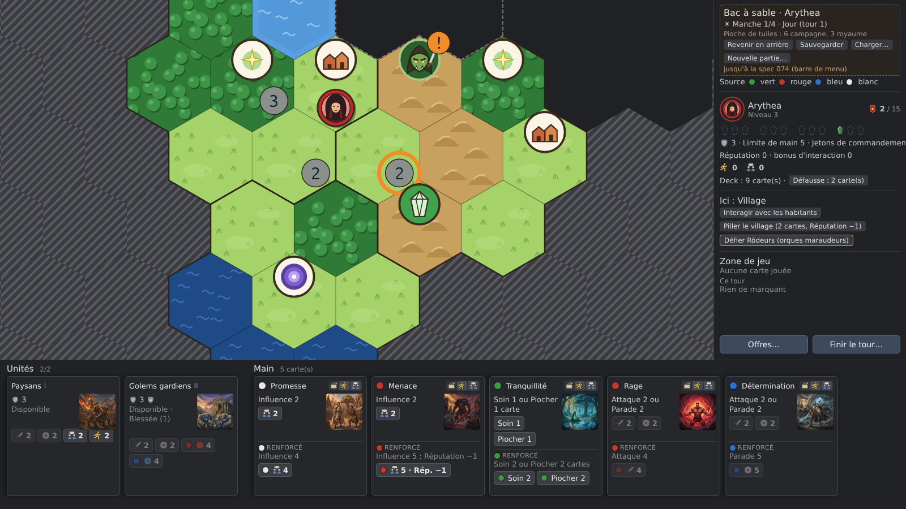
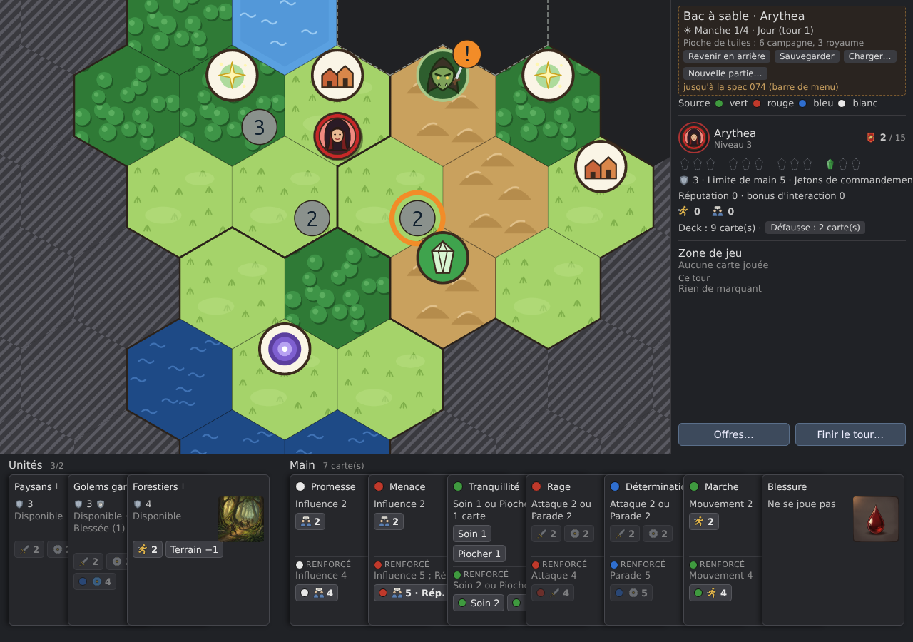

# 073 — Panneau du bas et panneau de droite

- Statut : validée (2026-11-10 ; Q1 à Q7 tranchées par Mathieu le même jour)
- Jalon : IHM (refonte de l'interface, entre J4 et J5)
- Dépend de : 070 (écran de combat), 071 (icônes, boutons-icônes, raccourcis affichés), 072 (vignettes), 013, 016, 022, 025
  (cartes, fin du tour, effets renforcés et payants), 042 (unités), 050 (Offres), 023 (annonce de la fin de la manche) ;
  toutes implémentées
- Livret : aucune règle nouvelle. Rappels : MKUE p. 4, *Deed Cards* 3.a à 3.e (effet de base, renforcé, de côté) ; p. 3,
  *Play Area* (zone de jeu, défausse)
- Crates touchées : arcanum-core (faits du tour et jetons dépensés, dans l'état et la vue), arcanum-ui, `assets/i18n/` (fr.json et
  en.json). Pas de nouvelle image.
- Base : [synthèse de la refonte](refonte-ihm.md), section « Disposition générale » ; [ADR 0009](../decisions/0009-illustrations-generees.md)
- Maquettes : [`images/073-panneaux/`](images/073-panneaux/), montées en HTML avec les vraies icônes et illustrations
  sur des captures du jeu actuel (script hors dépôt : `/mnt/project-files/ihm/073/`)

## Objectif

Quatrième lot de la refonte : l'écran se partage en trois zones fixes. En bas, sur toute la largeur, les **ressources** du
joueur : unités et main côte à côte, en cartes posées en rangée, qui se chevauchent quand la place manque et se poussent au
survol. À droite, au-dessus, le **joueur** (portrait, gloire, cristaux, valeurs), les **actions du lieu**, la **zone de jeu**
avec ce qui s'est passé pendant le tour, et deux boutons toujours à la même place : **Offres** et **Fin du tour**. Au centre,
le plateau de jeu ou l'écran de combat, qui gagne la place de la main. Chaque carte sépare son effet de base et son effet
renforcé, chacun avec ses boutons-icônes.



## Règles

Aucune règle n'est ajoutée ni changée : le moteur propose les mêmes actions légales, l'écran les range autrement.

- **Effet de base et effet renforcé** (MKUE p. 4, *Deed Cards* 3.a à 3.d) : deux blocs séparés sur la carte, chacun avec ses
  boutons ; le renforcé se paie d'un mana de la couleur de la carte (spec 022) ou propose une option payante (spec 025).
- **Jouer de côté** (MKUE p. 4, 3.e) : l'encart de la spec 071, inchangé, en tête de la carte.
- **Défausse** (MKUE p. 3, *Play Area*) : ses cartes sont face visible, le joueur peut la consulter ; le deck reste caché
  (seul son nombre de cartes se voit, comme aujourd'hui).

## Modèle

Termes ajoutés au glossaire par cette PR (section « Panneaux (spec 073) ») : panneau du bas, panneau de droite, chevauchement,
bouton d'effet, fait du tour.

### Écran : trois zones

```
┌──────────────────────────────────────────────┬──────────────────────┐
│                                              │ (en-tête provisoire) │
│   Plateau de jeu                             │ Source               │
│   ou écran de combat                         │ Joueur               │
│                                              │ Ici (actions du lieu)│
│                                              │ Zone de jeu, ce tour │
│┌────────────────────────────────────────────┐│                      │
││ Bandeau du choix en cours (s'il y en a un) ││ [Offres] [Fin du tour]│
├┴────────────────────────────────────────────┴┴──────────────────────┤
│ Unités ▢▢▢        Main ▢▢▢▢▢▢▢                     (Compétences, 051)│
└─────────────────────────────────────────────────────────────────────┘
```

- **Panneau du bas** (`BottomPanel`, arcanum-ui) : sur toute la largeur de la fenêtre, de la même hauteur sur le plateau et en
  combat. De gauche à droite, les sections **Unités** et **Main** ; la section **Compétences** viendra à droite avec la
  spec 051 (rien ne s'affiche pour elle d'ici là).
- **Bandeau du choix en cours** : celui qui était dans le panneau latéral (choix de la carte à défausser, du mana, des dés,
  Concentration, capacité d'unité, unité à renvoyer, fin du tour). Il se pose **par-dessus le bas du plateau** (ou de
  l'écran de combat), sur toute sa largeur, le temps du choix : ni le panneau du bas ni le plateau ne changent de taille
  (issue privée 177). L'écran de combat garde en bas de son défilement la place du bandeau, pour qu'il ne cache rien.
- **Panneau de droite** (`RightPanel`) : le panneau latéral d'aujourd'hui, réorganisé, entre le haut de la fenêtre et le
  panneau du bas. Le milieu défile si la place manque ; ses deux boutons du bas restent visibles.
- **Centre** : le plateau de jeu, ou l'écran de combat (spec 070) privé de sa main et de ses unités, qui passent dans le
  panneau du bas.

### Cartes posées en rangée et chevauchement

Une carte de la main et une unité ont la même taille, 200 × 212 points (216 × 240 depuis la spec 077, qui recalcule les
nombres de C9 à C12 bis dans ses cas C3 à C7), et se posent en rangée, côte à côte avec un écart
de 8 points.

- **Largeur des sections** : chacune prend sa largeur naturelle (cartes et écarts) si tout tient. Sinon la largeur disponible
  se partage en proportion des largeurs naturelles, chaque section gardant au moins la plus petite de sa largeur naturelle
  et de 400 points (deux cartes). Une section Unités vide prend la place de son titre et de « Aucune unité ».
- **Chevauchement** : quand les n cartes d'une section ne tiennent pas dans sa largeur w, elles se posent sans écart, la
  suivante par-dessus la précédente, avec un pas s = (w − 200) / (n − 1) : de chaque carte couverte, on voit la bande de
  gauche (couleur et début du nom).
- **Survol** : la carte survolée k (si ce n'est pas la dernière) s'affiche en entier, par-dessus ses voisines ; les autres se
  tassent avec un pas s = (w − 400) / (n − 2) : les cartes 0 à k à i·s, les suivantes à 200 + (i − 1)·s. La dernière carte
  de la section est toujours entière, la survoler ne change rien. Un pas négatif est ramené à 0, et aucune carte ne dépasse
  le bord droit (abscisse au plus w − 200) : dans une section trop étroite, les cartes s'empilent.
- **Carte survolée** : celle du dessus sous le pointeur. La carte survolée se dessine par-dessus toutes les autres et compte
  comme celle du dessus, ce qui évite
  qu'elle se dérobe sous le pointeur pendant qu'elle s'élargit.
- **Animation** : chaque carte glisse vers sa place en 0,15 s (vérification à l'œil).
- **Carte trop haute** (ajouté après relecture de Mathieu, 2026-11-10) : une carte ou une unité dont le contenu dépasse
  212 points est coupée en bas, et un « … » en bas à droite le signale. Survolée, elle grandit vers le haut, par-dessus le
  plateau, jusqu'à la hauteur de son contenu (au plus le haut de la fenêtre), et reste survolée tant que le pointeur est
  sur elle. Hauteur par une fonction pure (`card_height(contenu, plafond)`), testée sans egui (C12 bis) ; le dessin se
  vérifie à l'œil.

La disposition est une fonction pure (`fan_layout(n, w, survolée) → abscisses`, `section_widths`), testée sans egui.




### Carte de la main

De haut en bas (maquettes) :

- **En-tête** : pastille de couleur et nom ; à droite, l'encart « jouer de côté » de la spec 071, inchangé, ou en mode fin
  du tour la case « Défausser » (issue privée 282).
- **Vignette** 64 × 64 en haut à droite, sous l'encart (spec 072).
- **Effet de base** : son texte (`effect`, inchangé), puis un **bouton d'effet** par option de l'effet de base.
- **Effet renforcé**, séparé par un filet : le petit titre « Renforcé » précédé de la pastille de la couleur du mana, son
  texte, puis un bouton d'effet par option renforcée et un par option payante (spec 025).
- En mode fin du tour, la case « Défausser » dans l'en-tête, à droite du nom, pour qu'elle se voie sans survol (issue
  privée 282) ; en mode choix de la carte à défausser, le bouton
  « Défausser » à la place des boutons d'effet ; en mode Concentration, les options renforcées de la carte à
  renforcer, bonus compris, en boutons d'effet actifs du bloc renforcé (C19 bis) ; « siège seulement » (spec 032) sous
  l'effet de base. Comme aujourd'hui, ailleurs.

Un **bouton d'effet** (`EffectButton`) montre l'icône de l'effet suivie de sa valeur quand l'effet en a une (spec 071) :

| Effet (`Effect`) | Bouton |
|---|---|
| `Move`, `Influence`, `InfluenceReputation`, `InfluenceInInteraction` | icône Mouvement ou Influence, points |
| `Attack` | icône de sa sorte et de son élément (`attack_icon`), points |
| `Block`, `SwiftBlock`, `IceBlockPerAbility` | icône de parade de son élément (`block_icon`), points |
| `GainToken`, `GainCrystal` | cristal de la couleur (`crystal_image`), sans valeur |
| les autres (Soin, Piocher, Concentration, dés, unité, jetons multiples, option payante) | le texte de l'effet, comme aujourd'hui sans « Jouer : » |

Son infobulle reprend le libellé d'aujourd'hui (« Jouer : Attaque 2 », « Renforcer : Attaque 4 »), puis la raison du grisé
s'il y en a une (« Il faut un mana rouge… », spec 022). Un bouton renforcé porte la pastille de la couleur du mana, comme
aujourd'hui ; quand l'option demande un mana en plus (Magie pure, Talent magique, Mélodie du vent), la pastille est celle de
ce mana, la couleur de la carte restant sur le titre « Renforcé » (issue privée 312).

**Toutes les options sont montrées**, grisées quand le moteur ne les rend pas légales (aujourd'hui, une option illégale
n'a pas de bouton) : la carte garde la même forme d'un moment à l'autre. Sans fichier d'icône, le bouton écrit le nom puis
la valeur (spec 071, L1).

### Unité

Même cadre : en-tête (nom, niveau), vignette, ligne de l'armure et des résistances, état (« Disponible · Blessée (1) »),
puis **un bouton d'effet par option de chaque capacité** (« Attaque ou Parade 2 » donne deux boutons), avec la pastille du
mana qu'elle coûte. Un clic sur une option joue la capacité s'il n'y a qu'une façon de la payer et de la viser ; sinon il
ouvre le choix de la capacité (`ScreenMode::ChoosingUnitAbility`, spec 042) déjà réduit à cette option. Une capacité pas
encore codée garde son bouton texte grisé et son infobulle « pas encore disponible ». En mode choix de l'unité à renvoyer,
le bouton « Renvoyer » remplace les boutons d'effet.

### Panneau de droite

De haut en bas :

1. **En-tête provisoire**, jusqu'à la barre de menu de la spec 074 : ligne « scénario · héros », manche, jour ou nuit et
   tour, pioche de tuiles, boutons Revenir en arrière, Sauvegarder, Charger…, Nouvelle partie… et Recentrer. Contenu et
   ordre d'aujourd'hui.
2. **Bandeaux** d'aujourd'hui : dernier tour, niveaux gagnés, nouvelle manche, fin de partie et « Score final ».
3. **Source** : ses dés (spec 020), comme aujourd'hui.
4. **Joueur** : portrait, nom et « Niveau 3 » ; à droite, l'icône Gloire et « 2 / 15 » (gloire, gloire du niveau suivant ;
   « 2 » seul au niveau 10) ; puis l'inventaire, la ligne de l'armure, la réputation, les points (Mouvement, Influence,
   Soin), « Niveau 4 à la fin du tour » et la limite de main d'une forteresse s'il y a lieu ; enfin « Deck : 9 carte(s) » et le
   bouton « Défausse : 2 carte(s) ».
5. **Ici** (provisoire, Q3 : ces boutons iront près de la case concernée sur le plateau, issue privée 169) : les actions du lieu, titre « Ici » seul, absent quand il n'y a rien : interaction (en-tête, bouton, avertissement),
   pillage, achats, recrutement, soins, incendie, entrée dans un site d'aventure, offrande, et leurs confirmations ; ennemis
   provoqués, « Défier … » et « Engager le combat ».
6. **Zone de jeu** : jetons de mana (disponibles, puis dépensés en grisé), cartes jouées, puis **Ce tour** : les faits du tour
   et les récompenses en attente (artefact, sort, cristaux, dé du donjon, ruines, clairière), le trajet arrêté et l'assaut
   repoussé. « Rien de marquant » quand il n'y a ni fait ni récompense.
7. **Boutons du bas**, toujours visibles, côte à côte : « Offres… » et « Finir le tour… ».

### Fin du tour, fin de manche et Offres

- **« Finir le tour… »** est toujours là. Grisé quand finir le tour n'est pas légal, avec la raison en infobulle : combat en
  cours, choix en cours (mode de l'écran, confirmation, récompense à choisir), partie terminée.
- **Mode fin du tour** : le bandeau du choix porte le texte (cartes à défausser, repos, pioche) et les choix
  (reprise, clairière) ; les deux boutons du bas deviennent « Annuler » (Échap) et « Finir le tour » (Entrée), grisé tant que
  la sélection n'est pas valide. Les cases « Défausser » sont sur les cartes.
- **Annonce de la fin de la manche** (spec 023) : quand elle est légale, un troisième bouton « Finir la manche… » se place
  entre les deux, et le texte du bandeau d'aujourd'hui passe dans son infobulle (« Votre deck est vide : … »). Le clic ouvre la
  confirmation d'aujourd'hui, dans le bandeau du choix ; main vide, il annonce directement (spec 023, Q2).
- **« Offres… »** est toujours là. Grisé pendant un choix (mode de l'écran, confirmation) ou un combat, comme la touche O
  aujourd'hui, avec la raison en infobulle ; la fenêtre Offres ne change pas (spec 050).

### Défausse consultable

Le bouton « Défausse : 2 carte(s) » ouvre la **fenêtre de la défausse** (`DiscardWindow`) : ses cartes, la dernière
défaussée en tête, chacune avec sa vignette, son nom, son effet de base et son effet renforcé, sans bouton. « Fermer » et
Échap la ferment ; la touche D l'ouvre et la ferme. Défausse vide : le bouton est grisé. La fenêtre prend la largeur de ses
cartes, jusqu'à 80 % de l'écran, puis défile (issue privée 177).

### Faits du tour et jetons dépensés (arcanum-core)

Deux données nouvelles du joueur, dans l'état et dans sa vue, vidées au début de chacun de ses tours (`TurnStarted`) :

- **Faits du tour** (`PlayerView::turn_facts`, liste de `TurnFact` dans l'ordre) : ce que le tour a donné ou coûté. Un fait
  par événement du joueur :

  | Événement | Fait |
  |---|---|
  | `Explored` | tuile révélée |
  | `EnemiesDefeated` | ennemis vaincus et leur gloire |
  | `FameGained` | gloire gagnée hors combat |
  | `ReputationChanged` | réputation changée (signée) |
  | `WoundsTaken` | Blessures reçues en main (nombre) |
  | `WoundsHealed` | Blessures soignées (nombre) |
  | `CrystalGained` | cristal gagné (couleur) |
  | `OfferCardGained`, `AdvancedActionBought`, `SpellBought`, `ArtifactTaken` | carte gagnée |
  | `UnitRecruited`, `UnitRewardTaken` | unité gagnée |
  | `UnitDisbanded`, `UnitDestroyed` | unité perdue |
  | `UnitWounded`, `UnitHealed` | unité blessée, soignée |
  | `SiteConquered`, `VillagePlundered`, `MonasteryBurned` | site conquis, village pillé, monastère incendié |

  Les autres événements (déplacement, mana, cartes jouées, dés…) n'en font pas : la zone de jeu les montre déjà. Les
  récompenses de la fin du tour arrivent après `TurnEnded` : elles restent visibles jusqu'au tour suivant.
- **Jetons dépensés** (`PlayerView::spent_mana_tokens`) : les jetons de mana utilisés ce tour (`ManaTokenUsed`), dans
  l'ordre, vidés avec les jetons à la fin du tour (spec 025).

Tout se rejoue depuis le journal : retour en arrière et sauvegarde n'ont rien à faire (spec 024).

## Actions et événements

Aucune action ni aucun événement nouveau. L'écran gagne des commandes (`Command`) : `OpenDiscard`, `CloseDiscard`.

## Comportements attendus

Tests arcanum-core dans `crates/arcanum-core/tests/faits_du_tour.rs`, tests arcanum-ui dans `crates/arcanum-ui/tests/panneaux.rs`, sauf mention.
Exemples tirés du bac à sable (`docs/reference/bac-a-sable.md`), de l'arène des tests et du contenu (`basic_actions.ron`,
`units.ron`, `enemies.ron`).

Faits du tour (arcanum-core) :

- **C1** — Vaincre les Rôdeurs (enemies.ron, Prowlers : gloire 2) ajoute le fait « ennemis vaincus : Rôdeurs, 2 gloire » à la
  vue (`defeating_enemies_is_a_turn_fact`).
- **C2** — Les faits suivent l'ordre des événements : explorer une tuile puis recruter des Paysans (units.ron, Peasants) au
  village donne « tuile révélée » puis « unité gagnée : Paysans » (`turn_facts_keep_event_order`).
- **C3** — Chaque événement du tableau donne son fait ; un déplacement, une carte jouée ou un dé pris n'en donnent aucun
  (`each_listed_event_makes_a_fact`, `moves_and_plays_make_no_fact`).
- **C4** — Les faits sont vidés au début du tour suivant ; ceux de la fin du tour (artefact pris, cristal de la mine) restent
  visibles entre `TurnEnded` et `TurnStarted` (`turn_facts_cleared_at_turn_start`).
- **C5** — Revenir en arrière avant le recrutement retire le fait « unité gagnée » (`undo_removes_turn_fact`) — spec 024.
- **C6** — Payer un effet renforcé avec un jeton bleu (Concentration jouée pour un jeton bleu, puis Détermination renforcée) :
  le jeton quitte `mana_tokens` et apparaît dans `spent_mana_tokens` ; tous deux sont vides au tour suivant
  (`spent_tokens_are_listed_until_turn_end`) — spec 025.

Panneau du bas :

- **C7** — La section Unités vient avant la Main ; la section Compétences n'existe pas encore (`bottom_panel_sections`).
- **C8** — Sans unité, la section Unités dit « Unités : 0/1 » et « Aucune unité » (`empty_units_section`).
- Avec les cartes de 216 × 240 de la spec 077, les nombres de C9 à C12 bis ci-dessous sont ceux de ses cas C3 à C7.
- **C9** — Largeurs : 2 unités et 5 cartes dans 1 600 points tiennent à leur largeur naturelle (408 et 1 032) ; 3 unités et
  7 cartes dans 1 228 points se partagent en proportion, la section Unités gardant au moins 400 (`section_widths_share_space`).
- **C10** — Chevauchement : 7 cartes dans 600 points se posent à 0, 67, 133, 200, 267, 333, 400 ; 5 cartes dans 1 032 points
  à 0, 208, 416, 624, 832, sans chevauchement (`fan_layout_overlaps_when_short`).
- **C11** — Survol : la 4e carte (k = 3) de 7 dans 600 points place les cartes à 0, 40, 80, 120, 320, 360, 400 : la carte
  survolée a ses 200 points, la suivante commence à son bord (`fan_layout_hovered_card_is_whole`).
- **C12** — Survoler la dernière carte ne change rien ; dans une section de 300 points, 4 cartes, la 2e survolée : 0, 0, 100,
  100, la survolée dessinée par-dessus (`fan_layout_last_and_too_narrow`).
- **C12 bis** — Hauteur d'une carte survolée : un contenu de 150 points donne 212 (jamais plus petite), un contenu de
  300 points donne 300, plafonné à 260 si la fenêtre n'a que 260 points au-dessus du bas de la carte
  (`hovered_card_grows_to_its_content`).

Carte de la main :

- **C13** — Rage (basic_actions.ron, Rage) hors combat : effet de base « Attaque 2 ou Parade 2 » avec deux boutons d'effet
  grisés, épée « 2 » et rondache « 2 » ; effet renforcé « Attaque 4 » avec un bouton épée « 4 » grisé, pastille rouge
  (`hand_card_shows_every_option`). Depuis la spec [#11](issue-11-cartes-en-main-epurees.md) : plus de texte d'effet sur la
  carte (bouton « i ») ni de pastille sur le bouton renforcé, le mana est dans la séparation « Renforcé ».
- **C14** — En phase de parade contre les Rôdeurs, le bouton rondache « 2 » de Rage est actif et joue la carte pour Parade 2
  (même action légale qu'aujourd'hui « Jouer : Parade 2 »), l'épée reste grisée (`effect_button_plays_legal_option`).
- **C15** — Marche : bouton Mouvement « 2 », infobulle « Jouer : Mouvement 2 » ; renforcée sans mana vert disponible, le
  bouton Mouvement « 4 » est grisé avec l'infobulle « Renforcer : Mouvement 4 » puis la raison d'aujourd'hui
  (`play.strong_no_mana`) (`effect_button_tooltips`). Sans pastille verte depuis la spec [#11](issue-11-cartes-en-main-epurees.md).
- **C16** — Tranquillité : boutons texte « Soin 1 » et « Piocher 1 carte(s) », renforcés « Soin 2 » et « Piocher 2 carte(s) » ;
  Concentration : trois boutons cristal (bleu, blanc, rouge) sans valeur (`effect_buttons_without_icon`). Renforcés sans
  pastille depuis la spec [#11](issue-11-cartes-en-main-epurees.md).
- **C17** — Une option payante (Cristallisation, spec 025) a son bouton dans le bloc renforcé, avec la pastille de la couleur
  à payer, comme aujourd'hui le bouton « Payer … » (`paid_option_in_strong_block`). **Remplacé** par la spec
  [#11](issue-11-cartes-en-main-epurees.md), C11 : dans le bloc de base, « pastille : effet » (`paid_option_in_basic_block`).
- **C18** — Une Blessure n'a ni bouton d'effet ni encart de côté (`wound_card_has_no_button`), comme aujourd'hui (spec 071 C17).
- **C19** — En mode fin du tour, chaque carte a sa case « Défausser » ; en mode choix de la carte à défausser, « Défausser
  cette carte » remplace les boutons d'effet (`modes_keep_their_card_buttons`), comme aujourd'hui (tests
  `end_turn_mode_lists_cards_to_discard` de `fin_du_tour.rs`, spec 016, et `discard_choice_lists_the_other_cards` de
  `jouer_des_cartes.rs`, spec 013).
- **C19 bis** — En mode Concentration, la carte à renforcer montre dans son bloc renforcé un bouton d'effet actif par
  option, augmentée du bonus et sans pastille (Célérité en phase d'attaque à distance : Attaque à distance « 5 »,
  infobulle « Renforcer avec Concentration : Attaque à distance 5 ») ; ses options de base restent grisées
  (`boost_mode_keeps_its_card_buttons`). Ajouté après relecture de Mathieu (2026-11-10).

Unité :

- **C20** — Golems gardiens (units.ron, GuardianGolems) disponibles : boutons épée « 2 », rondache « 2 », rondache de feu « 4 »
  (pastille rouge) et rondache de glace « 4 » (pastille bleue) ; hors combat, tous grisés (`unit_effect_buttons`).
- **C21** — Paysans (units.ron, Peasants) hors combat : Influence « 2 » et Mouvement « 2 » actifs ; un clic sur Influence « 2 »
  joue la capacité sans passer par le choix de l'option (`unit_option_plays_directly`).
- **C22** — Une option d'unité qui a plusieurs façons de payer (mana rouge d'un dé, d'un cristal ou d'un jeton) ouvre le choix
  de la capacité réduit à cette option, au choix du mana (`unit_option_opens_mana_choice`) — spec 042.

Panneau de droite :

- **C23** — L'en-tête du joueur montre le portrait, « Arythea », « Niveau 1 », l'icône Gloire et « 0 / 3 » ; au niveau 10, « 0 »
  seul après la gloire (`player_header`).
- **C24** — « Deck : 11 carte(s) » et le bouton « Défausse : 0 carte(s) », grisé ; après une fin de tour qui défausse deux
  cartes, « Défausse : 2 carte(s) » actif (`deck_and_discard_line`).
- **C25** — La section Ici n'existe pas loin de tout site et de tout ennemi ; sur le village (2, −3) voisin des Rôdeurs
  (3, −3), elle contient « Interagir avec les habitants », « Piller le village… » et « Défier Rôdeurs… », dans cet ordre
  (`here_section_lists_site_actions`).
- **C26** — La zone de jeu montre les jetons disponibles, puis les jetons dépensés marqués comme tels, infobulle « Jeton de
  mana bleu : dépensé ce tour » (`spent_tokens_shown`).
- **C27** — Chaque ligne de carte jouée a en infobulle le nom de la carte, son effet de base et son effet renforcé
  (`played_card_tooltip`).
- **C28** — « Ce tour » liste les faits : « Rôdeurs vaincus : +2 Gloire », « Paysans recrutés », « Réputation −1 », « 2 Blessures
  reçues », « Carte gagnée : … », dans l'ordre (`turn_facts_lines`) ; sans fait ni récompense en attente, « Rien de marquant »
  (`no_turn_fact_line`).
- **C29** — Les récompenses en attente (« Récompense en fin de tour : 1 artefact(s) », dé du donjon…) passent sous les faits
  (`pending_rewards_under_this_turn`), avec leurs textes d'aujourd'hui (specs 041, 043, 044, 045).

Boutons du bas :

- **C30** — « Finir le tour… » est présent au début du tour (actif, « Raccourci : Fin ») et pendant un combat (grisé, infobulle
  « Finissez d'abord le combat ») (`end_turn_button_always_present`).
- **C31** — Grisé aussi pendant un choix en cours (« Terminez d'abord le choix en cours ») et une fois la partie terminée
  (« La partie est terminée ») (`end_turn_button_disabled_reasons`).
- **C32** — En mode fin du tour, les boutons du bas sont « Annuler » (Échap) et « Finir le tour » (Entrée), ce dernier grisé
  sans aucune carte cochée quand il faut en défausser une (spec 016) ; le bandeau du choix porte le texte du mode
  (`end_turn_mode_buttons`).
- **C33** — Deck vide en début de tour : « Finir la manche… » entre les deux, infobulle « Votre deck est vide : vous pouvez
  annoncer la fin de la manche au lieu de jouer ce tour. » ; le clic ouvre la confirmation dans le bandeau ; main vide, le
  clic annonce (`round_end_button`) — spec 023.
- **C34** — « Offres… » est présent, actif hors des choix et des combats, grisé sinon, avec la raison
  (`offers_button_always_present`).

Défausse :

- **C35** — `Command::OpenDiscard` ouvre la fenêtre : la dernière carte défaussée en tête, nom, effet de base et effet
  renforcé, sans bouton ; `CloseDiscard` et Échap la ferment ; D l'ouvre et la ferme (`discard_window_lists_cards`).
- **C36** — Défausse vide : ni bouton actif ni fenêtre ; D ne fait rien (`empty_discard_has_no_window`).

Combat :

- **C37** — Pendant un combat, l'écran de combat ne contient plus la main ni les unités ; le panneau du bas les montre comme
  sur le plateau, avec les boutons de la phase (`combat_hand_in_bottom_panel`).

## Cas limites et refus

- **L1** — Fenêtre étroite (1 280 × 720) : les sections se partagent la largeur (C9), le panneau de droite défile au milieu, ses
  deux boutons restent visibles (vérification à l'œil).
- **L2** — Une carte couverte n'est pas cliquable sous ses voisines : on la survole d'abord, elle s'affiche en entier (C11).
  Ses boutons restent accessibles au clavier par les raccourcis existants seulement.
- **L3** — Le dessin d'une carte dépasse 212 points (option longue sans icône, Concentration renforcée) : le texte se coupe
  à la ligne et le bas de la carte reste visible ; à vérifier à l'œil sur Concentration et Tranquillité.
- **L4** — Main vide : la section Main dit « Aucune carte en main », comme aujourd'hui.

## Information cachée

Champs de la vue ajoutés : `PlayerView::turn_facts` (C1 à C5, C28) et `spent_mana_tokens` (C6, C26), les faits et jetons du
joueur lui-même. Le reste vient de champs existants : `hand` et `discard` (cartes, défausse, C24, C35), `deck_size` (C24),
`units` (C20 à C22), `fame`, `level`, `next_level_fame` (C23), `mana_tokens` (C26), `play_area` (C27), les champs des
récompenses en attente (C29), `combat` (C30, C34, C37). Le deck reste caché : seul son nombre se voit.

## Libellés (i18n)

Valeurs relues dans `assets/i18n/fr.json` et `en.json` le 2026-11-10.

Réutilisés : `hand.title` (« Main »), `hand.empty`, `units.header` (« Unités : {count}/{command} » ; `{count}` = 0,
`{command}` = 1 donne « Unités : 0/1 » / « Units: 0/1 »), `deck.count`, `discard.count` (« Défausse : {count} carte(s) »,
devenu le libellé du bouton), `play_area.title`, `play_area.token_tooltip` (jetons disponibles), `play.basic` et `play.strong`
(infobulles des boutons d'effet), `round.announce.optional` et `.mandatory` (infobulle de « Finir la manche… »),
`end_turn.confirm` et `end_turn.cancel`, `offers.button`, `offers.close` (« Fermer »), `site.conquered.*`.

Nouveaux :

| Clé | fr | en | Note |
|---|---|---|---|
| `units.none` | « Aucune unité » | « No units » | C8 |
| `panel.level` | « Niveau {level} » | « Level {level} » | C23 |
| `panel.fame` | « {fame} / {next} » | « {fame} / {next} » | C23 ; `{fame}` = 0, `{next}` = 3 |
| `panel.strong` | « Renforcé » | « Powered » | titre du bloc renforcé |
| `panel.here` | « Ici » | « Here » | C25 |
| `panel.this_turn` | « Ce tour » | « This turn » | C28 |
| `panel.nothing_this_turn` | « Rien de marquant » | « Nothing notable » | C28 |
| `play_area.token_spent` | « Jeton de mana {color} : dépensé ce tour » | « {color} mana token: spent this turn » | C26 ; `{color}` = « bleu » |
| `round.announce.button_short` | « Finir la manche… » | « End the round… » | C33 |
| `end_turn.disabled.combat` | « Finissez d'abord le combat » | « Finish the combat first » | C30 |
| `end_turn.disabled.choice` | « Terminez d'abord le choix en cours » | « Finish the current choice first » | C31, C34 |
| `end_turn.disabled.game_over` | « La partie est terminée » | « The game is over » | C31 |
| `offers.disabled.combat` | « Impossible pendant un combat » | « Not during a combat » | C34 |
| `discard.title` | « Défausse » | « Discard pile » | titre de la fenêtre |
| `turn_fact.explored` | « Tuile révélée » | « Tile revealed » | |
| `turn_fact.defeated` | « {enemies} vaincu(s) : +{fame} Gloire » | « {enemies} defeated: +{fame} Fame » | `{enemies}` = « Rôdeurs » donne « Rôdeurs vaincu(s) : +2 Gloire » |
| `turn_fact.fame` | « +{fame} Gloire » | « +{fame} Fame » | |
| `turn_fact.reputation` | « Réputation {change} » | « Reputation {change} » | `{change}` signé avec le vrai moins (spec 040) : « Réputation −1 » |
| `turn_fact.wounds` | « {count} Blessure(s) reçue(s) » | « {count} Wound(s) taken » | |
| `turn_fact.healed` | « {count} Blessure(s) soignée(s) » | « {count} Wound(s) healed » | |
| `turn_fact.crystal` | « Cristal {color} gagné » | « {color} crystal gained » | `{color}` = « vert » |
| `turn_fact.card` | « Carte gagnée : {card} » | « Card gained: {card} » | |
| `turn_fact.unit_gained` | « Unité gagnée : {unit} » | « Unit gained: {unit} » | `{unit}` = « Paysans » |
| `turn_fact.unit_lost` | « Unité perdue : {unit} » | « Unit lost: {unit} » | |
| `turn_fact.unit_wounded` | « Unité blessée : {unit} » | « Unit wounded: {unit} » | |
| `turn_fact.unit_healed` | « Unité soignée : {unit} » | « Unit healed: {unit} » | |
| `turn_fact.plundered` | « Village pillé » | « Village plundered » | |
| `turn_fact.burned` | « Monastère incendié » | « Monastery burned » | |

Site conquis : `site.conquered.keep`, `.mage_tower`, `.adventure` (`{site}` = « Donjon » donne « Donjon conquis » /
« Conquered Dungeon »), `.ruins`. Les écritures « vaincu(s) », « reçue(s) » suivent celles du jeu (« carte(s) »).

`play.basic` et `play.strong` gardent leur valeur ; les boutons « Jouer : … » disparaissent de l'écran mais ces clés restent
les infobulles. `round.announce.button` reste le libellé de la confirmation.

Aucun caractère nouveau.

## Interface

- **Disposition** en trois zones, panneau du bas sur toute la largeur, panneau de droite au-dessus (C7, C37 ; maquette
  [plateau](images/073-panneaux/plateau.png) ; proportions : vérification à l'œil).
- **Chevauchement et survol** animés (C9 à C12 ; animation : vérification à l'œil ; maquettes
  [chevauchement](images/073-panneaux/chevauchement.png) et [survol](images/073-panneaux/chevauchement-survol.png)).
- **Carte de la main** : effet de base et renforcé séparés, boutons d'effet (C13 à C19, `PlayerView::hand`, actions légales).
- **Unité** : boutons d'effet par option (C20 à C22, `PlayerView::units`).
- **Panneau de droite** : en-tête provisoire et bandeaux comme aujourd'hui (vérification à l'œil), joueur (C23,
  `PlayerView::fame`, `level`, `next_level_fame`), deck et défausse (C24, `deck_size`, `discard`), Ici (C25), zone de jeu et
  ce tour (C26 à C29, `mana_tokens`, `spent_mana_tokens`, `play_area`, `turn_facts`).
- **Boutons du bas** (C30 à C34, actions légales, `PlayerView::combat`, `game_end`).
- **Fenêtre de la défausse** (C35, C36, `PlayerView::discard`).
- **Écran de combat** sans main ni unités (C37 ; maquette [combat](images/073-panneaux/combat.png)).

### Raccourcis clavier

- **D** : ouvrir ou fermer la fenêtre de la défausse ; partie, hors mode choix, défausse non vide (C35, C36).
- **Échap** : fermer la fenêtre de la défausse (C35).
- Les autres touches ne changent pas : Fin, Entrée et Échap du mode fin du tour agissent comme aujourd'hui, O ouvre les
  Offres, et les boutons du bas le disent en infobulle (spec 071).

Reportés dans `docs/raccourcis.md`.

## Hors périmètre

- **Barre de menu** (Revenir en arrière, Charger, Sauvegarder, Nouvelle partie, Quitter, Plein écran, scénario, jour ou nuit,
  manche et tour, pioches de tuiles) : spec 074. Ces éléments restent en tête du panneau de droite d'ici là.
- **Compétences** : section du panneau du bas, à droite, en colonne d'icônes avec le détail en infobulle, avec la spec 051.
- **Autres joueurs et joueur fantôme** (partie dépliable du panneau de droite) : avec leurs specs (joueur fantôme, J6).
- **Boutons d'action sur le plateau** (défier, interagir, entrer… près de la case concernée) : issue privée 169, traitée à part (Q3).
- **Plateau isométrique** : spec 075.
- **Taille des cartes réglable**, cartes plus grandes au survol (zoom) : pas demandé.
- **Fenêtre de fin et fenêtres Offres, chargement, nouvelle partie** : inchangées.

## Découpage proposé de l'implémentation

Grosse spec (moteur et écran) : deux fils successifs sur la même branche (issue privée 118). D'abord arcanum-core (faits du tour, jetons
dépensés, C1 à C6) et les fonctions pures de disposition (C9 à C12) ; puis l'écran (C7, C8, C13 à C37), les libellés, les
raccourcis, la vérification à l'œil depuis les parties préparées `unites`, `combat-deux-ennemis`, `monastere`, `clairiere`, et
les docs (`architecture.md`, `raccourcis.md`, glossaire).

## Questions ouvertes

Aucune.

## Questions tranchées

Par Mathieu le 2026-11-10.

- **Q1. Cartes « à l'horizontale »** : cartes posées en rangée, presque carrées (200 × 212) (proposition acceptée).
- **Q2. Options grisées** : toutes les options d'une carte sont montrées, grisées quand elles ne sont pas légales (proposition
  acceptée).
- **Q3. Section Ici** : gardée telle quelle dans le panneau de droite pour cette spec ; l'affichage des actions près de la case
  concernée, sur le plateau, est l'objet de l'issue privée 169, traitée dans un fil à part.
- **Q4. Source** : en tête du panneau de droite, au-dessus du joueur (proposition acceptée).
- **Q5. Fin de manche** : bouton « Finir la manche… » entre « Offres… » et « Finir le tour… », quand l'annonce est légale
  (proposition acceptée).
- **Q6. Faits du tour** : la liste du tableau, sans déplacements ni cartes piochées (proposition acceptée).
- **Q7. Touche D** : ouvre et ferme la fenêtre de la défausse (proposition acceptée).
- **Q8. Place du bandeau du choix** (issue privée 177, après l'implémentation) : il se pose par-dessus le bas du plateau au lieu
  d'agrandir le panneau du bas (choix de Mathieu, 2026-11-10 ; écartés : une place réservée en permanence, ou laisser le
  panneau grandir).
