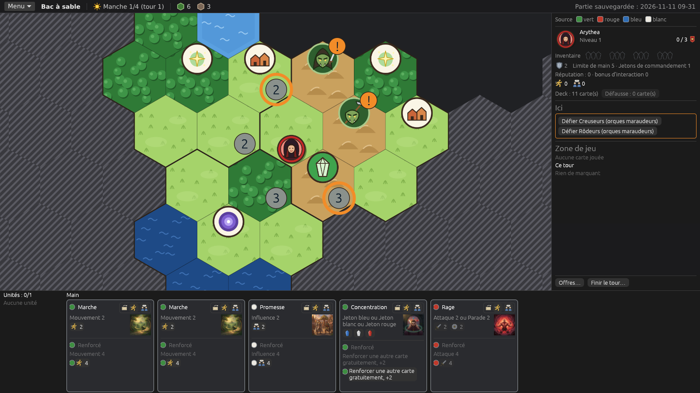
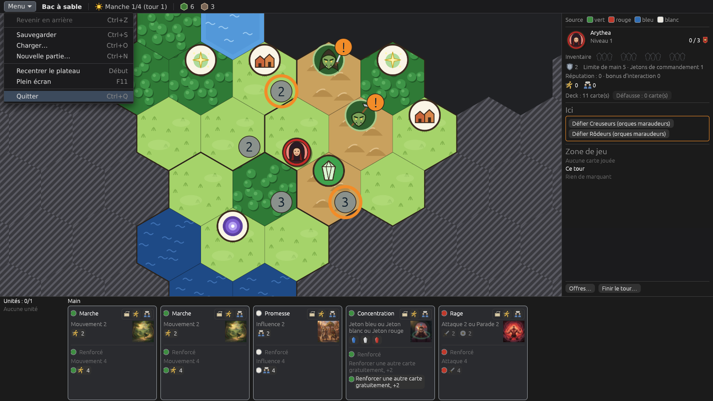
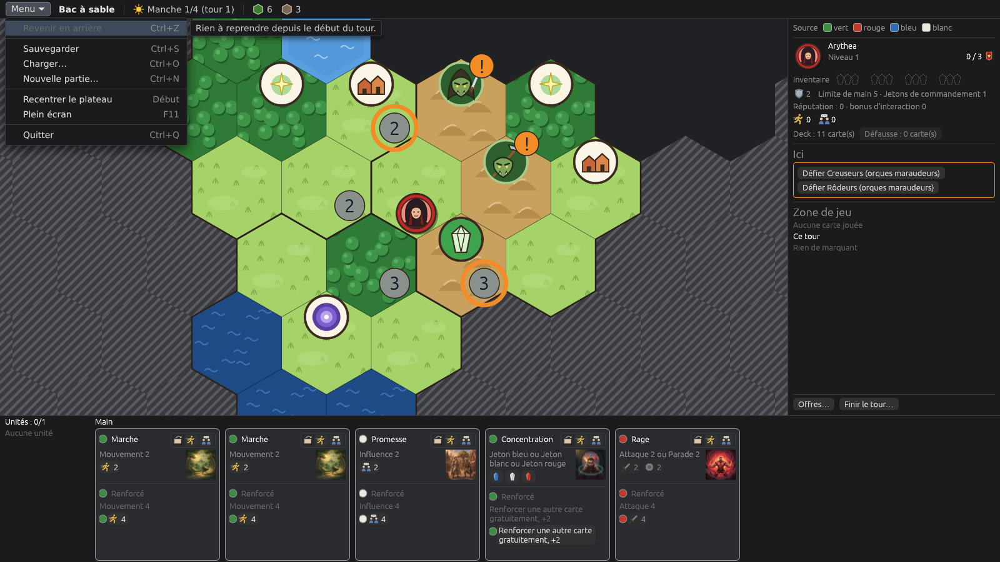
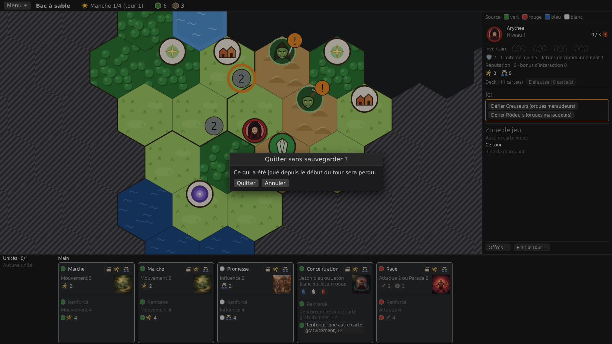

# 074 — Barre de menu

- Statut : implémentée (2026-11-11 ; validée le même jour, Q1 à Q5 tranchées par Mathieu ; plan :
  [`plans/074-barre-de-menu.md`](plans/074-barre-de-menu.md))
- Jalon : IHM (refonte de l'interface, entre J4 et J5)
- Dépend de : 024 (retour en arrière, sauvegarde, chargement, sauvegarde automatique), 065 (nouvelle partie, « Continuer »),
  071 (icônes, table des touches `KEY_BINDINGS`), 073 (panneaux : l'en-tête provisoire du panneau de droite), 011 (Recentrer),
  015 (pioche de tuiles, tuiles écartées), 023 (manche, jour et nuit) ; toutes implémentées
- Livret : aucune règle nouvelle. Rappels : MKUE p. 3 (dos des tuiles visibles : le nombre de tuiles de la pioche est public)
- Crates touchées : arcanum-ui, `assets/i18n/` (fr.json et en.json), `assets/images/ui/` (deux icônes). Rien dans arcanum-core :
  tout ce que la barre montre est déjà dans la vue.
- Base : [synthèse de la refonte](refonte-ihm.md), section « Disposition générale », premier point
- Maquettes : [`images/074-barre-de-menu/`](images/074-barre-de-menu/), HTML posé sur une capture du jeu actuel (partie
  préparée `combat-deux-ennemis`) ; script hors dépôt : `/mnt/project-files/ihm/074/`

## Objectif

Cinquième lot de la refonte : une **barre de menu** en haut de la fenêtre, sur toute sa largeur, sur le plateau comme en
combat. À gauche, un bouton **Menu** déroule les commandes de la partie (revenir en arrière, sauvegarder, charger, nouvelle
partie, recentrer le plateau, plein écran, quitter), chacune avec sa touche en face du libellé. À côté, ce qu'on regarde
souvent : le **scénario**, l'icône **jour ou nuit**, la **manche et le tour**, et les deux **pioches de tuiles** (campagne et
royaume) avec leur nombre restant. Le panneau de droite perd son en-tête provisoire (spec 073) et commence par la Source.

## Règles

Aucune règle n'est ajoutée ni changée : la barre montre des informations publiques que le panneau de droite montrait déjà.

- **Pioche de tuiles** (MKUE p. 3) : seul le dos des tuiles se voit, donc le nombre de tuiles de chaque pioche est public
  (déjà dans `PlayerView::tile_deck`, spec 015).
- **Pioche vide, tuiles écartées** (spec 015) : quand les deux pioches sont vides, les tuiles écartées encore révélables
  remplacent leur nombre, comme aujourd'hui (test `exploration.rs`, ligne « Pioche de tuiles vide · tuiles écartées »).
- **Revenir en arrière** (MKUE p. 5, *Reverting*) : inchangé, spec 024 ; seul l'endroit du bouton change.

## Modèle

Termes ajoutés au glossaire par cette PR (nouvelle section « Barre de menu (spec 074) ») : **barre de menu** (`MenuBar`),
**Menu** (le bouton qui déroule les commandes), **plein écran**.

### Écran : la barre au-dessus des trois zones de la spec 073









Les icônes des pioches sont provisoires dans la maquette (hexagones simples).

```
┌────────────────────────────────────────────────────────────────────────────────────────────┐
│ [Menu ▾]  Première reconnaissance   ☀ Manche 1/4 (tour 3)   ⬡ 6  ⬡ 3                       … │
├─────────────────────────────────────────────────────────────────┬──────────────────────────┤
│                                                                 │ (bandeaux)               │
│ Plateau de jeu                                                  │ Source                   │
│ ou écran de combat                                              │ Joueur                   │
│                                                                 │ Ici, zone de jeu …       │
│                                                                 │ [Offres] [Fin du tour]   │
├─────────────────────────────────────────────────────────────────┴──────────────────────────┤
│ Unités ▢▢▢        Main ▢▢▢▢▢▢▢                                                             │
└────────────────────────────────────────────────────────────────────────────────────────────┘
```

(« … » à droite de la barre : le message de la dernière sauvegarde, « Partie sauvegardée : … ».)

- **Barre de menu** (`MenuBar`, arcanum-ui, calculée sans egui comme `Controls`) : une ligne, au-dessus du panneau de droite et du
  plateau, sur toute la largeur de la fenêtre. De gauche à droite :
  1. le bouton **Menu**, qui déroule la liste ci-dessous ;
  2. le **nom du scénario** (« Première reconnaissance ») ; le héros n'y est plus, son portrait et son nom sont dans le
     panneau de droite (spec 073) ;
  3. l'**icône du jour ou de la nuit** (celle d'aujourd'hui, `time_of_day/day.svg` et `night.svg`, infobulle « Jour » ou
     « Nuit »), suivie de « Manche 1/4 (tour 3) » ;
  4. les **deux pioches de tuiles** : une icône de dos de tuile de campagne suivie de son nombre, puis une icône de dos de
     tuile royaume suivie du sien, chacune avec son infobulle ;
  5. à l'extrémité droite, le **message** de la dernière sauvegarde ou du dernier chargement (`Controls::notice`,
     spec 024), qui était sous les boutons de l'en-tête.
- **Le Menu**, dans cet ordre, séparateurs compris :

  | Élément | Touche affichée en face | Grisé quand… | Effet |
  |---|---|---|---|
  | Revenir en arrière | Ctrl+Z | comme aujourd'hui (spec 024 : rien à reprendre, point de non-retour, mode choix) | `Command::Undo` |
  | — | | | |
  | Sauvegarder | Ctrl+S | comme aujourd'hui (mode choix, fenêtre de chargement) | `Command::Save` |
  | Charger… | Ctrl+O | idem | `Command::OpenLoad` |
  | Nouvelle partie… | Ctrl+N | idem | `Command::OpenNewGame` |
  | — | | | |
  | Recentrer le plateau | Début | jamais | `Command::Recenter` (nouveau) |
  | Plein écran (coché quand il l'est) | F11 | jamais | `Command::ToggleFullscreen` (nouveau) |
  | — | | | |
  | Quitter | Ctrl+Q | jamais | `Command::Quit` (nouveau) |

  L'infobulle d'un élément donne sa description seule (celle d'aujourd'hui pour les quatre premiers, raison du grisé
  comprise) : sa touche est déjà écrite en face du libellé (synthèse, « en face du libellé dans les menus » ; spec 071,
  hors périmètre). Recentrer, Plein écran et Quitter n'ont pas de description.
- **Demandes à la fenêtre** (`WindowRequest`, arcanum-ui) : Recentrer, Plein écran et Quitter ne touchent pas la partie. La
  session (`ClientSession`) les note dans une file que l'application vide à chaque image pour les transmettre à la fenêtre
  (recadrage du plateau, `ViewportCommand::Fullscreen`, `ViewportCommand::Close`) : elles se testent sans fenêtre.
- **État du plein écran** : celui de la fenêtre (`ViewportInfo::fullscreen` d'egui), que l'application donne à la session à
  chaque image ; la case cochée du menu le suit, même si le système l'a changé autrement. Il n'est pas gardé d'un lancement à
  l'autre (hors périmètre).
- **Quitter** (Q1) : ferme le jeu **sans rien écrire**, comme la croix de la fenêtre aujourd'hui ; « Continuer » (spec 065)
  repart de la sauvegarde automatique du début du tour. Si le tour a **avancé depuis la sauvegarde automatique** (le journal
  de la partie est plus long qu'à son écriture, `GameSession::autosaved_len`), une **confirmation** s'ouvre d'abord :
  « Quitter sans sauvegarder ? Ce qui a été joué depuis le début du tour sera perdu. », boutons « Quitter » (Entrée) et
  « Annuler » (Échap). Une sauvegarde Ctrl+S ne compte pas : seule la sauvegarde automatique est reprise par « Continuer ».
  La croix de la fenêtre fait la même chose : la fermeture demandée par le système est annulée
  (`ViewportCommand::CancelClose`) le temps de la confirmation.
- **Au lancement** (fenêtre de nouvelle partie seule, spec 065) : pas de barre ; F11 et Ctrl+Q agissent quand même (Q5).

### Les éléments qui quittent le panneau de droite

L'en-tête provisoire du panneau de droite (spec 073, « Panneau de droite » point 1) disparaît : ligne « scénario · héros »,
ligne de la manche, ligne de la pioche de tuiles, boutons Revenir en arrière, Sauvegarder, Charger…, Nouvelle partie… et
Recentrer, message de la sauvegarde. Le panneau commence par les bandeaux (dernier tour, niveaux gagnés, nouvelle manche, fin
de partie et « Score final »), qui restent à leur place, puis la Source.

Les champs `GameScreen::scenario`, `time_of_day`, `clock` et `tile_deck` passent dans `MenuBar` (le contenu change : nom
du scénario seul, manche sans le mot « Jour », pioches en deux nombres). **Tests existants modifiés**, signalés ici comme
l'exige le CLAUDE.md : `panel_names_first_reconnaissance` (premiere_reconnaissance.rs) et
`side_panel_shows_scenario_and_tile_deck` (scenario_affichage.rs) deviennent C4 et C6 ; les assertions sur
`screen.time_of_day` de fin_de_manche.rs deviennent C5 ; celle sur `.tile_deck` de exploration.rs devient C7. Les
tests de `Controls` (sauvegarde_ui.rs, `undo_button_follows_status`…) ne changent pas : le menu reprend `Controls` tel quel.

## Actions et événements

Aucune action ni événement de jeu : Recentrer, Plein écran et Quitter sont des commandes de l'écran (`Command`), comme
Sauvegarder. Revenir en arrière, Sauvegarder, Charger… et Nouvelle partie… gardent leurs commandes d'aujourd'hui.

## Comportements attendus

Chaque cas devient au moins un test (nom indicatif entre parenthèses). Exemples dans le bac à sable (`Scenario::sandbox`,
4 manches, pioche de départ 6 tuiles de campagne et 3 royaume, spec 012) ou dans « Première reconnaissance » (même plateau),
avec Arythea.

### Le Menu

- **C1** — Le Menu d'une partie en cours liste, dans l'ordre : Revenir en arrière, séparateur, Sauvegarder, Charger…,
  Nouvelle partie…, séparateur, Recentrer le plateau, Plein écran, séparateur, Quitter ; touches en face « Ctrl+Z »,
  « Ctrl+S », « Ctrl+O », « Ctrl+N », « Début », « F11 », « Ctrl+Q » (`menu_lists_commands_with_keys`).
- **C2** — Les quatre premiers éléments ont le libellé, la description, l'état grisé et la commande du bouton de `Controls`
  correspondant (spec 024, tests `undo_button_follows_status` et suivants de sauvegarde_ui.rs) : au début du premier tour,
  Revenir en arrière est grisé avec la description « Rien à reprendre depuis le début du tour. » (`undo.blocked.turn_start`),
  Sauvegarder est actif (`menu_follows_controls`).
- **C3** — Recentrer le plateau, Plein écran et Quitter sont actifs en mode choix (choix de la carte à défausser, spec 013),
  quand Sauvegarder est grisé (`window_commands_stay_enabled_in_choice_mode`).

### Les informations de la barre

- **C4** — Nom du scénario seul : « Première reconnaissance » pour une partie de ce scénario, « Bac à sable » pour le bac à
  sable, sans le héros (`bar_names_scenario_only` ; remplace `panel_names_first_reconnaissance` et la première assertion de
  `side_panel_shows_scenario_and_tile_deck`).
- **C5** — Manche et tour : au début d'une partie du bac à sable, icône du jour (`Clock::time_of_day` = Jour, infobulle
  « Jour ») et « Manche 1/4 (tour 1) » ; après l'annonce de la fin de la manche et la préparation de la suivante, icône de la
  nuit et « Manche 2/4 (tour 1) » (`bar_shows_round_and_turn` ; remplace les assertions sur `screen.time_of_day` de
  fin_de_manche.rs, qui portaient « Manche 1/4 · Jour (tour 1) »).
- **C6** — Pioches de tuiles : au début du bac à sable, l'icône de la campagne suivie de « 6 », infobulle « Pioche de tuiles
  de campagne : 6 », puis l'icône du royaume suivie de « 3 », infobulle « Pioche de tuiles royaume : 3 »
  (`bar_shows_tile_decks` ; remplace la seconde assertion de `side_panel_shows_scenario_and_tile_deck`).
- **C7** — Pioche vide : quand les deux pioches sont vides et qu'il reste des tuiles écartées (état de la fin du test de
  exploration.rs qui vérifie aujourd'hui « Pioche de tuiles vide · tuiles écartées : 9 campagne, 4 royaume »), les deux
  nombres sont ceux des tuiles écartées, « 9 » et « 4 », infobulles « Pioche vide · tuiles de campagne écartées : 9 » et
  « Pioche vide · tuiles royaume écartées : 4 »
  (`bar_shows_removed_tiles_when_decks_are_empty` ; remplace l'assertion sur `.tile_deck` de exploration.rs).
- **C8** — Les deux icônes de dos de tuile (`Icon::TileCountryside`, `Icon::TileCore`) ont leur SVG dans
  `assets/images/ui/` et leur nom traduit, comme les autres icônes de la planche (tests `every_icon_image_exists` et
  `every_icon_has_a_name`, la planche passe de 24 à 26 icônes).
- **C9** — Le message de la sauvegarde est dans la barre : après Ctrl+S, `MenuBar::notice` vaut « Partie sauvegardée :
  <nom> » (`save.done`) (`bar_shows_save_notice`).
- **C10** — En combat (un ennemi errant combattu, décor `fighting` des tests de icones.rs, spec 031), la barre est la même : nom du scénario, manche et
  tour, pioches et Menu (`bar_stays_during_combat`).

### Plein écran, Recentrer, Quitter

- **C11** — `Command::ToggleFullscreen` hors plein écran ajoute la demande « plein écran : oui » à la file ; en plein écran,
  « plein écran : non » ; l'élément Plein écran est coché quand la fenêtre dit être en plein écran
  (`toggle_fullscreen_requests_the_opposite_state`).
- **C12** — `Command::Recenter` ajoute la demande « recentrer » à la file (`recenter_is_a_window_request`).
- **C13** — Quitter au début d'un tour (rien joué depuis la sauvegarde automatique) : aucune confirmation, rien n'est écrit,
  la demande « fermer » est ajoutée (`quit_at_turn_start_closes_at_once`) — Q1.
- **C14** — Quitter après une carte jouée de côté (n'importe quelle carte de la main hors Blessure, Mouvement 1 hors combat,
  MKUE p. 4, 3.e) : la confirmation s'ouvre, sans demande « fermer » ; « Annuler » (ou Échap) la ferme et la partie continue,
  carte toujours jouée ; « Quitter » (ou Entrée) ajoute la demande « fermer » sans rien écrire : la sauvegarde automatique
  reste celle du début du tour (`quit_after_play_asks_confirmation`) — Q1.
- **C15** — Quitter une partie terminée (fenêtre de fin, spec 063) : aucune confirmation, rien n'est écrit, la demande
  « fermer » est ajoutée (`quit_finished_game_closes_at_once`).
- **C16** — La croix de la fenêtre fait comme Quitter : au début du tour, le jeu se ferme ; après une carte jouée, la
  fermeture est annulée et la même confirmation s'ouvre (`window_close_asks_confirmation_after_play`) — Q1.
- **C17** — Touches : `KEY_BINDINGS` lie Ctrl+Q à Quitter et F11 à Plein écran ; leurs libellés sont « Ctrl+Q » et « F11 »
  (`quit_and_fullscreen_keys_are_bound`).
- **C18** — Au lancement, fenêtre de nouvelle partie ouverte et aucune partie : Ctrl+Q ajoute la demande « fermer » sans rien
  écrire, F11 la demande de plein écran (`launch_screen_accepts_quit_and_fullscreen`) — Q5.

## Cas limites et refus

- **L1** — Fenêtre de nouvelle partie ouverte pendant une partie (Ctrl+N) : Revenir en arrière, Sauvegarder, Charger… et
  Nouvelle partie… sont grisés (aujourd'hui leurs boutons restent actifs mais sans effet) ; Recentrer, Plein écran et Quitter
  restent actifs (`menu_greys_game_commands_behind_new_game_window`).
- **L2** — Fenêtre de chargement ouverte : grisés comme aujourd'hui (spec 024, L7), Plein écran et Quitter actifs.
- **L3** — Pas de dossier de sauvegardes (spec 024) : même règle ; la confirmation dit la même chose, puisque rien n'est
  repris de toute façon (`quit_without_saves_dir_follows_the_same_rule`).
- **L4** — Confirmation ouverte : les autres touches et boutons ne jouent pas ; Ctrl+Q de nouveau ne fait rien de plus.
- **L5** — Quitter en mode choix (choix du mana, fin du tour…) : permis, même règle ; « Annuler » rend le mode tel quel.
- **L6** — Les touches ne jouent pas quand un champ de saisie a le focus (règle générale, `docs/raccourcis.md`) : F11 et Ctrl+Q
  dans le champ de la graine ne font rien.
- **L7** — Nom de scénario long ou fenêtre étroite : la barre ne passe pas à la ligne ; le nom du scénario se tronque avec
  « … » avant les autres éléments (vérification à l'œil).

## Information cachée

Rien de nouveau : la barre lit `PlayerView::scenario`, `time_of_day`, `round`, `turn`, `tile_deck` et `removed_tiles`, déjà
publics (specs 012, 014, 015, 016, 023). Aucun champ de la vue n'est ajouté.

## Libellés (i18n)

Nouvelles clés (fr / en) :

| Clé | Paramètres | fr | en |
|---|---|---|---|
| `menu.title` | — | Menu | Menu |
| `menu.round` | `round`, `limit`, `number` | Manche {round}/{limit} (tour {number}) | Round {round}/{limit} (turn {number}) |
| `menu.fullscreen` | — | Plein écran | Full screen |
| `menu.quit` | — | Quitter | Quit |
| `quit.confirm.title` | — | Quitter sans sauvegarder ? | Quit without saving? |
| `quit.confirm.text` | — | Ce qui a été joué depuis le début du tour sera perdu. | What was played since the start of the turn will be lost. |
| `quit.confirm.quit` | — | Quitter | Quit |
| `quit.confirm.cancel` | — | Annuler | Cancel |
| `menu.tiles.countryside` | `count` | Pioche de tuiles de campagne : {count} | Countryside tile deck: {count} |
| `menu.tiles.core` | `count` | Pioche de tuiles royaume : {count} | Core tile deck: {count} |
| `menu.tiles.countryside_removed` | `count` | Pioche vide · tuiles de campagne écartées : {count} | Deck empty · removed Countryside tiles: {count} |
| `menu.tiles.core_removed` | `count` | Pioche vide · tuiles royaume écartées : {count} | Deck empty · removed Core tiles: {count} |
| `icon.tile.countryside` | — | Tuile de campagne | Countryside tile |
| `icon.tile.core` | — | Tuile royaume | Core tile |

Texte obtenu avec les paramètres des exemples : `menu.round` (1, 4, 3) donne « Manche 1/4 (tour 3) » / « Round 1/4 (turn 3) » ;
`menu.tiles.countryside` (6) donne « Pioche de tuiles de campagne : 6 » / « Countryside tile deck: 6 » ;
`menu.tiles.core_removed` (4) donne « Pioche vide · tuiles royaume écartées : 4 » / « Deck empty · removed Core tiles: 4 »
(pas d'accord à faire : le nombre suit les deux-points). `menu`, `menu.tiles`, `quit`, `quit.confirm` et `icon.tile` sont des groupes neufs, sans
libellé du même nom (vérifié dans fr.json).

Libellés réutilisés, relus dans `assets/i18n/fr.json` :

- `undo.button` « Revenir en arrière », `save.button` « Sauvegarder », `load.button` « Charger… », `new_game.button`
  « Nouvelle partie… », et leurs descriptions `undo.hint` « Reprendre votre dernière action » (ou `undo.blocked.*`),
  `save.hint` « Sauvegarder la partie », `load.hint` « Charger une partie », `new_game.hint` « Commencer une autre partie » :
  inchangés, ils conviennent dans un menu.
- `board.recenter` « Recentrer » / « Recenter » : **valeur changée** en « Recentrer le plateau » / « Recenter the board »,
  seul dans un menu ; la clé n'a pas d'autre usage (seul le bouton de l'en-tête provisoire, qui disparaît, la lisait).
- `time_of_day.icon.day` « Jour », `time_of_day.icon.night` « Nuit » : infobulle de l'icône, inchangée.
- `save.done` « Partie sauvegardée : {name} » et les autres messages de `Controls::notice` : inchangés.
- `shortcut.key.ctrl` « Ctrl+{key} » avec `{key}` = « Q » donne « Ctrl+Q » ; « F11 » vient du nom de la touche
  (`Key::F11.name()`), sans traduction, comme les lettres. Une clé `shortcut.key.home` « Début » / « Home » est **ajoutée**
  pour écrire la touche de Recentrer en face de l'élément (la touche Début est lue par la caméra, hors de `KEY_BINDINGS`).

Clés retirées (plus lues) : `panel.scenario_and_hero`, `board.tile_deck`, `board.tile_deck_empty`. `turn.line` reste : la
fenêtre de chargement et « Continuer » l'utilisent.

Aucun caractère nouveau : « · », « … » et les guillemets sont déjà affichés ailleurs ; la flèche du bouton Menu est celle que
dessine egui (`menu_button`), pas un caractère du libellé.

## Interface

- **Barre de menu en haut** de la fenêtre, sur toute sa largeur, au-dessus du panneau de droite et du plateau, sur le plateau
  comme en combat (C10 ; placement : vérification à l'œil).
- **Bouton Menu** et sa liste : éléments, séparateurs, touches en face des libellés, grisés et infobulles (C1, C2, C3, L1, L2 ;
  alignement des touches à droite : vérification à l'œil). Plein écran coché (C11).
- **Nom du scénario** (C4, `PlayerView::scenario`), tronqué si la place manque (L7, vérification à l'œil).
- **Icône du jour ou de la nuit** et « Manche 1/4 (tour 3) » (C5, `PlayerView::time_of_day`, `round`, `turn`, et le nombre de
  manches du scénario).
- **Pioches de tuiles** : deux icônes neuves et leurs nombres (C6, C7, C8, `PlayerView::tile_deck`, `removed_tiles`). Les
  icônes sont dessinées par nous : un petit hexagone vu de dessus, vert sombre pour la campagne, brun-gris pour le royaume,
  dans le style des icônes de la spec 071 (vérification à l'œil).
- **Message** de la sauvegarde à droite de la barre (C9).
- **Panneau de droite** sans en-tête : il commence par les bandeaux, puis la Source (vérification à l'œil).
- **Confirmation de Quitter** : petite fenêtre au centre, comme celle du chargement (C14, C16).
- **Plein écran, Recentrer, Quitter** transmis à la fenêtre (C11 à C16 ; l'effet réel sur la fenêtre : vérification à l'œil sous
  Xvfb, `scripts/verif-manuelle.sh`).

### Raccourcis clavier

| Touche | Effet | Contexte |
|---|---|---|
| Ctrl+Q | Quitter le jeu (confirmation si le tour a avancé, Q1) | Toujours, lancement compris, hors champ de saisie |
| Entrée | Quitter sans sauvegarder | Confirmation de Quitter ouverte |
| Échap | Annuler, rester dans la partie | Confirmation de Quitter ouverte |
| F11 | Passer en plein écran ou en sortir | Toujours, lancement compris, hors champ de saisie |

Ctrl+Z, Ctrl+S, Ctrl+O, Ctrl+N et Début : inchangés, désormais écrits en face des éléments du Menu. Reportés dans
`docs/raccourcis.md` par l'implémentation.

## Hors périmètre

- **Actions sur le plateau** (défier, interagir, entrer près de la case) et section « Ici » : issue privée 169, avec la spec 075.
- **Jetons d'ennemis révélés** dessinés en figurines : issue privée 165, avec la spec 075.
- **Aide des touches** (fenêtre qui liste toutes les touches, dont celles du plateau sans bouton : flèches, `+`/`-`) : la spec
  071 l'avait renvoyée « avec la spec 074 » au conditionnel ; pas dans ce lot, pour le garder petit (Q3, issue #1). `docs/raccourcis.md`
  reste la référence.
- **Préférences gardées d'un lancement à l'autre** (plein écran, taille de la fenêtre) : pas de fichier de réglages aujourd'hui.
- **Sauvegarde en quittant** : non (Q1) ; seule la sauvegarde automatique du début du tour est reprise.
- **Nouvelle partie en plusieurs étapes** : issue privée 162 (réservée).
- **Audio** (volume dans le menu) : point ouvert de la synthèse, sans spec.
- **Autres joueurs, joueur fantôme** dans la barre : avec leurs specs (J6).

## Décisions de Mathieu (2026-11-11)

- **Q1. Quitter et la croix de la fenêtre** : fermer sans rien écrire, comme aujourd'hui, mais demander une confirmation si
  le tour a avancé depuis la sauvegarde automatique (C13 à C16). La proposition (réécrire la sauvegarde automatique) est
  écartée.
- **Q2. Revenir en arrière** : dans le Menu seul (et Ctrl+Z), pas de bouton dans la barre, comme dans la synthèse.
- **Q3. Aide des touches** : hors de cette spec, tracée dans l'issue #1.
- **Q4. Touches** : Ctrl+Q pour Quitter, F11 pour le plein écran, Recentrer dans le Menu avec sa touche Début (proposition
  acceptée).
- **Q5. Au lancement** : pas de barre sur l'écran de nouvelle partie ; F11 et Ctrl+Q y agissent (proposition acceptée).

## Questions ouvertes

Aucune.
