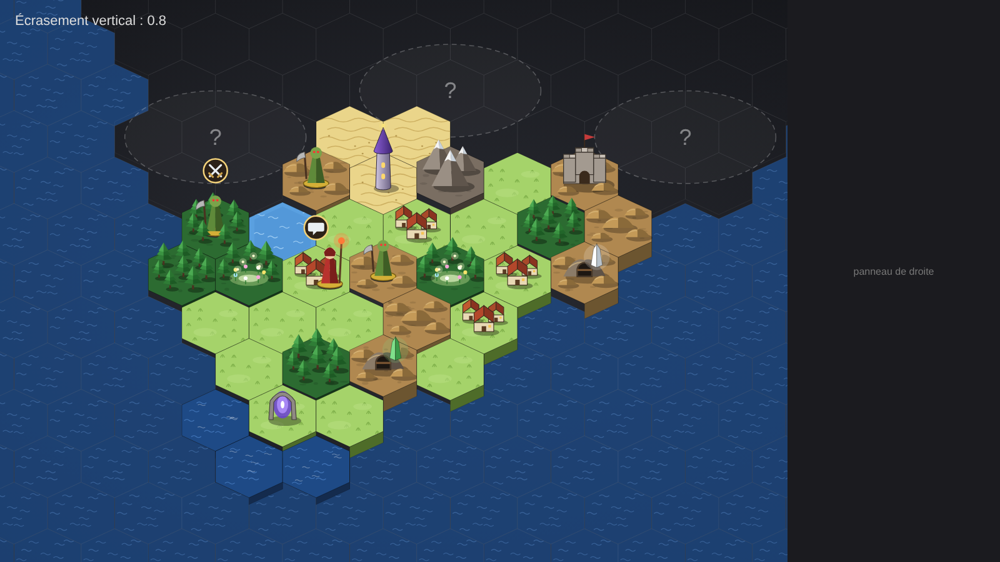
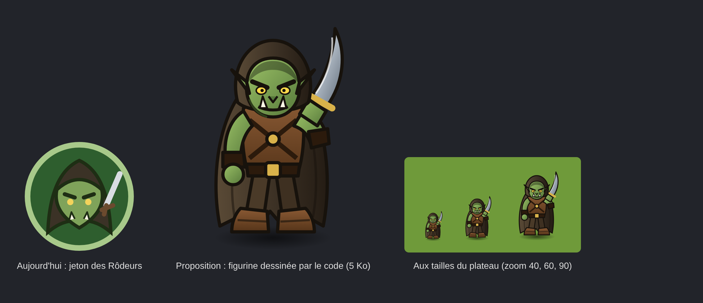

# 075 — Plateau isométrique

- Statut : validée (2026-11-11, par Mathieu ; Q1 à Q9 tranchées, section Décisions ; plan :
  [`plans/075-plateau-isometrique.md`](plans/075-plateau-isometrique.md)) ; implémentée : fil A (géométrie, étapes 1 à 5),
  fil B (éléments debout, étapes 6 à 9) et fil C (actions et essai d'animation, étapes 10 à 15) ; restent les dessins D4
  et D5
- Jalon : IHM (refonte de l'interface, entre J4 et J5)
- Dépend de : 011 (affichage du plateau, caméra), 012 (forme du plateau, zone au-delà de la côte), 014, 015, 017, 036 (cases
  atteignables, exploration, trajets), 030 (ennemis errants, « Défier »), 037 (infobulle de survol), 040 à 045 (actions des
  sites), 065 (héros de la partie), 071 (icônes), 073 (panneau de droite, section Ici provisoire), 074 (Menu) ; toutes
  implémentées
- Livret : aucune règle nouvelle. Rappels : MKUE p. 14 *Map Shape* (côte), p. 7, 5.a (pas de tuile derrière la côte)
- Crates touchées : arcanum-ui, `assets/images/` (terrains, sites, ennemis, héros, icônes d'action), `assets/i18n/`. Rien dans
  arcanum-core : tout ce que le plateau montre est déjà dans la vue.
- Base : [synthèse de la refonte](refonte-ihm.md), sections « Plateau » et « Décisions prises » ; issues privée 169 (actions sur
  le plateau) et issue privée 165 (monstres sur pied aux sites), reprises ici avec l'accord de Mathieu
- Maquettes : [`images/075-plateau-isometrique/`](images/075-plateau-isometrique/), SVG dessinés par un script hors dépôt
  (`/mnt/project-files/ihm/075/maquette.py`), même plateau que la maquette de la synthèse

## Objectif

Dernier lot de la refonte : le plateau de jeu passe en **vue isométrique 2D**. Les cases sont vues de trois quarts, les
forêts, collines et montagnes ont du relief, les sites, le héros et les monstres sont **debout** sur leur case, la **mer**
couvre ce qui est au-delà de la côte et le zoom est **borné**. Un **essai d'animation** porte sur le seul héros (Q6). Les actions
du lieu (défier, interagir, piller, incendier, entrer, faire une offrande) se déclenchent par des **boutons-icônes posés sur
la case concernée**, et la section provisoire « Ici » du panneau de droite disparaît (issue privée 169). Un ennemi posé sur un
site se voit en figurine, dans le brouillard tant qu'il est face cachée (issue privée 165).

Le jeu se joue exactement comme avant : mêmes clics sur les cases, mêmes trajets, mêmes infobulles, mêmes touches.

## Règles

Aucune règle n'est ajoutée ni changée.

- **Côte** (MKUE p. 14 *Map Shape* ; p. 7, 5.a) : la zone où aucune tuile ne peut être posée est déjà calculée
  (`MapShape::allows`, spec 012) ; la spec change seulement son dessin (mer au lieu des hachures).
- **Information publique** : dos des jetons d'ennemis, donc leur couleur (spec 043, `PlayerView::face_down_defenders`) ; le
  brouillard ne montre rien de plus que le dos du jeton d'aujourd'hui.
- **Actions du lieu** : leurs conditions restent celles des specs 030, 031, 040 à 045 ; seul l'endroit du bouton change.

## Modèle

Termes ajoutés au glossaire par cette PR (section « Plateau isométrique (spec 075) ») : **vue isométrique**, **inclinaison**
(`BOARD_TILT`), **élément debout** (`Overlay` : décor de relief, site, figurine, drapeau), **figurine** (héros ou monstre
debout), **brouillard** (ennemi face cachée), **bouton d'action du plateau** (`BoardAction`).

### Projection



Variantes écartées : [0,58 (maquette de la synthèse, trop inclinée)](images/075-plateau-isometrique/inclinaison-0-58.png),
[0,70](images/075-plateau-isometrique/inclinaison-0-70.png).

- Les **coordonnées du plateau ne changent pas** (`geometry.rs` : rayon 1, pointe en haut, `hex_center`, `hex_corners`,
  `point_to_hex`). Seule la caméra change : elle écrase l'axe vertical par l'inclinaison.

  ```
  écran.x = centre_zone.x + (plateau.x − caméra.x) × zoom
  écran.y = centre_zone.y + (plateau.y − caméra.y) × zoom × BOARD_TILT        BOARD_TILT = 0,80 (Q1)
  ```

  `to_board` fait l'inverse. Le zoom reste « points d'écran par rayon de case », mesuré à l'horizontale.
- **Le sol est plat** : toutes les cases sont au même niveau, donc la case sous le curseur se calcule exactement
  (`point_to_hex(camera.to_board(curseur))`). Le relief vient de ce qui est **posé debout** sur les cases, pas de cases
  surélevées (la maquette surélevait un peu collines et montagnes : abandonné, Q3).
- **Tranche** : le plateau a une épaisseur. Une case de tuile dont la voisine du sud-est ou du sud-ouest n'a pas de tuile
  montre sa tranche (0,22 rayon, couleur du terrain assombrie), y compris au bord de la mer.
- **Éléments debout** : dessinés sans écrasement, le pied sur leur case, et **de l'arrière vers l'avant** (par `y` croissant
  du pied, puis `x`), après tout le sol. Un élément du nord est donc caché en partie par celui du sud, jamais l'inverse.
  Ils ne captent pas le clic : cliquer sur le haut d'une tour vise la case sous le curseur, pas celle de la tour (L2).

### Ce qui est posé sur une case, de l'arrière vers l'avant

```
        décor de relief (arbres, buttes, pics)          terrain : forêt, collines, montagne
        site debout (+ drapeau du héros s'il est conquis)
        à gauche du site : défenseur(s) ou jeton de ruines
        figurine du héros, devant et un peu à droite
     ─────────────── sol de la case (terrain écrasé) ───────────────
```

- **Sol** : l'image du terrain, écrasée. Forêt, collines et montagne reçoivent un sol nu redessiné (leurs arbres, buttes et
  pics deviennent du décor debout).
- **Décor de relief** : une image par terrain en relief, en deux variantes : **pleine**, ou **dégagée** au centre quand la
  case porte un site, un jeton ou une figurine. Plaine, désert, marais, friche, lac et mer restent plats.
- **Sites** : les 19 images de `assets/images/site/` sont redessinées debout (village à reprendre, retour de Mathieu sur la
  maquette). Le **drapeau** du héros (spec 043) est planté à gauche du site conquis ou du monastère incendié, à la place du défenseur
  qu'un site conquis n'a plus (à droite, la figurine restée sur le site le cachait : issue privée 292).
- **Figurines** : héros et monstres sont dessinés **par le code** (SVG écrits à la main, Q4), en pied, sur le modèle des
  Rôdeurs de l'essai, dans un dossier neuf `assets/images/figure/` : `figure/<héros>.svg` pour les quatre héros,
  `figure/<ennemi>.svg` pour les 29 ennemis de `enemies.ron`, `figure/fog.svg` pour le brouillard. Même gabarit pour
  toutes (cadre 120 × 160, pieds au milieu du bas, parties séparées et nommées : cape, jambes, torse, bras, tête), décrit
  dans `assets/images/figure/README.md`.
  - **Écran de combat** : la carte d'un ennemi montre sa figurine à la place du jeton rond (même repli, disque à la
    couleur de la pile). Les jetons de `assets/images/enemy/` (12 ennemis, 6 dos, 2 symboles d'ennemis errants) ne
    servent plus à rien et sont **supprimés** avec leur dossier (Mathieu, Q4).
  - Le panneau de droite montre aussi la figurine du héros, à la place de son portrait rond (retour de Mathieu sur le
    fil B, 2026-11-11) ; les portraits `hero/<héros>.svg` restent sur l'écran de nouvelle partie. Les `hero/<héros>-improved.svg` vectorisés (issue privée 167) et les portraits de
    `scripts/illustrations/heroes/` ne sont pas affichés : ils servent de modèle pour dessiner les héros.
  - Héros : sa figurine sur un socle à sa couleur (`hero_color`).
  - Ennemi errant : sa figurine sur sa case, à la place du jeton rond (spec 030).
  - Ennemi face visible resté sur un site (spec 043 défenseur retourné, spec 044 site d'aventure) : sa figurine à gauche
    du site ; deux ennemis (Sombre Terrier), deux figurines côte à côte, réduites (issue privée 165).
  - Défenseur **face cachée** : une silhouette dans un **brouillard** teinté à la couleur de sa pile (gris, violet, blanc),
    à la place du dos de jeton (issue privée 165) : une seule image claire, teintée par le code.
- **Jeton de ruines** (spec 045) : reste un jeton, posé à plat (écrasé comme le sol), ses pastilles lisibles.
- **Marques du jeu** (cases atteignables, pastilles de coût, trajet, fantôme d'exploration, « ! » de provocation) : mêmes
  règles qu'aujourd'hui, dessinées au sol (écrasées), sauf les pastilles de coût et le « ! », qui restent droits et passent
  par-dessus les éléments debout pour rester lisibles.

### Mer et emplacements à découvrir

- La zone au-delà de la côte (`BoardScreen::forbidden`) est dessinée en **mer**, avec la même image que les cases de mer
  des tuiles, un peu plus sombre, jusqu'aux bords de la zone visible. Les hachures grises (`board/forbidden.svg`)
  disparaissent.
- Les emplacements où une tuile peut encore venir **restent sombres** (fond actuel), avec le fantôme d'exploration de la
  spec 015 pour ceux qui touchent la figurine.

### Caméra : zoom et défilement bornés

- **Dézoom** : on ne dézoome pas au-delà de `0,5 ×` le zoom de cadrage (celui de « Recentrer », tout le plateau visible),
  avec un plancher absolu de 16 (`OVERLAY_MIN_ZOOM` : les figurines sont donc toujours dessinées). Le zoom maximal reste
  120. La borne suit le plateau : elle baisse quand une tuile révélée l'agrandit.
- **Cadrage** (`BoardCamera::initial`, Recentrer, touche Début) : calculé sur le plateau projeté, avec la marge actuelle et
  la hauteur des éléments debout en haut.
- **Défilement** : le centre de la caméra ne sort pas du rectangle qui englobe les tuiles posées ; le plateau ne peut plus
  être perdu hors de l'écran.

### Boutons d'action du plateau (issue privée 169)

Des boutons ronds à icône, de taille fixe à l'écran (36 points, quel que soit le zoom), au-dessus de la case concernée, par
dessus tout le reste, voile de nuit compris. Plusieurs boutons d'une même case s'alignent côte à côte.

| Bouton | Icône | Case | Action (inchangée) | Touche |
|---|---|---|---|---|
| Défier | deux épées croisées | celle de l'ennemi errant voisin | `Action::Challenge` (spec 030) | — |
| Engager le combat | deux épées croisées, fond rouge | chaque case de `enemies_to_fight` | `Action::StartCombat` (spec 031) | — |
| Interagir | bulle de dialogue | celle du héros | `Action::Interact` (spec 040) | I |
| Piller | bourse | celle du héros | pillage du village (spec 041) | — |
| Incendier | flamme | celle du héros | `Command::OpenBurn` (spec 041) | — |
| Entrer | porte | celle du héros | `Command::OpenAdventure` (spec 044) | E |
| Offrande | autel | celle du héros | `Command::OpenAltar` (spec 045) | E |

- Un bouton existe **exactement quand** le bouton de la section Ici existe aujourd'hui (mêmes champs de `GameScreen` :
  `combat_buttons`, `interact`, `plunder`, `burn`, `adventure`, `altar`), grisé dans les mêmes cas (offrande sans mana).
- Son **infobulle** reprend le libellé d'aujourd'hui, puis l'avertissement qui l'accompagnait (points perdus par
  l'interaction, raison du bouton grisé), puis « Raccourci : … ».
- **Pendant une interaction** (`PlayerView::interaction`) : un **menu** s'ouvre à côté de la case du site, titré comme
  l'en-tête d'aujourd'hui (« Interaction : Village »). Il liste les boutons actuels, dans l'ordre actuel : recrutement,
  achats (soin, action avancée, sort), grisés avec leur raison en infobulle. Un clic sur le bouton bulle replie ou déplie
  le menu, pour voir le plateau.
- **Confirmations** de l'incendie et de l'entrée dans un site d'aventure : dans le même cadre, près de la case, avec leurs
  boutons actuels ; Échap annule comme aujourd'hui.
- Ce qui **reste dans le panneau de droite** : les boutons de soin hors combat (spec 042 : ils dépensent des points de
  soin, pas une action du lieu), placés sous les points du joueur. La section « Ici », son titre et le bandeau « À
  combattre : … » disparaissent ; ce dernier devient l'infobulle du bouton « Engager le combat ».
- Les boutons ne sont pas dessinés quand le plateau ne montre pas les déplacements (`GameSession::board_shows_moves` faux :
  mode fin du tour) ni en combat sous « Voir le plateau ».

### Animations : un essai sur un seul héros (Q6)

Les animations envisagées par la synthèse (respiration des figurines, drapeau, vagues, scintillement des cristaux,
brouillard) ne sont **pas** dans cette spec : Mathieu veut d'abord en juger sur un héros. La spec livre donc un **essai**,
sur la figurine du héros de la partie seulement :

| Animation | Mouvement |
|---|---|
| Respiration | hauteur de la figurine ± 2 %, période 3 s |
| Déplacement | la figurine glisse d'une case à la suivante, 150 ms par pas, le long du trajet joué |

- Calculées à partir d'un temps injecté (`BoardInput::time`, en secondes) : l'écran reste une fonction pure.
- Le plateau se redessine au plus **30 fois par seconde** pour l'essai, et seulement quand il est affiché et que la fenêtre
  a le focus ; sinon le temps s'arrête et le jeu ne consomme rien, comme aujourd'hui.
- Après l'essai, Mathieu décide : les autres animations et la ligne « Animations » du Menu qui les coupe (Q7) font alors
  l'objet d'une spec à part ; sinon l'essai est retiré.

## Actions et événements

Aucune action ni événement nouveau. Commande d'écran nouvelle : `Command::ToggleSiteMenu`.

## Comportements attendus

Tests dans `crates/arcanum-ui/tests/plateau_isometrique.rs`, sauf mention. Les cases viennent du décor `Units` de l'arène
(village (2, −3), Rôdeurs voisins en (3, −3), spec 073 C25) et de `docs/reference/bac-a-sable.md`.

### Projection et caméra

- **C1** — `to_screen` écrase la verticale : deux points du plateau distants de (1, 1) sont distants de
  (zoom, zoom × `BOARD_TILT`) à l'écran (`camera_squashes_the_vertical_axis`).
- **C2** — `to_board(to_screen(p)) = p` et la case sous le centre projeté d'une case est cette case, pour toutes les cases à
  moins de 4 de l'origine (`picking_inverts_the_projection`).
- **C3** — Comme aujourd'hui (spec 011, tests `wheel_zoom_keeps_point_under_cursor`, `key_zoom_keeps_area_center`), le zoom
  garde fixe le point sous le curseur ou le centre de la zone ; les deux tests passent sans changement.
- **C4** — Le cadrage initial montre tous les sommets projetés de toutes les cases, marge comprise, et laisse en haut la
  hauteur d'un élément debout (`initial_camera_fits_the_projected_map`).
- **C5** — Dézoomer de 80 crans s'arrête à `0,5 ×` le zoom de cadrage ; sur un plateau si grand que cette valeur passe sous
  16, à 16 ; zoomer de 40 crans s'arrête à 120 (`zoom_out_stops_near_the_fitted_board`).
- **C6** — Révéler une tuile qui agrandit le plateau abaisse la borne de dézoom ; le zoom courant ne change pas
  (`zoom_floor_follows_the_map`).
- **C7** — Glisser ou défiler loin dans une direction arrête le centre de la caméra au bord du rectangle des tuiles posées
  (`camera_center_stays_over_the_map`).

### Sol, mer, tranche

- **C8** — Chaque case posée a ses six sommets projetés par la caméra ; `HexDrawing::rect` est leur rectangle englobant,
  donc écrasé (`ground_hexes_are_squashed`).
- **C9** — Comme aujourd'hui (spec 012, test `forbidden_zone_covers_empty_positions_outside_the_shape`), les cases au-delà
  de la côte sont dans `BoardScreen::forbidden` ; leur image est celle de la mer (`terrain_image(Terrain::Sea)`), leur
  couleur de repli un bleu (`sea_covers_the_forbidden_zone`).
- **C10** — Un emplacement libre permis par la forme ne donne aucune case à dessiner, hors fantôme d'exploration
  (`free_positions_stay_dark`).
- **C11** — Une case de tuile sans tuile au sud-est ou au sud-ouest porte une tranche de ce côté ; une case entourée de
  tuiles n'en porte pas ; une case de tuile bordée par la mer au-delà de la côte en porte une (`slab_sides_on_open_edges`).

### Éléments debout

- **C12** — Une forêt vide a un décor de relief plein ; la même forêt avec la figurine a le décor dégagé ; une plaine n'a
  pas de décor (`relief_decor_follows_terrain_and_occupancy`).
- **C13** — Les éléments debout sont rendus de l'arrière vers l'avant : dans `BoardScreen::overlays`, le pied de chaque
  élément est plus bas à l'écran (ou à la même hauteur et plus à droite) que celui du précédent
  (`standing_elements_are_sorted_back_to_front`).
- **C14** — Sur une même case, l'ordre est décor, site, drapeau, défenseur ou ennemi du site, figurine du héros ; le héros
  sur le village (2, −3) ne cache pas le centre du site (son pied est décalé vers la droite et le bas), comme le voulait
  `hero_figure_does_not_hide_the_site` (`hero_stands_in_front_of_the_site`).
- **C15** — Le pied d'un élément debout est dans sa case, et son rectangle est plus haut que large pour une figurine
  (`standing_elements_stand_on_their_hex`).
- **C16** — La figurine du héros utilise l'image `figure/<héros>` pour les quatre héros, repli `hero_color`
  (`hero_figure_uses_its_standing_image`).
- **C17** — Les Rôdeurs errants en (3, −3) (enemies.ron, `Prowlers`) sont une figurine `OverlayKind::Rampaging` à l'image
  `figure/prowlers` ; l'infobulle de survol de leur case est inchangée (spec 037) (`rampaging_enemy_is_a_standing_figure`).
- **C18** — Un défenseur face cachée d'une forteresse (décor `Fortified`, `KEEP`) est un brouillard
  (`figure/fog`, teinte grise), sans rien qui dise l'ennemi ; retourné, c'est la figurine de l'ennemi ; au Sombre Terrier avec deux
  jetons restés (décor `Adventure`, `SPAWNING_GROUNDS`), deux figurines côte à côte, plus petites
  (`site_enemies_stand_or_hide_in_fog`).
- **C19** — Le drapeau d'un site conquis est un élément debout à gauche du site (`flag_stands_beside_the_site`) ; la
  figurine du héros restée sur le site ne le recouvre pas (issue privée 292, `flag_stays_visible_under_the_hero`).
- **C20** — Chaque ennemi de `Enemy::ALL`, chaque site, chaque héros, les trois décors de relief dans leurs deux variantes
  et le brouillard ont leur fichier dans `assets/images/` (`every_board_image_exists`, étendu).
- **C20b** — Sur l'écran de combat, l'image d'un ennemi est sa figurine : `figure_image(Enemy::Prowlers)` donne
  `figure/prowlers`, et plus aucune image du jeu n'est cherchée dans `assets/images/enemy/` (`combat_shows_the_figure`,
  `no_token_image_is_left`).
- **C21** — Sous le zoom 16 il n'y a plus de cas : le test `overlays_are_hidden_when_zoomed_out` est retiré (voir Tests
  existants modifiés).

### Clics et survol

- **C22** — Comme aujourd'hui (spec 014, `cases_atteignables.rs` ; spec 036, `trajet_en_un_clic.rs`), un clic au centre
  projeté d'une case atteignable donne la même commande ; les tests de ces fichiers qui cliquent par `camera.to_screen`
  passent sans changement.
- **C23** — Un curseur sur le haut de la tour de mage, au-dessus de la case voisine du nord, survole la case du nord
  (`standing_elements_do_not_catch_the_cursor`).

### Boutons d'action du plateau

- **C24** — Sur le village (2, −3) voisin des Rôdeurs (3, −3) : boutons « Interagir » et « Piller » sur (2, −3), « Défier »
  sur (3, −3), avec les commandes des boutons d'aujourd'hui (`board_actions_sit_on_their_hex`).
- **C25** — Loin de tout site et de tout ennemi, aucun bouton (`no_board_action_without_site_or_enemy`).
- **C26** — L'infobulle de « Interagir » avec 2 points de Mouvement en réserve : « Interagir avec les habitants », puis
  « Interagir fait perdre : 2 mouvement, 0 influence », puis « Raccourci : I » (`board_action_tooltip_carries_the_warning`).
- **C27** — Un clic dans le disque d'un bouton donne sa commande, pas le déplacement vers la case qu'il recouvre
  (`board_action_wins_over_the_hex_click`).
- **C28** — Le bouton garde 36 points de diamètre au zoom 16 comme au zoom 120, et reste dans la zone du plateau quand sa
  case touche le bord (`board_actions_keep_their_size_and_stay_visible`).
- **C29** — Après une provocation, « Engager le combat » est sur chaque case de `enemies_to_fight`, infobulle « À
  combattre : Rôdeurs (orques maraudeurs) » puis « Engager le combat » (`start_combat_button_sits_on_the_provoked_enemy`).
- **C30** — Pendant l'interaction au village : le menu du site a le titre « Interaction : Village » et les lignes de
  recrutement et d'achat d'aujourd'hui, dans le même ordre ; `Command::ToggleSiteMenu` le replie puis le déplie ; il
  disparaît avec l'interaction (`site_menu_lists_interaction_options`). Issue privée 307 : le replier quand rien n'a encore été
  joué ni acheté dans l'interaction la reprend, comme Ctrl+Z, pour pouvoir encore se déplacer
  (`folding_untouched_interaction_cancels_it`, spec 040 C18 bis).
- **C31** — La confirmation de l'incendie (partie préparée `monastere`, monastère (5, −6)) est attachée à la case du
  monastère, avec ses deux boutons (`burn_confirmation_is_anchored_to_the_site`).
- **C32** — Le panneau de droite n'a plus de section Ici ; les boutons de soin hors combat suivent la ligne des points
  (`healing_buttons_follow_the_points`, dans `panneaux.rs`).
- **C33** — En mode fin du tour, aucun bouton d'action du plateau (`no_board_action_while_ending_the_turn`).

### Essai d'animation

- **C34** — La hauteur de la figurine du héros varie de ± 2 % et revient à sa valeur après 3 s ; les autres éléments
  debout sont identiques à tout instant (`hero_breathing_is_periodic_and_alone`).
- **C35** — Après un pas vers une voisine, la figurine est à mi-chemin à 75 ms et sur sa case à 150 ms ; pour un trajet de
  trois cases, elle suit les cases du trajet dans l'ordre (`figure_slides_along_its_route`).

### Tests existants modifiés

Aucun champ de `BoardScreen` n'est retiré ni renommé. De `GameScreen`, `here_title` et `here_labels()` sont retirés ;
leurs seuls lecteurs sont `crates/arcanum-ui/tests/panneaux.rs` (`here_section_lists_site_actions`, lignes 665 à 675) et
`app/side_panel.rs` (recherche `here_title|here_labels|has_here` faite le 2026-11-11).

| Test | Changement | Raison |
|---|---|---|
| `panneaux.rs` : `here_section_lists_site_actions` | remplacé par C24, C25 et C32 | la section Ici disparaît |
| `affichage_plateau.rs` : `zoom_is_clamped` | remplacé par C5 | bornes du zoom |
| `affichage_plateau.rs` : `camera_can_leave_the_map_and_come_back` | remplacé par C7 | défilement borné |
| `affichage_plateau.rs` : `initial_camera_fits_the_map`, `recenter_restores_initial_camera` | adaptés (C4) | cadrage projeté |
| `affichage_plateau.rs` : `overlays_are_hidden_when_zoomed_out` | retiré | le zoom ne descend plus sous 16 |
| `affichage_plateau.rs` : `printed_sites_and_enemies_get_an_overlay`, `hero_figure_does_not_hide_the_site` | adaptés (C13 à C15) | rectangles des éléments debout |
| `scenario_affichage.rs` : `forbidden_zone_has_an_image_and_a_fallback` | adapté (C9) | mer au lieu des hachures |
| `sites_fortifies.rs`, `sites_d_aventure.rs`, `ennemis_errants.rs`, `ruines.rs`, `villages_et_monasteres.rs` : tests qui comparent l'image ou le rectangle d'un `Overlay` | adaptés (C17 à C19) | figurines et brouillard à la place des jetons |

Le fil d'implémentation complète ce tableau test par test dans son plan, avant les tests rouges ; tout autre test modifié
est signalé dans la PR.

## Cas limites et refus

- **L1** — Image absente ou illisible : repli actuel (disque ou hexagone de couleur), à la place et à la taille de
  l'élément debout ; le jeu ne s'arrête pas (spec 011).
- **L2** — Un élément debout qui dépasse sur la case du nord ne change ni le survol ni le clic de cette case (C23).
- **L3** — Deux boutons d'action de cases voisines qui se chevaucheraient à petit zoom : ils s'écartent à l'horizontale,
  chacun restant au plus près de sa case.
- **L4** — Zone du plateau de taille nulle : rien n'est dessiné, pas de division par zéro (test actuel
  `empty_area_draws_nothing`, inchangé).
- **L5** — Plateau vide : caméra par défaut, pas de borne de défilement (test actuel `empty_map_gives_default_camera`).
- **L6** — Retour en arrière ou chargement pendant un glissement : la figurine est aussitôt sur sa case.
- **L7** — Fenêtre sans focus ou réduite : aucune image redemandée pour l'essai d'animation.
- **L8** — Nuit : le voile de nuit couvre le sol et les éléments debout, pas les boutons d'action ni les infobulles.

## Information cachée

Aucun champ ajouté à `PlayerView`. Le plateau lit ce qu'il lit déjà : `map`, `figure`, `hero`, `scenario`, `enemy_tokens`,
`face_down_defenders`, `shields`, `ruins`, `enemies_to_fight`, `interaction`, et les actions légales. Le brouillard ne
dépend que de la couleur de la pile.

## Libellés (i18n)

| Clé | fr | en | Cas |
|---|---|---|---|
| `board.action.challenge` | « Défier » | « Challenge » | nom court, lecteurs d'écran et repli sans icône |
| `board.action.start_combat` | « Combattre » | « Fight » | idem |
| `board.action.interact` | « Interagir » | « Interact » | idem |
| `board.action.plunder` | « Piller » | « Plunder » | idem |
| `board.action.burn` | « Incendier » | « Burn » | idem |
| `board.action.enter` | « Entrer » | « Enter » | idem |
| `board.action.tribute` | « Offrande » | « Tribute » | idem |

Réutilisés tels quels, relus dans `fr.json` : `interaction.button` (« Interagir avec les habitants »),
`interaction.lost_points` (« Interagir fait perdre : {move} mouvement, {influence} influence »), `combat.start` (« Engager
le combat »), `combat.challenge`, `combat.to_fight`, `interaction.header`, `board.hover.forbidden` (« Au-delà de la côte :
aucune tuile ne peut être posée ici », qui convient à la mer). Retirée : `panel.here`.

## Interface

- **Plateau en vue isométrique**, sol écrasé, tranche, mer au-delà de la côte, emplacements libres sombres (C1, C8 à C11 ;
  `PlayerView::map`, `scenario`). Couleurs et dessin : vérification à l'œil.
- **Écran de combat** : figurine de l'ennemi à la place du jeton (C20b). Cadrage dans la carte : vérification à l'œil.
- **Éléments debout** triés par profondeur : décor, sites, drapeaux, monstres, brouillard, héros (C12 à C20 ;
  `PlayerView::map`, `figure`, `hero`, `enemy_tokens`, `face_down_defenders`, `shields`, `ruins`). Qualité des dessins :
  vérification à l'œil, sur une planche de toutes les images jointe à la PR.
- **Zoom et défilement bornés**, Recentrer (C3 à C7).
- **Boutons d'action** sur les cases, menu du site et confirmations (C24 à C33 ; actions légales,
  `PlayerView::enemies_to_fight`, `interaction`). Dessin des icônes : vérification à l'œil.
- **Essai d'animation** du héros (C34, C35 ; `PlayerView::figure`). Fluidité et charge du processeur : vérification à
  l'œil, sur le poste de Mathieu aussi (Windows).
- **Panneau de droite** sans section Ici, soins sous les points (C32 ; `PlayerView::healing_points`).
- Parties préparées pour la vérification à l'œil : `interaction`, `monastere`, `forteresse`, `tour-conquise`, `donjon`,
  `sombre-terrier`, `ruines-nuit` (nuit), `cite-en-vue`.

### Raccourcis clavier

Aucun ajout. I et E agissent comme aujourd'hui (le bouton est sur le plateau au lieu du panneau) ; flèches, `+`, `-` et
Début aussi, dans les nouvelles bornes. `docs/raccourcis.md` : seules les lignes du zoom et du défilement sont précisées.

## Hors périmètre

- Vraie 3D, rotation de la vue, cases surélevées.
- Images générées sur le plateau (ADR 0009, spec 072 Q5 : SVG seulement).
- Sons et musique d'ambiance : issue privée 187.
- Figurines des autres joueurs et du joueur fantôme : avec leurs specs (J6).
- Animations du plateau au-delà de l'essai (monstres, drapeau, vagues, cristaux, brouillard) et ligne « Animations » du
  Menu : spec à part, si l'essai convainc (Q6, Q7).
- Animation des combats, des cartes et des dés.
- Menu de préférences (langue, animations…), gardées entre deux sessions : plus tard (Mathieu, Q7).

## Découpage de l'implémentation

Voir le [plan de développement](plans/075-plateau-isometrique.md) : trois fils de code successifs, une PR par fil (Q8), et
des fils de dessin à part pour les figurines, les sites et le décor.

## Questions ouvertes

Aucune.

## Décisions (Mathieu, 2026-11-11)

- **Q1. Inclinaison** : 0,80.
- **Q2. Bornes de la caméra** : dézoom arrêté à 0,75 × le cadrage de « Recentrer » (0,5 depuis le fil B, Mathieu,
  2026-11-11), zoom maximal 120, centre de la caméra
  retenu au-dessus du plateau (proposition acceptée).
- **Q3. Sol plat** : accepté.
- **Q4. Production des figurines** : dessinées par le code, comme les Rôdeurs de l'essai
  ([`rodeurs-essai.svg`](images/075-plateau-isometrique/rodeurs-essai.svg), 5 Ko), jugés « très bien ». Pas d'images
  vectorisées, pour les héros non plus : elles jureraient avec le style plus simple des autres SVG. Les figurines
  remplacent aussi les jetons sur l'écran de combat ; les images de jetons ne sont pas gardées. Fils et modèle : dans le
  plan.

  
- **Q5. Options d'une interaction** : menu ouvert à côté du site, que le bouton bulle replie et déplie (proposition
  acceptée).
- **Q6. Animations** : à essayer d'abord sur un seul héros, avant de décider de se lancer. La spec ne garde qu'un essai
  (respiration et déplacement du héros) ; le reste attend.
- **Q7. Couper les animations** : d'accord pour une ligne du Menu si les animations se font ; un menu de préférences
  viendra plus tard (langue, entre autres). Reporté avec les animations.
- **Q8. Découpage** : une spec, trois fils d'implémentation, une PR par fil.
- **Q9. « Engager le combat »** : un bouton sur chaque ennemi provoqué.
