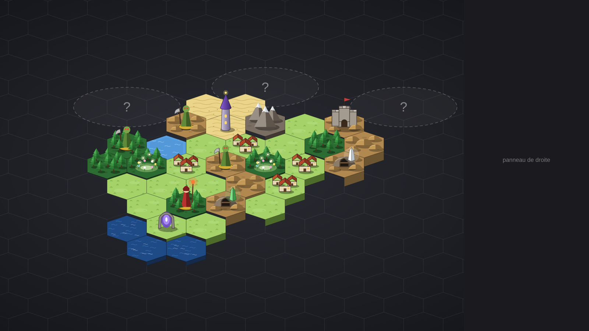
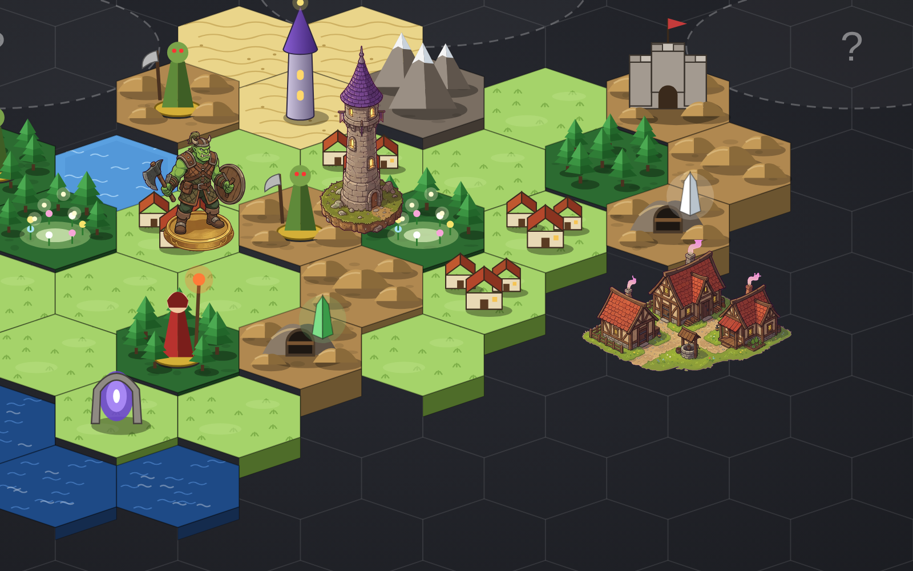

# Refonte de l'IHM : synthèse de la discussion

- Statut : **validée par Mathieu** (2026-11-05), fil « Discuter la refonte de l'IHM ». Base des specs 070 à 075 (`PLAN.md`,
  jalon IHM) : chacune reprend sa part de cette page, la précise et la fait valider.
- Images : [ADR 0009](../decisions/0009-illustrations-generees.md) (SVG ou images générées).
- Calendrier : après le jalon 4 (045, 049), avant le jalon 5.

## Remarques de Mathieu (2026-11-05)

### Divers

- Afficher les raccourcis clavier en infobulle, ou en face du libellé dans les menus.
- Jouer une carte de côté : un bouton-icône par effet possible (infobulle pour le texte) ; variante : un encart avec une icône
  de carte de côté et des boutons-icônes par type d'effet.

### Iconographie

Moins de texte, des icônes avec infobulle là où c'est pertinent (pas dans la description des cartes), inspirées des icônes du
jeu mais redessinées par nous :

- Mouvement : jambes qui courent. Influence : personnes qui se parlent. Armure : bouclier. Gloire : d'après l'icône du jeu.
- Attaque physique, de feu, de glace, de feu glacé : épée grise, rouge, bleue, dégradé rouge-bleu.
- Attaque à distance : arc, à la couleur de l'élément. Attaque de siège : catapulte, à la couleur de l'élément.
- Cristal et jeton de mana : cristal de la couleur.
- Une icône par héros, reprise dans les drapeaux des sites possédés.

### Disposition générale

- **Barre de menu en haut** : Menu (revenir en arrière, charger, sauvegarder, nouvelle partie, quitter, plein écran), nom du
  scénario, icône jour ou nuit, manche x/y (tour z), pioches de tuiles campagne et royaume avec leur nombre restant.
- **Panneau des ressources en bas**, sur toute la largeur, sur le plateau comme en combat : unités, main, compétences, en trois
  sections. Cartes et unités à l'horizontale, compétences à la verticale. S'il en manque la place, elles se chevauchent ; au
  survol, celle visée s'affiche en entier et pousse les autres, qui se tassent. Les actions proposées dépendent du contexte,
  comme aujourd'hui.
  - Carte action : illustration en haut à droite, effet de base et effet renforcé séparés, chacun avec ses boutons.
  - Compétence : icône seule, détail en infobulle.
  - Unité : illustration, description, puis les boutons permis par le contexte, comme pour les cartes.
- **Panneau de droite**, au-dessus du panneau du bas :
  - boutons « Fin du tour » (ou de manche) et « Offres » en bas, toujours visibles, grisés quand ils sont impossibles ;
  - joueur : icône, nom, niveau ; inventaire de cristaux ; Gloire courante / prochain niveau ; autres valeurs ; deck et défausse
    (consultable) ;
  - autres joueurs ou joueur fantôme : dépliable, informations publiques (à détailler avec leurs specs) ;
  - zone de jeu : jetons de mana gagnés et dépensés, cartes jouées (consultables), événements marquants du tour (ennemi vaincu,
    carte gagnée, unité recrutée…).

### Écran de combat

- Carte d'ennemi simplifiée ; ennemi coché d'office s'il est seul.
- Bouton « Parer » au lieu de « Parer <ennemi> ».
- Une parade insuffisante n'est pas proposée : le bouton de validation devient « Annuler » tant qu'elle ne suffit pas.

### Fenêtre des offres

- Police à la même taille qu'ailleurs ; ne plus afficher la taille de la pioche.

### Plateau

- Vue isométrique 2D (pas de 3D) ; zoom borné (le dézoom actuel va trop loin).
- Mer sur les zones infranchissables au-delà de la côte, comme les cases de littoral de la tuile de départ ; pas sur les
  emplacements à découvrir, qui restent sombres.
- Vraies illustrations debout au lieu d'icônes : héros et ennemis errants animés, villages, mines, forteresses, tours de mage…
- Effets de profondeur pour les forêts, collines et montagnes.

## Décisions prises pendant la discussion

- **Ordre des lots** : combat et offres, icônes, illustrations, panneaux, barre de menu, plateau (specs 070 à 075).
- **Isométrie** : 2D dans egui, pas de 3D (qui demanderait un autre moteur de rendu).
- **Maquette 1** (SVG dessinés par le code), retenue comme base avec trois retours : inclinaison trop forte (vue un peu plus de
  dessus), mer aussi au-delà de la côte, villages à reprendre à la réalisation.

  

- **Maquette 2** : des images générées (figurine d'orque, tour de mage, village) posées sur la maquette 1. Au vu de l'essai,
  SVG pour le plateau et les icônes simples, images générées pour les illustrations (ADR 0009) ; une figurine SVG du plateau
  montre son image générée en infobulle. Révisé le 2026-11-06 (spec 072) : images générées pour les cartes et les unités
  seulement ; héros et monstres restent en SVG, plus soignés. Point de départ pour les héros debout de la spec 075 :
  `assets/images/hero/<héros>-improved.svg`, tirés des portraits de référence de `scripts/illustrations/heroes/`, détourés
  avec rembg puis vectorisés par `scripts/vectoriser/vectoriser_svg.py` (Mathieu, issue privée 167). Pas encore affichés par le jeu.

  

- **Animations envisagées** (à préciser dans la spec 075) : respiration légère des figurines, drapeau qui flotte, vagues,
  scintillement des cristaux.

## Points ouverts

- **Audio d'ambiance** (Mathieu, 2026-11-05) : issue privée 187.
